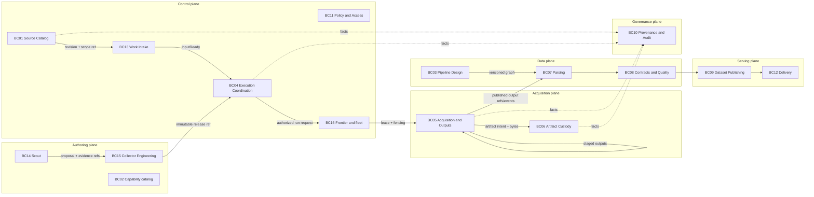

# Principal Engineering Architecture Rebaseline — 2026-11-24

## Executive assessment

The repository is a credible, contract-aware prototype of authoring and fixture-only collector engineering. Its implemented architectural center is BC14 Scout and BC15 Collector Engineering. `apps/execution-coordination` adds a fixture-only BC04 run coordinator and a protected Scrapy/Docker adapter; it is not yet durable coordination. PostgreSQL is used for Scout state and outbox. There is no MongoDB, MinIO, production artifact custody, acquisition-output persistence, live collector runtime, or pipeline/data-serving implementation in this checkout.

The current architectural investments are worth preserving: explicit owners, draft contracts, typed/deterministic build artifacts, fixture-only conformance, scoped HTTP exploration, Scout receipts/outbox/recovery, and a strict separation between compiler and worker. The key next move is a single vertical slice for output and custody semantics, not a broad service split or a database rollout detached from a consumer.

**Recommendation:** keep CaptureOutput and OutputSet in BC05 Acquisition as an internal module and published contract family. Keep physical artifact identity, custody, retention, and authorized byte access in BC06. Use PostgreSQL for control and governance state, MongoDB as the candidate canonical store for published acquisition output documents, and MinIO for large immutable byte objects. Start as modules in a small number of deployables. Introduce MongoDB and MinIO only through a reviewed vertical PR with idempotent staging/publication and reconciliation behavior. Do not claim distributed exactly-once semantics.

This report is an assessment and proposal. It does not accept an ADR, approve a live-source policy, authorize production deployment, or implement any feature.

## Evidence rules and scope

- **Observed fact** means present in tracked files or the inspected Git state.
- **Documented proposal** means architecture prose or an ADR marked Proposed/draft; it is not implementation evidence.
- **Assessment** is an interpretation of observed facts.
- **Proposal** is a recommended future design that needs owner review.
- **Open decision** requires human approval or operational evidence.
- No credentials, `.env` values, or other secret values were inspected. No external source was contacted.

Primary evidence read: `AGENTS.md`; architecture index, platform/domain/authoring/execution/contracts-security/monorepo/libraries/Scout documents; all ADR files 001–021 and the ADR index; roadmap and validation assessment; development standards and naming conventions; all package manifests, SQL migrations, Compose files, contract schemas, current application modules, current workers, tests and CI/Make targets. The current baseline document is historical and does not describe this checkout.

## A. Exact repository and Git state

Observed at assessment time:

| Item | Value |
|---|---|
| Root | `/Volumes/OWC Express 1M2/Develop/data-mozaic` |
| Branch | `main`, tracking `origin/main` |
| HEAD | `427a027b5b3894cc7ef926f155be671ca73a7d0a` — `feat(execution): add fixture-only run coordination (#15)` |
| Initial worktree status | Clean: `git status --short --branch --untracked-files=all` returned `## main...origin/main` |
| Remote | `origin` → `https://github.com/FabioCaffarello/data-mozaic.git` |
| Recent history | HEAD follows `a07e393` Scrapy multi-bot, `ca2a1a5` Scrapy fixture backend, `a11d514` Playbook v2/compiler, and `b483ad6` Scout authoring |

Open local work discovered using `git worktree list --porcelain`, branch listings, logs, and worktree statuses:

| Worktree/branch | Observed state |
|---|---|
| `feat/execution-coordination-fixture-v0` at `/private/tmp/data-mozaic-execution-coordination` | Clean; 14 commits ahead and 1 behind `origin/main`; includes BC04 fixture coordination and protected BC05 Scrapy adapter work. Keep separate pending review/integration. |
| `feat/collector-playbook-v2` at `.../data-mozaic-pr10` | Clean, tracking its remote branch. |
| `feat/collector-scrapy-fixture-backend` at `.../data-mozaic-scrapy` | Clean, tracking its remote branch. |
| `feat/scrapy-collector-multibot` at `.../data-mozaic-scrapy-multibot` | Clean, tracking its remote branch. |
| Detached `.../.data-mozaic-pr9-generalization-72058db` | Listed by Git worktree, but status inspection was unavailable because its Git metadata was no longer resolvable from that path. |
| Detached `/private/tmp/data-mozaic-pr8-review` | Git reports worktree prunable; its referenced gitdir path no longer exists. |

The root checkout remained unchanged through the assessment except for this new Markdown assessment file. No destructive Git commands, commits, pushes, merges, or PR operations were performed. Branch/worktree state is local evidence and may change after this report.

## B. As-is component and dependency inventory

| Component | Observed implementation and dependencies | Current limit |
|---|---|---|
| `apps/scout` | Python BC14 package: domain, application, ports, JSON edge, fixture/local adapters, PostgreSQL repository, MCP STDIO/HTTP host, HTTP policy/transport, outbox relay. Uses psycopg and JSON Schema; shared observability library consumed here. | Local source/policy and custody adapters remain reference/double integrations. No production BC01/BC06/BC11 services, agent process sandbox, or generic public browsing host. |
| `apps/collector-engineering` | Python BC15 package: draft v1/v2 validation, typed IR, deterministic Python Reference and Scrapy fixture backends, BotBuild verification, fixture replay/evidence, capability profiles and protected replay. | Both compiler runtimes are fixture-based. “Python HTTP Reference” is not a live HTTP acquisition runtime. No persistent Playbook/Build/Release registry or approval service is evidenced. |
| `apps/workers/scrapy-collector` | Python Scrapy project: verified multi-BotBuild catalog/assembly, isolated fresh child process per crawl, fixture-only handlers, bounded output and provenance validation. | No live networking or artifact/output-service client; current catalog is local immutable assembly, not a release/control plane. |
| `apps/execution-coordination` | Python BC04 domain/application/ports with in-memory repository and Scrapy container adapter. Draft ExecutionRequest/Report v0 contracts; protected Linux Docker path uses pinned image identity, network none, non-root UID, read-only rootfs/minimal mounts and bounded outputs. | State lost at process exit; no persistent retries/recovery, API, BC11 admission, BC06 custody, BC16 lease/frontier, live egress, or distributed worker coordination. Docker daemon remains privileged boundary. |
| `libs/python/observability` | Experimental stdlib structured-event/correlation helper, one consumer (Scout), independent tests. | Not a telemetry/exporter platform; free-form caller messages remain caller responsibility. |
| `libs/python/bot-build` | Internal stdlib-only BotBuild file/manifest identity and integrity verifier; consumed by BC15 and Scrapy Collector; independent tests. | Not Playbook validation, authorization, release approval, signature verification, or runtime selection policy. |
| `contracts/` | Draft versioned Scout, transcript, CapturePlaybook, BotBuild and ExecutionRequest/Report JSON Schemas; fixture examples. | Not approved public wire contracts; no AcquisitionOutput, artifact custody service, source catalog, pipeline, dataset, or MongoDB contracts. |
| `migrations/scout` | Six monotonic PostgreSQL migrations for Scout document state, command receipts, custody intents, outbox/recovery, reconciliation and navigation budgets. | No control-plane schema or shared platform migration mechanism. Scout migrations are owner-specific; do not generalize them into a universal repository. |
| `deployments/compose` | PostgreSQL local profile plus separate Scout HTTP egress and tool sandbox profiles. | No MongoDB, MinIO, output service, custody service, execution coordination or complete local platform profile. |
| Root tooling/CI | uv workspace, Makefile, architecture/naming/docs/migration checkers, CI security E2E. | Runtime topology and local command surface only cover current increments. |

Actual workspace members in root `pyproject.toml`: Scout, Collector Engineering, Scrapy Collector, Execution Coordination, BotBuild, and observability. There are no Go, Rust, or TypeScript modules. The repository has apps, workers, libs, contracts, examples, deployments, tooling, tests, and docs; it does not currently use `services/` or `examples/use-cases/`.

## C. Updated bounded-context map and ownership assessment

The table preserves the documented BC01–BC16 vocabulary while distinguishing actual code from proposals. “Public contract” below means an actual schema only where indicated; names elsewhere remain proposed. The domain catalog in `docs/architecture/domain.md` is a context proposal, not proof of implementation.

| BC | Responsibility / root and invariant | Commands, queries, events and contract state | Current code, persistence, consumers/tests, readiness and gap |
|---|---|---|---|
| BC01 Source Catalog | Own `Source` and immutable `SourceRevision`; revision and access scope cannot widen implicitly. | Proposed `RegisterSource`, `ReviseSource`; `SourceRegistered`, `SourceRevised`; `SourceRef` is proposed. | No context/package or durable state. Scout currently uses local source lookup. No source revision lifecycle, credential reference registry, API, or tests as a context. |
| BC02 Extension Catalog | Own extension/capability descriptors and compatibility; does not approve a BotRelease. | Proposed registration/compatibility queries and capability descriptor. | No BC02 code. BC15 profiles and worker catalog are local BC15 mechanics, not a BC02 catalog. |
| BC03 Pipeline Design | Own versioned pipeline definition/DAG; no crawl-task scheduling. | Proposed pipeline create/validate/version/publish contracts. | No pipeline definition, graph validation, state, adapter, or consumers. |
| BC04 Execution Coordination | Own `CaptureRun`; fixes input, source/revision, release, policy snapshot, deadline and status. Invariant: only the current attempt/revision may complete; cancellation/deadline prevent late success. | Present local submit/get/wait/cancel operations and draft `execution-request/v0`, `execution-report/v0`; durable events/API are absent. | Domain/application/ports and in-memory repository implemented; Scrapy container adapter is composed here. Unit tests cover state/races, but no persistence/recovery. Main readiness is fixture-only and one process. |
| BC05 Acquisition | Own capture semantics and output lifecycle, independent of engine; distinguish observation from artifact identity and business records. | `CaptureReceipt`, `CaptureOutcome`, `CaptureOutput`, `OutputSet` not implemented as public contracts. Compiler request/report is not their substitute. | Scrapy execution adapter and local JSONL/raw references exist, but no BC05 domain/persistence/output publication module. No live acquisition. Domain ownership of output should be made explicit here. |
| BC06 Artifact Custody | Own `RawArtifact`, `ArtifactLocation`, digest, classification, retention and access; bytes shared by hash do not share authorization or retention. | Proposed artifact reference/custody receipts and durable events only. | Scout has local/reference custody adapter, custody-intent rows for Scout recovery, and local file handling. No production MinIO/S3 adapter, streaming custody API, inventory lifecycle, reconciliation worker or independent custody service. |
| BC07 Parsing & Normalization | Own derived representations and transformation identity; never mutate raw evidence. | Future parser/normalizer commands and derived-record contracts. | No implementation, state, tests or runtime. |
| BC08 Contract & Quality | Own payload/dataset contract policy and quality outcomes; distinguish structural validation from source evidence/authentication. | JSON Schemas currently validate selected draft contracts, not a BC08 service. | No central contract registry or quality engine. Payload validation ownership and compatibility lifecycle remain open. |
| BC09 Dataset Publishing | Own dataset version/manifest and publication state. | No dataset publication contracts/events implemented. | No implementation or persistence. Acquisition Output publication should not be conflated with dataset publication. |
| BC10 Provenance & Audit | Cross-context evidence projection/lineage; does not own other contexts’ transactions. | Scout receipts/outbox/reconciliation are local BC14 facts; broad lineage event schema is only proposed. | No platform-wide provenance/audit context or query API. |
| BC11 Policy & Access | Own authorization decisions, grants, budgets and revocation; enforcement also occurs at network/runtime boundaries. | No stable public policy decision contract. | Scout has local policy/source config and proxy enforcement for its experimental workflow; no shared policy service or BC11 production adapter. |
| BC12 Delivery | Own consumer delivery and acknowledgments, distinct from dataset publication. | No delivery contract, command, event or adapter. | No implementation. |
| BC13 Work Intake | Own logical `Input`, lifecycle and explicit reprocess intent; does not own crawl requests/leases. | Proposed `CreateInput`, `ReprocessInput`, `InputReady`, `InputCompleted`; no approved contract. | No implementation or durable state. BC04’s current execution binding carries source/build but is not Input Manager. |
| BC14 Source Intelligence | Own `ScoutSession`, findings, evidence references and proposal; evidence-backed conclusions never imply authorization/release. | Implemented Scout request/finding/proposal schemas are draft; transcript draft v1/v2; incremental MCP commands, receipts and proposal outbox. | Substantial Python application/domain and PostgreSQL adapter, six migrations, local/fake integrations, HTTP tools and tests. Most operationally mature context, but source/policy/custody production integration and agent sandbox gates remain. |
| BC15 Collector Engineering | Own playbook revisions, typed IR, deterministic BotBuild and eventual approval/release; worker does not compile or invent persistence. | CapturePlaybook draft/v1-v2 and BotBuild draft/v2. Actual execution artifacts are manifests/builds; no approved `BotRelease` lifecycle contract. | Compiler, Python/Scrapy backends, BotBuild verifier, multi-bot catalog assembly and fixture tests are implemented. Persistent registry, human approval/signing, production release distribution and output port remain absent. |
| BC16 Crawl Frontier & Bot Fleet | Proposed task/frontier partition, leases, fencing token, rate/capacity budgets; not Input or CaptureRun. | Proposed task enqueue/lease/complete and frontier events; no worker lease contract in code. | No durable frontier/fleet implementation. BC04’s in-memory ThreadPoolExecutor is local concurrency, not BC16. |

**Context distinctions:** bounded context is a language/state ownership boundary; module is a code boundary; deployable is a release/operation unit; worker is a workload role; library is independently reusable code; adapter connects a consumer-owned port; SDK is a supported consumer API. No BC is required to become a microservice. BC05 and BC16 remain distinct only if their capture semantics versus scheduling ownership prove stable; initial co-location is appropriate.

### Proposed context and plane organization



This is a proposed context map, not a deployment diagram. Begin with modular deployables: authoring, a control process hosting BC01/04/11/13 (and BC16 only when needed), an isolated worker runtime, BC06 custody API, and BC05 output persistence as owner interfaces justify. Keep data/serving contexts future until real consumer workloads establish their contracts.

## D. Violations, inconsistencies and technical debt

There is no evidence of a broad direct-import cycle in the registered Python modules; `tooling/check_architecture.py` passes. The more important risks are capability/contract gaps and several boundaries that are currently proposals:

1. **No durable BC04 state.** `apps/execution-coordination/src/execution_coordination/repository.py` is explicitly in-memory; restart loses Runs and idempotency history. No lease, event or recovery record exists. This is a known v0 limit, not a bug hidden by docs.
2. **Output is local files.** BC04 report and Scrapy worker accept `records.jsonl`, reports, and fixture raw references in temporary/staging paths. The outputs do not constitute published `CaptureOutput`, durable `OutputSet`, or custody receipts.
3. **BC05 has no owned persistence/API.** Capture semantics are split across compiler/runtime/worker and BC04 adapter concerns; no stable BC05 envelope allows engine-independent consumers.
4. **BC06 names overstate production readiness if read without the qualifiers.** Scout migration table names `scout_custody_intents`, and Scout has custody ports/adapters, but these support Scout evidence replay/recovery, not general RawArtifact custody. There is no MinIO/object-store integration.
5. **BC15 release lifecycle is incomplete.** Deterministic BotBuild and immutable local manifests are real; persistent approval, signed release, source-policy authorization and production distribution are not. A digest is integrity identity, not publisher approval/authentication.
6. **BC04 request identity is fixture-specific.** `ExecutionBinding` requires fixture bundle and fixture-only mode. The protected network-none adapter is a good hermetic conformance boundary but cannot be generalized to live mode by removing network isolation.
7. **MongoDB/MinIO choices are not validated by workloads.** They are absent from package manifests, migrations, deployment profiles and tests. The intended Mongo direction is a design proposal, not a demonstrated JSONB limitation.
8. **Historical documentation drift.** `docs/architecture/assessments/repository-baseline.md`, `architecture-validation.md`, and portions of the roadmap/libraries audit describe earlier snapshots. Their own text marks snapshots historical, but readers must be pointed to the present inventory. This report and a later baseline refresh should become the current evidence pointer.
9. **ADR 021 and execution worktree state.** ADR 021 is Proposed and the current main merge does not make it Accepted. The separate ahead/behind worktree is evidence of open coordination code, not automatically part of main.
10. **Test readiness is concentrated in fixtures.** Strong fixture/conformance tests do not establish live authorization, source policy, custody recovery, throughput, tenant isolation or production availability.

No observed code path lets generated bots connect directly to a database. Preserve that invariant. The next output port must be controlled by platform runtime and release identity, not playbook-authored schema/connection fields.

## E. Persistence ownership matrix

This matrix is proposed. Existing implementation is marked explicitly.

| Data category | Authoritative owner | Proposed persistence | Writes / reads and consistency | Retention, recovery and scale |
|---|---|---|---|---|
| Source and SourceRevision | BC01 | PostgreSQL | Versioned transactional updates; immutable revisions, current pointer/revocation query. Strong consistency at authorization boundary. | Retain revisions/audit per policy; PITR + tested restore; index by tenant/source/revision; cache only with revocation/version checks. Not implemented. |
| Input identities/lifecycle | BC13 | PostgreSQL | Idempotent create/reprocess; status query, unique scoped intent. Strong transactional transitions and outbox. | Business retention; backup/PITR; partition only on measured lifecycle volume. Not implemented. |
| Scout sessions/receipts/outbox | BC14 | PostgreSQL | Current implementation uses JSONB session documents, command receipts, custody intents, outbox and recovery data. Transaction + CAS; relay at least once with dedupe/ack. | Current migration-backed state; backup/PITR and migration replay. Review retention/PII policy. |
| Runs, attempts, leases, deadlines | BC04 / BC16 | PostgreSQL initially | Conditional state transitions, unique idempotency, lease claim/fence and transactional outbox. Strong per-run/attempt consistency. | Retain operational history according to audit policy; PITR; indexes by state/deadline/source. Hot scheduling may later require partitioning/queueing after benchmark. Current BC04 is process memory only. |
| BotBuild and BotRelease metadata | BC15 | PostgreSQL metadata; immutable build bytes in object storage or artifact registry | Build digest and immutable refs; release approval separate transaction/audit. Reads by exact release ID/digest. | Retain supported releases and provenance; replicated immutable objects plus DB backup. Current build local file artifacts only; no release registry. |
| CaptureOutput records and observation metadata | BC05 | MongoDB candidate canonical store | Append observations; idempotent bulk upserts/insert with stable identity, payload-contract ID/version, references. Mongo transactions only for bounded publication/outbox group; no cross-store transaction. | Retention by classification/tenant/source contract; backup/PITR or managed snapshot with restore validation. Scale by document size/access patterns, indexes, later sharding only after measured need. Not implemented. |
| OutputSet manifest and publication | BC05 | Same MongoDB deployment as outputs | Chunked stage; validate count/digests/contracts; atomically transition one manifest to published with outbox event. Consumers filter via published manifest. | Keep manifests at least as long as member outputs/consumer audit requires. Replica set locally for transaction/Change Stream tests, not HA. |
| Raw bytes / original response evidence / large downloads | BC06 | MinIO/S3-compatible object storage; PostgreSQL inventory authoritative | Authorized streaming put/get, checksum verification, immutable/versioned location. DB records intent then confirmed custody; object write is external and reconciled. | Explicit class/tenant retention, legal hold/delete rules, versioning and lifecycle. Object replication/backup separate from DB; integrity scrub and restore drills. Not implemented. |
| Custody inventory, retention, access receipt, outbox | BC06 | PostgreSQL | Identity/metadata/retention state and BC06 outbox in same transaction; never persist presigned URL as identity. | PITR plus object replication; orphan scan and inventory/object reconciliation. |
| Pipelines, dependencies, task/run state | BC03 / execution owner | PostgreSQL for definitions and orchestration state initially | Versioned immutable definitions; task state and dependency transitions; outbox. | Retain run history; indexes on status/ready time; bounded dispatch and measured partitioning. No implementation. |
| Parsing/quality/derived data | BC07/08 | Target-specific analytical stores; do not prescribe MongoDB | Read published output refs/artifacts, write versioned derivations and quality outcomes. Idempotent by input artifact/output digest + transform version. | Raw remains immutable; derived retention/rebuild from source outputs; object storage for bulk datasets; future lakehouse needs evidence. |
| Dataset manifests/consumer delivery | BC09/12 | PostgreSQL control metadata plus object/warehouse destination | Immutable dataset version and independent delivery receipts; consumer-specific consistency. | Consumer contract-specific retention and backup. No implementation. |
| Provenance/audit projections | BC10 | Append-oriented store selected by query/retention needs; source facts remain authoritative in owners | Consume durable domain events, dedupe event identity, preserve source aggregate/version. | Rebuild projections from retained event/outbox/archive; access is governed. Avoid duplicate command authority. |

**PostgreSQL vs MongoDB vs JSONB:** PostgreSQL is the right default for relational control invariants, multi-row transitions, idempotency constraints, leases and outboxes. PostgreSQL JSONB is already a reasonable fit for Scout’s aggregate document plus relational receipt indexes; do not move Scout merely for consistency. MongoDB is justified only if output workloads need independently evolving nested payloads, observation append histories, document-level reads/writes, bulk ingestion, and output publication by set. JSONB can do all of these with relational transactions and GIN/path indexes for moderate scale; its trade-offs are relational schema coupling, row/TOAST behavior, indexing and write amplification as heterogeneous documents and output volume grow. Mongo adds a second database’s backups, security, pools, schema provisioning, transaction/version expertise, monitoring and recovery. The correct choice remains conditional on expected document sizes, queries, event rates, retention, consistency, team operations and benchmark results. Pilot Mongo as BC05-owned storage; keep output contract independent of BSON.

## F. PostgreSQL/MongoDB decision and trade-offs

**Recommendation (proposed):** PostgreSQL for transactional control/governance; MongoDB for BC05 acquisition output documents once a real output consumer and retention/access pattern are defined; MinIO for large immutable bytes. MongoDB must not become a generic replacement for all JSON state, nor must documents be partitioned by bot. Keep source and release metadata in PostgreSQL, with Mongo storing references and the exact immutable revisions/releases needed to interpret outputs.

| Option | Strengths for outputs | Costs / risks | Suitable when |
|---|---|---|---|
| PostgreSQL normalized tables + JSONB | One operational database; transactional state/outbox; constraints and joins; good for bounded volume and relational access. | Heterogeneous payload indexing/query evolution can create schema/index complexity; hot append paths and large JSONB can compete with control workload. | Workload moderate, queries mostly by tenant/source/run and contract; team values one DB; benchmark is acceptable. |
| MongoDB | Natural document envelope + variable payload; collection validation; bulk write and document-level query; replica-set transactions/Change Streams. | Second operational stack; multi-document transaction constraints/cost; schema and index drift; tenant authorization must be application-enforced; shard/restore skills needed. | Output document lifecycle/access differs materially from control state and measured output workload benefits from document storage. |
| MongoDB for control + output | One document technology. | Weakens established relational transaction model and promotes gratuitous migration of PostgreSQL-owned state; more risk without value. | Rejected absent new evidence. |

No throughput estimate is asserted. Benchmark candidate dataset sizes, payload distributions, observation frequency, concurrent writers, index count, tenant mix, retention/delete load, read pagination, restore time and write concern. Compare PG JSONB and Mongo using identical fixture records and acceptance queries. Measure p50/p95/p99 latency, ingest throughput, CPU, disk, index growth, replication lag, pool wait, compaction/vacuum, backup size and restore correctness.

## G. CaptureOutput and OutputSet domain model

### Ownership decision

Keep the first-class output model as a BC05 module and BC05-owned contract family. It describes the durable result of an acquisition independently of Scrapy/Playwright/HTTP implementation and is consumed by parsing, quality, pipeline and publication contexts. This is a stable domain boundary, but currently not enough evidence for a separate BC17 or independent service. BC06 owns artifact bytes and custody identity; BC04 owns run/attempt terminal decisions; BC05 owns output staging and publication semantics. Revisit extraction only if output lifecycle, scaling, team ownership, or independent consumers prove a separate language and model.

### Proposed concepts

- **AcquisitionRecord:** one source-defined structured observation. Contract-specific key and payload; platform does not impose universal business fields.
- **CaptureReceipt:** evidence of one acquisition action/resource observation (sanitized request identity, response status/headers subset, timestamps, source/release/run/attempt, byte digest/ref if policy permits). Not a successful run by itself.
- **CaptureOutcome:** BC04-facing terminal or partial result summary, with reason/retry classification and output-set references. It is not the record payload.
- **CaptureOutput:** stable envelope for one emitted output observation. Variants: `RecordOutput` (bounded structured payload), `ArtifactOutput` (one or more artifact refs and descriptive metadata), `CompositeOutput` (records and artifact refs under one observation identity). Composite is one logical output with independently addressable parts.
- **RawArtifact:** BC06-owned byte object identity and metadata. Hash identifies bytes, not source observation.
- **CustodyReceipt:** BC06’s durable confirmation of verified bytes, object location/version, digest, size, classification and policy; opaque reference exposed to BC05.
- **ArtifactRef:** logical `artifactId`, digest and optional media type/size; physical URI is private or a non-authoritative hint. Never place an expiring presigned URL into a permanent output.
- **OutputReceipt:** BC05’s response to idempotent output-write/stage request, with operation/output IDs, status and set identity.
- **OutputSet:** bounded publication group for one attempt or subtask. Manifest contains expected/observed count, digest/count summaries, contract refs, status and failure information; it does not embed unbounded records.
- **PublicationReceipt:** durable BC05 fact that an OutputSet is published (or rejected/aborted), with publication generation/time/event identity.

### Proposed stable envelope (illustrative, draft until approved)

```json
{
  "envelopeVersion": "capture-output/v1",
  "outputId": "opaque-stable-id",
  "outputType": "record | artifact | composite",
  "tenantId": "opaque-tenant-id",
  "source": {"sourceId": "opaque-source-id", "revision": "immutable-revision"},
  "producer": {"component": "scrapy-collector", "producerVersion": "...", "outputKey": "..."},
  "bot": {"botId": "...", "releaseId": "...", "releaseDigest": "sha256:..."},
  "run": {"runId": "...", "attemptId": "...", "fencingToken": 12},
  "outputSetId": "...",
  "observation": {"observedAt": "RFC3339 UTC", "observationId": "..."},
  "payloadContract": {"id": "...", "version": "...", "digest": "sha256:..."},
  "naturalKey": {"contractDefined": true, "value": "..."},
  "payloadDigest": "sha256:...",
  "record": {"source-defined": "variable payload"},
  "artifactRefs": [{"artifactId": "...", "digest": "sha256:...", "mediaType": "...", "sizeBytes": 123}],
  "createdAt": "RFC3339 UTC"
}
```

Exactly one of `record`, `artifactRefs`, or both is allowed according to `outputType`; payload fields are validated against the referenced payload contract, not a bot-authored storage schema. `source.revision`, `releaseDigest`, run/attempt and operation identities are immutable. Add tenant authorization to every command/query. The stable idempotency identity should include namespace/tenant + run + attempt + producer + declared output key + observation identity. `outputId` identifies this observation; `naturalKey` is contract-specific entity identity and repeated observations with the same natural key remain separate history records. A payload digest is canonicalized only under a defined contract/version; hashing arbitrary JSON serialization is not stable enough.

**Avoid untrusted generated storage logic:** a reviewed, versioned payload contract is supplied at release approval and checked by the platform output adapter. A collector emits bounded JSON/ArtifactRef records through a constrained sink API. It cannot create collections, indexes, connection strings, database commands, or credentials.

## H. Concrete initial MongoDB model and publication semantics

Proposed initial logical collections (all BC05-owned, same replica set/database to permit bounded local transactions):

1. `capture_outputs`: one document per output observation; fixed envelope fields and bounded variable `payload`. Artifact refs contain logical IDs/digests; large/raw bytes stay out of BSON. Do not create a collection per bot or source. Reject documents above a conservative configured budget well below BSON’s hard maximum; spill large values to BC06.
2. `output_sets`: one manifest per bounded attempt/subtask set. Fields include tenant, source/revision, release digest, run/attempt/fence, payload contract refs, expected/accepted counts, rolling/partition digests, status (`staging`, `validating`, `published`, `failed`, `aborted`), timestamps and publication event ID. Manifest size stays bounded.
3. `output_operations`: optional durable idempotency ledger for operation IDs where retries can cross process lifetime. Store intent digest, result IDs, status and expiry governed by audit policy; unique key prevents same operation ID with different intent.
4. `output_outbox`: BC05-owned domain-event envelopes written in the same MongoDB transaction as state change (at minimum `OutputSetPublished`; staged chunk events are optional operational signals, not consumer publication facts).

Indexes to start with (validate against actual read shapes):

- `capture_outputs`: unique `{tenantId: 1, outputId: 1}`; unique scoped operation/observation key such as `{tenantId: 1, runId: 1, attemptId: 1, producer.component: 1, producer.outputKey: 1, observationId: 1}`; `{tenantId: 1, outputSetId: 1, observedAt: 1, _id: 1}` for stable set pagination; `{tenantId: 1, source.sourceId: 1, payloadContract.id: 1, payloadContract.version: 1, observedAt: -1, _id: -1}` for source history. Add contract-specific natural-key indexes only for demonstrated consumer queries.
- `output_sets`: unique `{tenantId: 1, outputSetId: 1}`; `{tenantId: 1, runId: 1, attemptId: 1, status: 1}`; `{status: 1, updatedAt: 1}` for recovery/reconciliation.
- `output_operations`: unique `{tenantId: 1, operationId: 1}` and bounded cleanup index if expiry is approved.
- `output_outbox`: unique `{eventSource: 1, eventId: 1}`; `{publicationState: 1, nextAttemptAt: 1, createdAt: 1}`; lease owner/deadline/fence as needed.

Provision strict Mongo JSON Schema/BSON validation for the fixed envelope, enum, BSON types, required fields, size and version fields. This does not validate source-specific payload semantics; the BC08/BC05 contract validator must validate payloads by immutable contract ID/version/digest before publication. Unknown envelope fields should fail closed for a versioned contract; payload compatibility rules are declared by the payload contract. Provision indexes/validators through versioned deployment migrations; drift is observable and startup fails on critical mismatch.

Bulk writer uses bounded chunks by both record count and encoded bytes, finite concurrency, explicit write concern, and per-record error mapping. Each item has deterministic operation/output identity. Retry only failed/transient items; duplicate key with matching intent is idempotent, mismatching digest/intent is a conflict. Stable pagination uses keyset `(observedAt, _id)` with tenant/set filters, not skip/offset; cursor tokens are versioned, opaque, authenticated, and bound to tenant/query/sort.

Publication protocol: (1) create `staging` manifest idempotently; (2) stream each chunk through BC05 after artifact dependencies have custody receipts; (3) validate contract, count, digest and fencing token; (4) mark manifest `published` and insert one durable `OutputSetPublished` outbox event in one Mongo transaction. The manifest is the visibility gate. Consumers query only outputs whose `outputSetId` resolves to a published manifest, or use a BC05 query API that enforces that predicate. A manifest read can be cached only with invalidation/version semantics. Never expose a growing staged set as a completed set. Atomicity of a multi-document transaction is bounded to MongoDB; it does not cover PostgreSQL or MinIO.

Do not use TTL as an implicit business retention policy. Retention requires output class, legal hold, downstream references and delete semantics. Enforce tenant filters in the BC05 API and credentials; MongoDB does not provide the platform’s tenant authorization policy. Namespace/database-per-tenant is a later isolation choice. A local single-node replica set is suitable for transaction/Change Stream tests only, not production HA. Future shard key selection depends on tenant sizes, run write distribution and read routing; benchmark candidates such as tenant+output/set key and hashed distribution, measure jumbo/hot partitions, and do not shard at initial launch.

Change Streams can wake a relay or projection consumer, but they are not the domain-event source of truth: persist explicit versioned event envelopes and a durable outbox with output state; resume tokens can expire and must be recoverable by scanning pending outbox rows/documents. At-least-once dispatch and consumer dedupe remain required.

## I. BC06 Artifact Custody proposal

### Minimum useful boundary

BC06 should expose consumer-owned ports for streaming `put`, authorized `open/read`, metadata lookup, retention decision and reconciliation. A BC06-owned `RawArtifact` has an opaque `artifactId`, digest algorithm/value, byte size, media type as observed/declared, classification, tenant/security scope, retention policy ID, creation time and immutable location/version references. `ArtifactLocation` includes provider/bucket/key/version and storage state, but remains adapter metadata. `ArtifactRef` carries logical artifact ID and integrity metadata; physical URIs are not authorization. `CustodyReceipt` is returned only after the object is stored and read/checksum guarantees required by policy are met.

Use an intent-first write: reserve stable artifact/operation identity and expected limits in PostgreSQL; stream bytes to a unique immutable object key using bounded multipart/chunked upload; enforce max bytes/time/concurrency while hashing; verify object metadata/checksum by provider semantics or read-back policy; commit inventory/location/receipt and BC06 outbox atomically. A retry with same id and digest returns existing custody; same id and different digest conflicts. If process dies, reconciler resumes/verifies incomplete intent. If object exists without committed inventory, quarantine as orphan until retention window and audit review; if inventory points to missing/corrupt object, mark unavailable, alert and prevent dependent publication.

Download goes through authorization and a streaming proxy/SDK that checks status, tenant and policy. Presigned URLs may be generated short-lived for an authorized request, never persisted in output/event/reference documents. Quota per tenant and operation; enforce byte, duration, concurrent streams, multipart count, memory buffer, temp disk and downstream backpressure. Never load a full artifact into RAM. Never silently content-sniff into a trust decision; classify declared media, detected format and policy separately.

Persist the exact representation promised by policy: for ordinary HTTP evidence, preserve original response entity bytes after transport decoding only if policy defines that representation, with request URL/method, status, selected sanitized headers, content-encoding/length, fetch time and digest; if wire-level bytes are required, capture at a transport layer that actually has them and state the distinction. Do not call a parsed body “wire bytes.” Preserve HTML source bytes as an artifact; browser DOM is a separate derived/rendered artifact with browser/version/URL/time metadata; extracted records are structured output, not the original response. Avoid storing credentials, cookies, authorization headers or unbounded headers.

### Language choice

**Start BC06 in Python for the first integrated vertical** if it is initially co-deployed with the current Python platform: it reuses current workspace, domain/test patterns and eases end-to-end integration. Define streaming interfaces and strict budgets so implementation is not byte-buffer-centric. Evaluate Go before an independent high-throughput custody service if measurements show streaming/concurrency/operational API benefits or the team wants a Go infrastructure service. Go offers a straightforward compiled service and bounded streaming, but introduces a second build/deploy/test chain before consumers exist. Rust is not indicated absent measured CPU or memory bottleneck. This is a proposed sequence, not a commitment to Python long term.

Use object-store SDK directly in the BC06 adapter; do not create a generic S3 wrapper library without a second consumer and compatibility tests. PostgreSQL is inventory and transactional event owner; MinIO is byte store, not the artifact identity owner. Validate bucket versioning/retention/encryption policies, lifecycle, multipart abort and backup/replication against the chosen operational requirements.

## J. Distributed consistency and failure-window analysis

### End-to-end state progression

`CaptureRun accepted → attempt leased/fenced → acquisition executes → required artifact custody confirmed → CaptureOutput chunks staged → OutputSet validated/published in Mongo → CaptureOutcome accepted by BC04 → run completed in PostgreSQL`.

Every command has a stable scoped operation ID, canonical intent digest, deadline and cancellation token. A different body under a reused key is a conflict. Outbox publishers retry at least once; receivers persist event identity/inbox with local state before acknowledgment. Fencing tokens prevent stale internal state changes, but cannot undo an external HTTP request. A new attempt receives a higher fence. Dependent outputs cannot publish until all required artifact refs have durable BC06 receipts. Partial capture is represented as an explicit partial outcome/set policy, not a false completed set.

| Failure window | Durable state at failure | Recovery behavior |
|---|---|---|
| BC04 commits run + outbox, relay not sent | Run and pending event in PostgreSQL | Relay retries; BC16/worker command dedupes by event/operation identity. |
| Worker receives request, crashes before fetching | Lease expires; no receipt | Reassign with higher fence if deadline/budget permits. |
| Remote request completed, worker dies before storing evidence | External side effect occurred, no local evidence | Retry only under method/source policy and idempotency budget; acknowledge possible repeated request. Cannot promise exactly once. |
| Object upload completes, BC06 DB commit absent | Orphan object plus intent/unknown state | Reconciler verifies key/digest/size and commits or quarantines/deletes per retention policy; no output publication meanwhile. |
| BC06 inventory committed, response lost | Durable receipt/outbox, caller uncertain | Same artifact operation ID returns receipt; caller dedupes. |
| Some output chunks inserted, process dies | OutputSet staging manifest and idempotent chunks | Resume missing chunks by operation IDs or abort after deadline; staged records invisible. |
| Mongo commit publishes manifest + outbox, relay not sent | Visible OutputSet and durable event | Mongo-owned relay scans/publishes pending event; consumer dedupe by event source+ID. |
| Event delivered twice / consumer crashes before ack | Duplicate delivery | Consumer transactionally dedupes and commits local state before ack; at-least-once. |
| PostgreSQL Run completion commit fails after Mongo publication | Published set with run unresolved | Reconciler queries published set, validates matching run/attempt/fence and retries BC04 completion. The set remains published as a BC05 fact; run API may report reconciliation pending. |
| Attempt expires while output/artifact upload is in progress | External writes may finish under stale fence | Reject publication/terminal acceptance; quarantine or reconcile objects and staged set; only current attempt may publish. |
| Cancel arrives during acquisition | New tasks stop; in-flight external operation may finish | Mark cancellation requested; stop streams where possible; do not publish as success; keep receipts/artifacts according to policy and emit cancelled/partial outcome. |
| Deadline passes during reconciliation | State may be incomplete but evidence durable | Stop scheduling, preserve receipts, classify timed out/partial, continue bounded background reconciliation; do not extend source access implicitly. |
| Mongo unavailable after artifact custody | Custody is durable; output staging fails | Retry output stage under same operation identity; apply bounded queue/backpressure; do not acknowledge output success. |
| MinIO unavailable before custody guarantee | Artifact pending/unavailable | Do not publish dependent output; retry until deadline/policy limit, then fail/partial with stable retry classification. |
| Store restored from different backup points | PG/Mongo/object inventory may disagree | Reconciliation by output/artifact/event IDs and digests; restore runbook must define coordinated recovery point and acceptable loss window. |

No cross-database ACID. Mongo multi-document transaction protects manifest+outbox only inside Mongo; PostgreSQL transaction protects run+its outbox only inside PostgreSQL; MinIO/object writes are reconciled. Do not claim exactly-once distributed delivery. Use backpressure on stage queues, bounded worker concurrency, per-source rates, deadlines, retry ceilings, exponential backoff/jitter and a DLQ/quarantine process with operator-owned resolution.

## K. Collector Engineering, Scrapy and live readiness

**Observed readiness:** deterministic compilation to typed IR; schema/semantic/capability checks; generated backend outputs; build manifest identity and integrity verification; fixture replay for HTML, JSON, finite link/pagination examples; cross-engine conformance; assembled immutable multi-bot catalog; fresh process per crawl; report/provenance checks; output budgets; Linux protected E2E targets in CI. Fixture HTTP handlers resolve only known fixture entries, and BC04’s protected container uses `--network none`.

| Capability | Current evidence | Readiness |
|---|---|---|
| JSON APIs / HTML extraction | Playbook v2 and fixtures, typed extraction | Fixture-ready only; no live collector runtime. |
| Bounded pagination/link discovery | finite IR operations and fixture oracle | Fixture-ready; live crawl policy/frontier/rate budgets absent. |
| Direct HTTP acquisition | Scout authorized HTTP exploration exists separately; collector backend named HTTP Reference remains fixture-only | Not live worker capability; do not conflate authoring transport with capture runtime. |
| Raw-only output | fixture raw references/evidence exist | No durable raw response upload/custody pipeline. |
| CSV/XML/PDF/ZIP/binary | No implemented live download/decoder/output contract identified | Not supported as platform capability. Needs byte streaming, bounds, decompression bomb controls and artifact receipts. |
| Record/Artifact/Composite outputs | Local JSONL and fixture raw references only | Not implemented as versioned output domain. |
| Playwright/rendered DOM | Contract/example identifies unsupported browser capability | Explicitly fails capability check; no browser worker or sandbox. |
| Live profile | No approved live execution profile or release/authorization combination | Not ready. |

Keep authoring-time Scout/BC15 separate from runtime. A `BotRelease` must be approved, immutable and bind source policy snapshot, playbook/IR/compiler/runtime/backend/profile/dependencies/image and signatures/attestations before worker admission. Worker receives only that reference, scoped input, identity, deadline/budgets and output sink credentials via short-lived workload identity. It has no arbitrary DB access, source-authored schema installation, or reusable cloud secret.

Add a distinct `live-authorized` execution profile, contract and deployment policy only after source-owner authorization, egress enforcement at connection time/proxy, DNS/IP/redirect controls, per-source limits, tenant identity, credential mediation, cancellation/deadline, response/artifact size limits, browser subresource policy, sandbox hardening and audit are independently reviewed. Do not make fixture tests pass by disabling network-deny checks. Preserve fixture-only default and conformance suite.

Collector output ports should stream `CaptureReceipt` and bounded output envelopes to BC05; for artifact bytes, stream to BC06 and attach the returned `ArtifactRef`/`CustodyReceipt`; then stage and publish OutputSet. Worker cannot publish output set directly or declare BC04 run complete. BC04 accepts a matching, current-fence `CaptureOutcome` after BC05 publication and validates attempt/release identity.

## L. Monorepo and multilingual migration

The existing layout is coherent for current consumers; no directory reorganization is justified now. Existing `apps/`, `apps/workers/`, `libs/python/`, `contracts/`, `examples/playbooks/`, `deployments/compose/`, `tooling/`, `tests/`, and `docs/` already contain working packages and checks. Do not create empty `services/`, `libs/go/`, or `examples/use-cases/` scaffolding.

Incremental migration when a consumer arrives:

1. Add one BC05 output module or BC06 custody package under current app/package layout with owner, port, contract, consumer and tests; retain current imports and workspace.
2. Add deployment/service directories only with first independently operated process; keep context modules co-located until scale/team/isolation evidence calls for separation.
3. Add `examples/use-cases/<vertical>/` only when real reference-case source policies, contracts and fixtures are approved. Current `examples/playbooks/` stays compiler fixtures.
4. Add a Go module under `services/` or `apps/` only after service boundary decision; add its own `go.mod`, pinned toolchain, CI target, API contracts and conformance fixtures. Python remains for Scout/compiler/Scrapy/data tooling; Go is a candidate for a future streaming/control service; Rust only after benchmark identifies CPU/memory critical path; TypeScript for a justified operator UI/browser component. No rewrites for language uniformity.
5. JSON Schema remains appropriate for current language-neutral envelopes and draft contracts; OpenAPI for REST only when an API is approved; gRPC only if measured service-to-service needs justify schema/tooling complexity. Events keep versioned JSON envelope. Share fixture vectors and cross-language conformance tests, not domain objects.
6. Generated DTOs are wire adapters only; each context maps them to private domain types and retains its own invariants/error model.

Naming should remain aligned among directory, distribution, import, contract owner, deployable and Make target. Existing package paths/contract IDs require compatibility migration, never aesthetic rename.

## M. Shared library architecture and governance

Current libraries:

| Library | Class | Owner / consumer / API | Boundary and governance |
|---|---|---|---|
| `mozaic-observability` | Technical foundation (internal) | Platform-observability; currently Scout; stdlib structured allowlisted event fields and correlation context | No domain policy, global logging configuration, exporters, or BC models. Experimental 0.x; independent unit tests and Scout consumer tests. Keep one consumer until justified promotion. Caller owns logger/resource lifecycle and must avoid sensitive free text. |
| `mozaic-bot-build` | Contract/integrity library | BC15 BotBuild contract; consumed by Collector Engineering and Scrapy Collector; `verify_bot_build(...)` | Stdlib-only structural identity/file verification; excludes compiler, authorization, signatures, release approval and Scrapy. Has independent tests. Keep private domain models out. |

Candidate classification and recommendation:

| Candidate | Class | Recommendation / allowed scope |
|---|---|---|
| Configuration | Technical foundation | Use current app config and validation; extract only after repeated concrete consumers. Strict source/precedence/error semantics, secret references only, no arbitrary global singleton. |
| Content integrity/digests | Technical foundation | Small canonicalization/digest utilities only if actual multi-context reuse exists; canonical JSON rules belong to each contract if semantics differ. Do not export Artifact or aggregate models. |
| Resilience | Technical foundation | Prefer mature libraries and consumer-owned retry policy. Shared primitives only for demonstrated identical timeout/backoff/bulkhead semantics; no generic retry wrapper that hides policy. |
| PostgreSQL | Infrastructure integration | Direct psycopg and context-owned repositories/migrations; no `mozaic-postgres` wrapper currently. Connection pool/transaction helper only with multiple consumer evidence and explicit lifecycle/thread safety. |
| MongoDB | Infrastructure integration | Use official driver within BC05 adapter first. No wrapper until multiple independently owned consumers need the same tested lifecycle/error behavior. |
| Object storage | Infrastructure integration | BC06 adapter directly composes mature SDK. No universal S3 facade before provider compatibility requirements and second consumer. |
| Messaging | Infrastructure integration | Current PostgreSQL outbox/relay is owner-specific; broker is future. Add driver integration only with named producer/consumer and ack/dedupe/ordering semantics. |
| HTTP transport | Infrastructure integration | Compose mature HTTP client; Scout URL policy remains BC14 and live capture policy belongs its consumer. Do not centralize authorization in a shared transport helper. |
| Contract validation / event envelopes | Contract library | Keep schemas in owner contract family and draft until reviewed. Shared event envelope only after stable consumers across languages; validate compatibility and fixtures in each consumer. |
| Public service clients | Service SDK | Not yet warranted: no stable public BC01/04/05/06 API. Generate clients from approved OpenAPI/AsyncAPI only with compatibility, error and resource lifecycle policy. |

Promotion gates for every library: named owner and at least one independent real consumer (two for “shared” extraction absent clear platform boundary), one responsibility, public API and excluded responsibility, allowlisted dependencies, compatibility/deprecation policy, explicit configuration and credential model, connection/resource ownership, sync/async/thread safety, stable errors, unit + integration tests, consumer conformance tests and language-neutral fixtures where applicable. A library does not export private domain aggregates. No `common`, `utils`, `shared-core`, universal repository or thin wrapper around mature drivers.

## N. Local operational platform topology

**Current:** `deployments/compose/postgres.compose.yaml` is the only core database profile. Other Compose files isolate Scout tool sandbox and HTTP/DNS egress tests. Make targets cover PostgreSQL and Scout/collector/BC04 tests. There is no MongoDB or MinIO provisioning, migration/validator bootstrap, complete execution profile, backup/restore smoke test or unified CLI.

**Proposed future local profile, staged by consumer:**

- `control` network for PostgreSQL and narrowly scoped application APIs; `data` network for MongoDB and BC05 output API; private object network for MinIO; `worker` network with denied-by-default egress and only explicit custody/output endpoints; isolated egress proxy network for approved live-source tests. No worker direct route to DBs or MinIO admin API.
- Core profile: PostgreSQL pinned image, health check, persistent volume, migration job; MongoDB pinned image as a single-node replica set for local transactions/Change Streams, health/init job, volume, validator/index provisioning; MinIO pinned image, health/init bucket/versioning/policy job, separate application/admin credentials. Avoid floating `latest` tags.
- Credentials distinct per service and admin, sourced from ignored local config/secret mechanism; `.env.example` contains placeholders only. Validate required config before starting. Never print values. App startup waits for readiness/contract migrations; shutdown drains workers/outbox then stops data services.
- Compose resource limits/reservations where supported, bounded pools/queues, explicit profiles for core, live-e2e and optional tooling. Review macOS/Linux differences for UID/GID mounts, fsync, Docker networking, bind mounts and file permissions; do not equate local single-node services with HA.
- Make surface proposed: `platform-up/status/down`, `db-migrate`, `mongo-provision`, `object-store-provision`, `check-config`, `backup-smoke`, `restore-smoke`, `outputs-e2e`, `custody-e2e`. Keep existing `db-*`, `scout-*`, `collector-*`, and `execution-coordination-*` targets unchanged until migration is planned. `down` preserves volumes by default; destructive reset separate and explicit.
- Backups: PostgreSQL logical/PITR according to environment, MongoDB replica-set consistent snapshot, object version/replication inventory; restore into isolated namespace and reconcile IDs/digests/outboxes. Document RPO/RTO only after operators approve targets and measure drills.

## O. Real-source reference case strategy

The proposed Focus, CVM DFP/ITR and infrastructure monitoring verticals are hypotheses, not verified source facts. No endpoints, formats, access policies, current schemas, limits, or licenses were re-checked in this assessment; no network exploration or credentials were used. Prior to an authorized Scout session, each source owner must provide/approve endpoint scope, use terms, quota, retention and authentication rules. Store dated evidence and cite exact observed response bytes/headers within policy; do not guess selectors or pagination.

Suggested consumer structure when approved:

```text
examples/use-cases/<vertical>/
  source-definition/       # SourceRef/revision proposal and access-policy reference
  acquisition-policy/      # approved origins, methods, budgets, retention
  playbooks/               # draft/approved CapturePlaybook and release binding
  contracts/               # payload schemas, IDs, versions and compatibility notes
  fixtures/                # sanitized, policy-permitted exact evidence + digest index
  expectations/            # independently derived acceptance expectations
  pipelines/                # later versioned pipeline definitions
  operations/              # authorization, replay, backfill and troubleshooting
```

Vertical A should prove bounded JSON records, observation history, contract validation, Mongo output staging/publication and optional raw evidence. Vertical B should prove bounded download/streaming of approved ZIP/CSV inputs, MinIO custody and metadata, parser outputs, historical backfill and pipeline dependency/replay. Vertical C should prove HTML discovery, PDF attachments, composite record+artifact outputs and change observations. Keep vertical-specific source parsing/keys outside platform core. These three should be sequenced, not implemented in parallel: A establishes OutputSet, B exercises custody, C exercises composite and change history.

## P. Proposed ADRs (none accepted)

Create/update Proposed ADRs only after this review identifies owners and consumers. Suggested ADR subjects:

1. BC05 Acquisition Output ownership, envelope, idempotency and OutputSet visibility.
2. Persistence split: PostgreSQL control/governance, BC05 Mongo pilot vs PostgreSQL JSONB benchmark gate, Mongo replica set deployment and transaction bounds.
3. BC06 artifact custody write protocol, representation guarantee, MinIO adapter, retention, reconciliation and recovery.
4. BC05/BC06/BC04 publication consistency, event identity, retry/cancel/deadline/fencing and reconciliation protocol.
5. Approved live execution profile and source authorization/security gates, only after explicit source/runtime requirements.
6. Local Compose topology and backup/restore operator contract when all stores have consumers.
7. Pipeline/data product boundaries and format/engine choices after first downstream consumer exists.

ADR 021 remains Proposed despite code merge. ADRs 001–020 are not silently accepted by this assessment. Any ADR status change requires human approval recorded in the repository.

## Q. Ordered implementation roadmap and R. milestone acceptance criteria

Do not start simultaneous multi-service implementation. Each milestone is a separately reviewable PR; all contracts begin draft until producer/consumer review.

| Order / PR boundary | Scope | Acceptance criteria |
|---|---|---|
| 0. Assessment review | Human review of this rebaseline and open decisions | Owners accept/revise BC05/BC06 ownership, Mongo evaluation gate, vertical and security assumptions; ADR statuses remain unchanged until formally approved. |
| 1. Output contract/domain slice | BC05 types, JSON Schema draft, idempotent stage/output-set domain and in-memory tests; no DB rollout | Engine-neutral envelope; record/artifact/composite invariants; stable operation identity and payload digest rules; no bot-selected DB schema; draft compatibility notes; no regressions to fixture-only path. |
| 2. BC06 local custody slice | streaming interface, artifact identity/receipt, local test adapter, intent/reconciliation model; preserve Scout adapter | Bounded streaming and size/time/concurrency enforcement; digest verification; retry same identity; reject changed content; tests for partial upload/orphan/missing object; representation semantics documented; no permanent presigned URLs. |
| 3. First vertical record outputs | Focus-like authorized public JSON source after actual approval; BC05 persistence prototype comparing PG JSONB and Mongo with same contract | Source evidence/terms verified under approved scope; records and observation history; bulk idempotency; OutputSet stays invisible until publication; repeat test and output read pagination; measured benchmark report, no claimed throughput target without owner approval. Stop if Mongo has no demonstrated benefit. |
| 4. Mongo operational integration (conditional) | BC05-owned Mongo collections/validators/index provisioning, transaction/outbox, single-node local replica profile | Migration/provision idempotent; startup detects drift; schema and contract validation; crash injection around staged chunks/publication/outbox; replay and dedupe; backup/restore smoke test; macOS/Linux developer workflow documented; no use for PG-owned state. |
| 5. MinIO-backed custody | BC06 PostgreSQL inventory + object adapter, upload/download authorization and reconciler | Tests for streaming, limits, checksum, idempotency, duplicate digest vs distinct identity, orphan/corruption/missing object, retention and restore; custody receipt gates BC05 publication; provider credentials separated; object-level backup and lifecycle documented. |
| 6. Durable BC04/BC16 control | Persist CaptureRun/attempt, outbox, leases/fencing in PostgreSQL; only after output protocol shape stable | Restart recovery, concurrent claims, stale fence rejection, duplicate command, deadline/cancel, retry classification and crash tests; no worker direct DB access; BC04 returns completion only after OutputSet publication confirmation/reconciliation. |
| 7. Collector output adapter (fixture-only) | Add constrained BC05/BC06 sink to current fixture worker; keep network none | Immutable release ref, tested output schemas, artifact receipt gate, staging/publish is explicit, stale attempt rejected, no DB credential/code in generated bot, conformance across Python/Scrapy fixture backends. |
| 8. CVM artifact/parsing vertical | Authorized download, custody, CSV/ZIP parser, provenance and pipeline draft | Exact approved source evidence, download/decompression limits, artifact and derived outputs separately identified, backfill/replay idempotent, parser versioned, quality checks and recovery documented. |
| 9. Live profile and composite vertical | New authorized worker profile and later infrastructure-monitoring case | Separate security architecture review; egress controls verified on live runtime, source authorization and credential scope; HTML/PDF composite output, browser capability only if required; cancellation and output publication fault tests. |
| 10. Data pipeline/serving planes | BC03/07/08/09/12 only as real consumers mature | Versioned DAG, bounded task state, dependency/retry/backfill semantics, immutable dataset publication and delivery receipt, raw/output references consumable without originating bot, measured scaling and restore evidence. |

Every PR must update consumer-facing docs and tests and report exact commands/results. No claim of full platform readiness from a fixture-only milestone.

## S. Risks, operating cost, alternatives and open decisions

| Risk/open decision | Consequence / mitigation |
|---|---|
| MongoDB without demonstrated query/volume benefit | Adds operations and failure modes. Benchmark identical output workload against PostgreSQL JSONB before standardizing; make decision reversible at BC05 port. |
| Cross-store publication ambiguity | Output may be durable while run appears incomplete. Publish BC05 fact first, then reconcile BC04; expose reconciliation status and never undo event history silently. |
| Artifact privacy/retention mismatch under content dedup | Same digest may have different tenant policy. Keep logical artifact identity/access/retention separate; dedupe physical bytes only if policy permits. |
| Mongo schema/index drift and payload bloat | Reject malformed/oversized docs, validate envelope and payload, provision indexes via migration and alert on drift. |
| MinIO local success mistaken for production durability | Local single node lacks HA. Require explicit production replication, backup, encryption and restore architecture before production claim. |
| Collector live egress abuse or source restriction violation | Separate live profile; allowlists and source-owner authorization at runtime/proxy; no source auth secrets in build. |
| Worker execution result identity is not release approval | Immutable digest helps repeatability but does not authenticate publisher. Add approval/signing/attestation lifecycle before production. |
| Retry amplification/backpressure | Shared deadline and attempt budgets, bounded queues/concurrency, jitter and per-source limits; distinguish transient, contract, policy and cancellation. |
| Tenant policy unclear | Do not claim multitenancy security. Decide threat model, key/credential isolation and cross-tenant tests before offering tenants. |
| Polyglot cost | Every language adds toolchain, CI, packaging and on-call skills. Keep Python for existing workflows; introduce Go only with an independently operated, streaming need; no Rust/TS until measured/use-case need. |
| Restore points inconsistent across stores | Define coordinated snapshot and reconciliation strategy; test restore and classify acceptable loss before production RPO/RTO promises. |
| Public contract compatibility undefined | Current schemas are draft. Owner, consumer, version, required/unknown fields, error taxonomy and deprecation need review before external publication. |
| BC05 vs separate Outputs context | Keep module in BC05 now; revisit if independent output lifecycle/team/query needs appear. Do not mint BC17 to rationalize MongoDB. |
| Local credential separation and macOS/Linux volume differences | Document reviewed local setup with placeholder examples and test both host families before supporting it. |
| Performance unknown | No workload numbers exist. Benchmark record sizes, artifact sizes, tenants, burst patterns, observation rates and restore cost; do not invent throughput or SLO. |

Rejected for now: migrate Scout from PostgreSQL to MongoDB; put all contexts in MongoDB; store raw bytes or unbounded output sets in BSON; collection per bot; bots opening arbitrary databases; persist presigned URLs; use Change Streams as the sole event log; introduce distributed broker/frontier before control ownership/volume; create generic data libraries; split every BC into a microservice; turn on networking by weakening fixture controls; rewrite Python components in Go/Rust/TypeScript; choose a lakehouse/table format before analytical consumers exist.

## T. Recommended first implementation PR scope

**Recommended first PR: BC05 Acquisition Output contract and domain slice only**, subject to human review of this assessment before implementation as requested by the execution constraints. Keep MongoDB, MinIO, Compose expansion and live network execution out of that PR.

Scope: draft versioned CaptureOutput envelope and OutputSet manifest; Record/Artifact/Composite invariants; stable operation/output identity; payload-contract and digest semantics; bounded per-output and set-size rules; staging/publication state machine; output port and in-memory adapter consumed by a fixture example; event/receipt vocabulary; failure/cancellation/fencing behavior at the port boundary; independent expectations and documentation. Use actual fixture records only, clearly labeled illustrative. Do not change ADR status. This delivers a reviewable contract/domain surface and lets later PG JSONB/Mongo and custody implementation compare real consumer expectations rather than inventing schemas from a database decision.

## U. Validation performed and not performed

Executed from the clean root checkout:

- `make check` — completed successfully. The output reported lock check resolved 107 packages, Ruff passed, 124 files formatted, 61 Markdown files and local links/fences passed, six migration names passed, naming and architecture checks passed, independent library, Scrapy Collector and Execution Coordination suites passed, and the root suite reported `Ran 204 tests ... OK (skipped=26)`. The 26 skipped tests are environment-gated; this command did not establish Docker/PostgreSQL/live-source readiness.

Not run:

- `make ci` (would include sync/repository gate; `make check` was the requested local non-destructive gate).
- PostgreSQL integration/recovery (`make test-integration`) and database startup/migration.
- Protected Docker E2E `make execution-coordination-protected-e2e`, Scrapy multi-bot Docker conformance, sandbox/egress checks, or HTTP/DNS adversarial suites.
- Compose deployment validation for a future MongoDB/MinIO topology (none exists).
- Any Brazilian source exploration, endpoint/policy verification, throughput benchmark, backup/restore drill, multi-language conformance, or production security test.

No result above should be read as production acceptance. The only actual runtime/quality evidence in this pass is the completed local `make check` output.

## Review stop

This assessment concludes at the recommendation and proposed first PR boundary. Stop here for human architecture review before implementation. No ADR is Accepted, no source access is authorized, and no service or persistence feature has been added.

## Architecture review amendment — 2026-11-24

The review following this assessment approved the following planning/first-increment directions: BC05 owns CaptureOutput and OutputSet (no BC17); BC06 owns artifact identity/custody/access/retention; BC04 owns execution lifecycle and terminal run decisions; BC09 owns later dataset publication; PostgreSQL remains control/governance persistence; MongoDB is the preferred initial BC05 output-store candidate; MinIO is intended object storage; models remain datastore-independent. Python remains for Scout, Collector Engineering, Scrapy, BC04 and the first BC05 increment. BC06 language is to be evaluated before implementation, with Go a serious candidate; this is not a decision to build BC06 in Go. Existing libraries remain bounded and gain an L0–L4 maturity vocabulary. No database comparison requires duplicate production adapters before a useful vertical workload exists.

This review supersedes the original assessment's proposed roadmap order: MongoDB output persistence precedes BC06 custody; custody precedes durable coordination; fixture-only worker integration precedes authorized live acquisition; and only then do Focus, CVM and infrastructure composite verticals proceed. Synthetic fixtures, fixtures acquired under approved exploration scope, live collector execution and end-to-end vertical acceptance are distinct evidence classes. A real-source fixture is not evidence of live runtime readiness.

The review also identified an unresolved distributed-finalization race. A PostgreSQL current-attempt/fence check followed by MongoDB publication is not atomic: expiry/cancellation/replacement may occur between the check and publication, and a post-publication check cannot revoke an already visible set. The leading future design is a durable BC04-owned finalization reservation/grant for an exact sealed OutputSet manifest digest, followed by idempotent BC05 publication and a separate BC04 run-completion acknowledgment. Authorization and publication have separate linearization points; reservation/cancellation ordering, grant expiry, restart reconciliation and behavior when publication succeeded but acknowledgment was lost require an approved protocol before persistent multi-store integration. The initial BC05 increment claims only local state-machine and adapter-transaction guarantees. See [runtime and finalization consistency](../execution.md#bc05-outputset-finalization--unresolved-cross-store-race).

The implementation following this review is limited to BC05 domain/contracts and an in-memory adapter. It does not add MongoDB, PostgreSQL output storage, MinIO, BC06, Go, distributed finalization, or live source access. Public schemas remain draft and ADRs remain Proposed. The current roadmap and BC05 ownership text were amended in their respective architecture documents; the original observations and results above remain historical evidence from the assessment snapshot.
