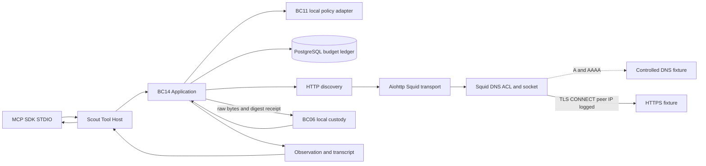

# Scout Authorized HTTP Exploration — resultado do incremento

Data da validação: 2026-11-18. Branch: `feat/scout-authorized-http-exploration`, baseada diretamente em `origin/main` no merge de PR #7 `bbc5df029e2f833437d8ed341f1d036185dc2819`.

## Escopo implementado

- O MCP host adiciona `scout_fetch` com schema fechado contendo somente `session_id`, `expected_version` e URL. Source/revision vem da sessão; URL não cria aprovação.
- A aplicação BC14 expõe uma porta de discovery HTTP. O adapter existente normaliza URL, revalida autorização por hop, usa transporte Squid fixo, desativa redirects automáticos e contabiliza cada hop no ledger PostgreSQL.
- A resposta final é preservada em bytes originais no adapter local de custody. BC14 verifica identity, tamanho e digest antes de acrescentar observation/manifest. Texto extraído limitado e links autorizados são retornados; campos de segredo comuns no texto e título são redigidos. Links nunca são seguidos sem nova chamada.
- Erros de policy, rede, estrutura e custody são distintos no retorno MCP. Conteúdo HTML permanece dado externo não confiável.
- A skill Codex e runbooks descrevem descoberta incremental, fronteiras, smoke e limites. ADR 016 permanece Proposed; ADRs existentes continuam Proposed.

## Verificações executadas

- `make ci` — aprovado. Testes offline e verificações de arquitetura, links, migrações, naming, lint e formatação passaram. O perfil geral reportou skips dos testes PostgreSQL por não carregar `.env` automaticamente; eles foram executados separadamente.
- `make db-migrate` — repetido; migrations atuais/idempotentes.
- `make test-integration` — 21 testes PostgreSQL passaram, sem skips; inclui concorrência do budget e replay HTTP após restart.
- `make scout-sandbox-check` — passou: egress TCP/DNS direto bloqueado no worker probe, proxy negou hostname não registrado e hostname de teste resolvido para loopback.
- Testes herméticos cobrem normalização/percent-encoding, URL fora do scope, redirect privado/path, resposta compressed/oversized, falha de rede, conteúdo com prompt injection, custódia e replay após restart.
- O teste de pacote BC15 wheel/sdist, instalação externa, CLI draft/validate/replay continuou passando dentro de `make ci`.

## Smoke público e evidência limite — histórico substituído pela seção de hardening

O MCP host foi configurado temporariamente para `example.com` e `www.iana.org`, com hostname cadastrado no arquivo de egress e source/revision/path/budget aprovados na policy local. Ambas as tentativas chegaram ao Squid e o log do proxy registrou `TCP_DENIED/403 CONNECT`. O adapter retornou `policy_denied`; nenhum conteúdo público foi lido. Nenhum fetch foi tentado via shell/curl e nenhuma restrição foi contornada.

Na validação inicial a navegação pública não foi demonstrada e uma fixture HTTPS estava pendente. Esse estado foi resolvido para o caminho controlado local pela seção “Hardening DNS/TOCTOU” abaixo. Não foi executado smoke público e ele não é evidência necessária para o gate hermético.

## Limites restantes

- Bytes intermediários de resposta a redirect ainda não são anexados a manifests; somente a resposta final é evidência de sessão.
- O container probe não é o processo MCP host. O shell/rede do Codex permanece fora de isolamento; o controle cobre somente o caminho de fetch pela ferramenta.
- Custody BC06, policy BC11 e source resolution BC01 são adapters locais de referência. Source com múltiplas origens não é aceito pelo composition atual.
- Não há Playwright, Scrapy, crawl distribuído, runtime de agente remoto ou BotRelease.
- A aprovação formal de review para PR #7 não foi reportada pela API GitHub (`reviewDecision` vazio), embora o PR esteja integrado em `main` e seu check remoto tenha passado.

## Revisão independente PR #8 — remediação de replay e evidências locais

Data: 2026-11-19. SHA originalmente revisado: `9284455f2e8e9ea51aa6df5abc0a21cd882fc6f9`; base observada: `bbc5df029e2f833437d8ed341f1d036185dc2819`. As mudanças desta revisão ainda são locais neste checkout e não representam evidência publicada no GitHub.

### Replay de `scout_fetch`

Causa-raiz: o receipt durável guardava o snapshot da sessão e referências de evidência, mas não o texto projetado da resposta. O ramo de replay devolvia `text=""` e `text_truncated=true`, embora a captura original tivesse texto extraído. Isso fazia a recuperação mudar a semântica da resposta MCP.

Foram comparadas duas opções. Uma projeção redigida durável simplificaria a leitura, mas duplicaria conteúdo derivado sensível no banco e exigiria retenção/integridade próprias. A reconstrução a partir de custody mantém BC06 como dono dos bytes e da retenção; custa uma leitura por retry e exige uma transformação versionada. Foi escolhida reconstrução por `scout-text-v1`: BC14 reautoriza sessão, principal, fonte/revisão e escopo atuais; exige observation e manifest únicos; lê BC06, valida tamanho, identidade e SHA-256, e reconstrói texto redigido com limite de 16.000 caracteres (resposta serializada limitada a 64 KiB). Artefato ausente, expirado, incompatível, corrompido ou transformação não suportada produz `evidence_unavailable`; não há segundo fetch nem budget novo. Não se duplica bytes raw no BC14.

A identidade durável do comando é independente do ID JSON-RPC: o slot usa principal, ferramenta, sessão e `expected_version`; o fingerprint cobre argumentos canônicos. Repetir os mesmos argumentos recupera o comando concluído. Um `expected_version` novo constitui novo slot/operação intencional; argumentos diferentes no mesmo slot conflitam.

### HTTPS/MCP hermético — resultado inicial, atualizado abaixo

Foi criado perfil Compose segregado com CA e certificado de curta duração gerados para o teste, Squid configurado para permitir apenas o host e endereço IP da fixture HTTPS `catalog.fixture.test` e para negar os demais destinos. A exceção a RFC1918 é exata ao endereço da fixture no perfil E2E; a configuração produtiva não foi alterada. A topologia é não-internal para que o cliente MCP executado no host alcance a porta loopback publicada; logo, este perfil não prova isolamento do host nem do processo Codex. O transporte do Scout continua exigindo proxy nomeado/loopback na porta fixa 3128 e usa `trust_env=False`, sem redirects automáticos.

`make scout-http-e2e` inicialmente validava o fluxo MCP/HTTPS, replay e custody, mas não capturava o IP peer nem controlava DNS do Squid. A conclusão inicial de egress foi insuficiente e está substituída pelos resultados abaixo.

### Limites e lacunas de segurança — estado inicial, atualizado abaixo

Testes herméticos também cobrem redirects para path fora de escopo, origem diferente, downgrade HTTPS→HTTP, destino IP privado literal, cadeia limitada pelo budget, caminhos codificados, IPv4/IPv6 não globais, IPv4-mapped IPv6, hosts numéricos ambíguos, timeout, tamanho e encoding da resposta. A proteção de DNS/TOCTOU inicialmente não estava demonstrada e foi investigada pelo novo perfil descrito adiante.

O MCP Tool Host permanece no processo local do usuário. Shell, ferramentas de desenvolvimento e rede do Codex não são isolados pelo proxy do Scout. BC01, BC06 e BC11 continuam representados por adapters locais nesta composição; nenhuma evidência deste teste substitui suas integrações de produção. O conteúdo da página é retornado somente como projeção redigida/dados não confiáveis; não vira instrução de sistema.

### Testes locais desta remediação

- `make scout-http-e2e` — passou (2 testes; fixture recebeu exatamente um GET; restart/replay recuperou a resposta).
- `make test-integration` e `make test-recovery` — cada um passou (21 testes PostgreSQL, zero skips).
- `make scout-sandbox-check` — passou para o probe de worker: TCP/DNS diretos bloqueados e proxy negou destino privado/não registrado. Isso não isola o host MCP/Codex.
- `make ci` e `make check` — passaram: 97 testes; 24 skips esperados porque esses targets não carregam `SCOUT_TEST_DATABASE_URL` e não iniciam o perfil E2E. Os mesmos gates PostgreSQL e HTTPS/MCP foram executados separadamente sem skips.
- `uv lock --check`, Ruff lint/format, checks de docs, migrations, naming e arquitetura passaram dentro de `make ci`/`make check`.
- `git diff --check` e `git diff --cached --check` passaram. Nenhuma migration ou alteração de lockfile foi necessária.

O SHA acima identifica o objeto de PR originalmente auditado, não um commit desta remediação. A seção seguinte registra o hardening local; esta avaliação não aprova merge.

## Hardening DNS/TOCTOU — evidência local em `feat/scout-authorized-http-exploration`

### Causa do risco e inspeção do fluxo real

O cliente `AiohttpSquidTransport` não resolve o host de origem: usa `trust_env=False`, URL de proxy explícita, `use_dns_cache=False`, `force_close=True`, valida TLS com o hostname original e desliga redirects automáticos. O processo Squid é o resolvedor e o único componente da rota Scout que abre o socket de origem. O fluxo exercitado foi:

```text
MCP SDK STDIO client → Scout Tool Host → BC14 application → BC11 local policy
  → PostgreSQL budget ledger → HTTP discovery → AiohttpSquidTransport
  → Squid (DNS + ACL dst + socket CONNECT) → HTTPS fixture
  → BC06 local custody → BC14 observation/transcript → MCP response
```



O risco era validar um hostname/endereço em Python e, depois, permitir que outro resolvedor escolhesse o peer. A garantia local passa a depender do próprio Squid: sua ACL `dst` rejeita qualquer resposta que contenha endereço bloqueado, e o resolvedor/forwarder usam o cache DNS de IP do Squid. A conexão não faz uma segunda resolução independente entre a ACL e o socket. O E2E configura um DNS controlado na rede do Squid e registra `%<a`, que é o peer IP remoto efetivamente selecionado, além do hostname, método e status. A prova de conexão não é inferida apenas da resposta DNS.

O trace BC14 registra origin, hashes de path/URL, hop e SHA-256 do arquivo local de policy usado naquela autorização. O Squid registra hostname, peer efetivo, código de hierarquia, status HTTP e método. DNS SERVFAIL/timeout aparece como falha de transporte sem peer; deny por ACL aparece como `TCP_DENIED/403`. O proxy não inclui ID de decisão BC11 nem causa específica de cada regra ACL no log HTTP; para diagnósticos detalhados de resolver/ACL, correlacionar cache log Squid e evento BC14 por timestamp/host. O fingerprint identifica conteúdo da policy local, não uma decisão produtiva BC11.

Durante o teste foi detectado um defeito real na configuração da ACL: a grafia `::ffff:0.0.0.0/96` era rejeitada por Squid 7.7 e normalizada de forma que criava `::/0`, cobrindo todos os endereços e negando também a fixture aprovada. O item foi removido da lista textual; o teste real confirma que o Squid bloqueia uma resposta AAAA IPv4-mapped privada usando a classificação IPv4 mapeada, sem uma rede wildcard. O access log agora registra apenas hostname, peer IP, resultado HTTP e método, nunca path, query, cabeçalhos, cookies ou body.

### Alternativas avaliadas

| Alternativa | Squid atual | Segurança e dual-stack | Operação, observabilidade e testes | Playwright/Scrapy |
|---|---|---|---|---|
| A. DNS validado e conexão pinada | Squid resolve e valida via ACL `dst`; não requer DNS próprio no BC14 | Usa o conjunto A/AAAA da cache IP compartilhada pela ACL e forwarding. Respostas mistas são negadas. HTTPS mantém hostname original para SNI/certificado. O teste verifica peer real por `%<a`. | Baixa mudança; DNS controlável e access log de peer tornam falhas visíveis; requer regressão contra a imagem Squid fixada. | Reutilizável pelos adapters que encaminharem pelo mesmo gateway; não se aplica a conexão direta de um browser/engine fora dele. |
| B. Firewall no gateway de egress | Exigiria nova regra/capacidade no host ou sidecar/kernel para filtrar IP do socket | Independente de DNS/ACL de aplicação e mais forte contra bug/configuração do Squid; dual-stack depende de aplicar regra equivalente a IPv4 e IPv6. | Maior custo e menor portabilidade entre Docker Desktop/macOS, Linux CI e deployments; precisa validar destino efetivo por fluxo. | Teria de ser a fronteira de rede compartilhada por cada worker de browser/scraper. |
| C. A + B | Possível, não implementada | Defesa em profundidade maior. | Duplicaria operação neste incremento sem evidência de que o caminho Squid/cache escolhido falha; permanece melhoria para ambientes hostis/produção. | Melhor destino futuro se novos workers de rede forem adicionados. |

Decisão local: A, limitada ao caminho governado de `scout_fetch` via imagem Squid fixada. A implementação evita um resolver/socket próprio em BC14 e preserva BC11 como dono da autorização e BC14 do budget/observação. Não há firewall independente no host ou na rede egress do Squid; portanto este resultado não certifica uma instalação com Squid não fixado, ACL alterada, proxy comprometido ou qualquer processo local que escolha abrir sockets diretamente.

### Política de endereços e redirects

`blocked_destinations` cobre loopback, unspecified, RFC1918, link-local, CGNAT/shared space, documentação/test-net, benchmark, multicast, reserved, IPv6 ULA/link-local/multicast, IPv4-mapped (avaliado pela forma IPv4 efetiva), NAT64, 6to4/Teredo e blocos especiais/documentação conhecidos. A lista foi confrontada com os [registros IANA de endereços especiais IPv4](https://www.iana.org/assignments/iana-ipv4-special-registry) e [IPv6](https://www.iana.org/assignments/iana-ipv6-special-registry), incluindo o bloco de documentação IPv6 `3fff::/20` e os SIDs SRv6 não globalmente alcançáveis `5f00::/16`. O perfil E2E retira somente `172.30.91.10/32`, que é o IP estático da fixture, da ACL de bloqueio; nenhum outro endereço da rede é liberado. A allowlist do Squid continua exigindo o hostname cadastrado, e BC11 continua autorizando origem/path por source/revision/principal. Mixed A/AAAA é deny-all; timeout/SERVFAIL falha sem fallback direto. Cada redirect é validado no BC14 antes de outro consumo de budget/GET; testes unitários cobrem origem, path, downgrade, cadeia e IP literal.

O IPv6 negativo foi exercitado com `::1` e IPv4-mapped privado; não houve conexão IPv6 pública positiva, pois o fixture só expõe IPv4. Os ranges são uma política conservadora versionada em configuração, não um substituto para firewall de ambiente ou atualização contínua de registries de endereços especiais.

### Matriz DNS adversarial — fronteira real do Squid

| Caso | Resultado observado |
|---|---|
| DNS-01 A explicitamente permitido na rede controlada | HTTPS 200 pelo Squid; log identifica o peer de fixture `172.30.91.10` (IP privado liberado somente no perfil isolado de teste). |
| CNAME para A permitido | Resposta DNS CNAME+A alcança fixture; HTTPS 200 e peer permitido. |
| DNS-02 A privado | Squid `TCP_DENIED/403`; sink não recebe conexão. |
| DNS-03 A misto permitido + proibido | `TCP_DENIED/403`; não escolhe somente o membro permitido. |
| DNS-04 AAAA misto com loopback | `TCP_DENIED/403`. |
| DNS-05 resposta A muda de permitido para privado | Uma consulta A observada; peer conectado foi o primeiro IP permitido. A resposta seguinte estava programada como privada. |
| DNS-06 lista de retry/fallback contém IP proibido | A lista mista foi negada antes de atingir o sink. |
| DNS-07 redirects | BC14 unit tests validam a nova URL antes de nova conexão; origens/path/downgrade/IP fora de escopo negados. |
| DNS-08 DNS SERVFAIL e timeout sem resposta | Ambos falharam fechado; Squid retornou 503/falha de transporte; o DNS controlado confirmou a consulta e o sink permaneceu sem conexão. |
| DNS-09 IPv4-mapped/endereços especiais | AAAA IPv4-mapped para endereço privado foi negada; `::1` também negado. |
| DNS-10 peer conectado | `%<a` registrou peer real para os CONNECT; positive e rebinding usaram `172.30.91.10`; sink `.11` contou zero accepts. |

O harness configura o DNS no container Squid que efetivamente resolve e abre o socket, não apenas no processo Python. A rede Compose do E2E é isolada por projeto e a fixture/sink usam IPs estáticos; para publicar o listener no loopback do host a bridge desse perfil não é `internal`. O perfil não tenta acessar serviços locais do host e não representa firewall de produção. Os testes E2E usam a imagem Squid digest-pinned e configuração renderizada efêmera.

### Evidência HTTPS/MCP, PostgreSQL e replay

`make scout-http-e2e` usa o SDK oficial MCP por STDIO, o Tool Host real, PostgreSQL real, Squid do Compose, DNS controlado, CA/certificado efêmeros e fixture HTTPS determinística. Passou localmente com três testes: (1) tool schema/handshake, source+revision e principal de contexto confiável, policy restritiva, budget PostgreSQL, TLS validado, byte preservation, SHA-256/custody, texto redigido, transcript verificável, restart e replay idêntico sem segundo GET; (2) destino privado, hostname não autorizado, CA inválida e proxy indisponível; (3) DNS A/CNAME positivo, mixed A, mixed AAAA, mapped IPv6/SRv6, retry proibido, rebinding TTL zero, SERVFAIL e timeout sem resposta. O runner exige exatamente um GET da rota `/docs/page`, log Squid apontando o IP real permitido, pelo menos cinco denies e zero conexão ao sink proibido.

O fixture inclui conteúdo externo com texto dirigido a agente e um segredo sentinela. O texto é tratado como dado, segredo é removido da projeção/transcript e o raw permanece somente em custody. `%<a` não inclui headers ou payload.

### Limites e riscos residuais

- O teste demonstra a semântica na imagem Squid por digest observada como versão 7.7 e não substitui validação de deployment real, controle do host de rede, firewall do cluster ou revisão de upgrades Squid.
- O host MCP e o processo Codex continuam fora do isolamento da rede do worker; shell e ferramentas locais podem ter rede própria. O controle auditado garante o caminho de `scout_fetch`, não isolamento global do agente.
- O proxy é um broker de rede; ACL ou configuração modificada podem mudar a garantia. Não existe atualmente bloqueio independente no kernel/firewall da interface egress do Squid.
- O teste de rebinding programa mudança na segunda resposta e comprova uma resolução A e peer first-answer na mesma operação. Não simula reinício no meio de conexão nem rebind no meio do TLS; sockets de fetch são fechados após cada request e o Squid image/cache de um request é fixado.
- DNS A/AAAA proibido, mixed e falha foram cobertos localmente. Ainda não há prova de comportamento sob kernel/bridge IPv6 habilitado em produção ou ambiente não-Docker.
- BC01/BC06/BC11 continuam adapters locais de referência; nenhum teste substitui suas integrações de produção.

### Comandos executados e estado do gate

`make db-status`, `make db-up`, `make db-migrate`, `make test-integration` e `make test-recovery` passaram; ambos os gates PostgreSQL executaram 21 testes sem skips. `make scout-http-e2e` e `make scout-dns-adversarial-check` passaram com 3 testes, incluindo TTL zero/rebinding, SERVFAIL e DNS sem resposta; peer/sink estão evidenciados. `make scout-sandbox-check` passou para o worker probe. `make ci` e `make check` passaram com 97 testes e 24 skips esperados (os gates obrigatórios foram executados separadamente). `uv lock --check` passou dentro dos dois alvos. No momento da publicação, o GitHub Actions do commit `1dbe57741d4d263cd04ddcae83af9465126466f7` passou ([check remoto](https://github.com/FabioCaffarello/data-mozaic/actions/runs/44548373799)); commits posteriores precisam de seu próprio check. O restante deste assessment registra evidência local, não integração produtiva de BC01/BC06/BC11.
