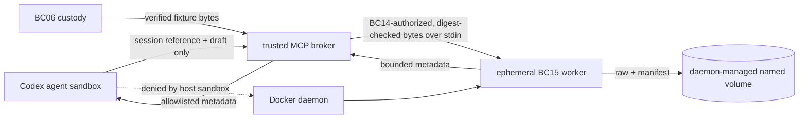

# PR #9 — BC15 filesystem trust boundary

Date: 2026-11-19. Baseline audited commit: `b682a775ee657ce268d841029be24e7f194bc82b`, tree `5cf335ead8c179fb16fe9fab420fe90661c61a46`. This assessment records the working-tree implementation; it does not approve ADR 013 or ADR 016, which remain Proposed.

## Security invariant and threat model

An untrusted agent must not modify, replace, rename, or control the directory used by the BC15 executor, and must not induce writes to a path it chooses. The output location is selected and owned by the trusted executor. The agent requests only replay or acceptance of a server-authorized Scout session and a bounded draft.

Two filesystem conditions are distinct:

1. **Executor-owned root:** another principal lacks permission to mutate the root and its parents. Descriptor-relative opens, `O_NOFOLLOW`, inode checks, and manifest-last publication defend against symlink substitution and ordinary path races within this premise.
2. **Same-UID adversary:** another process can rename a directory already opened by BC15. On Linux and macOS, an open directory descriptor continues to refer to the moved directory. Relative writes remain valid after the rename; `O_NOFOLLOW` does not make an inode immovable, `fstat` proves object identity rather than pathname containment, later checks cannot reverse prior writes, and cooperative locks do not constrain a process that ignores them.

The direct Python `replay` and `accept_acquisition` APIs remain trusted in-process APIs. They do not defend against a same-UID process with access to their output root. Their CLI replay/accept entry points were removed. The protected Scout MCP composition is the only supported path for an untrusted authoring agent.

## Selected composition

The implementation uses a trusted local MCP broker and a short-lived BC15 container. The broker reauthorizes the BC14 session, obtains custody-verified fixture bytes, and sends a bounded stdin envelope. It supplies no host paths, commands, URLs, mounts, output roots, or runtime options from the agent. The worker validates the envelope, writes only to a fresh daemon-managed named volume, has no network, host bind, Docker socket, writable root filesystem, or Linux capabilities, and returns bounded report metadata. The MCP layer binds run references to the authorized principal and session and never returns raw bodies.

The MCP broker is intended to be the trusted runtime controller and has Docker daemon access. Its launcher/configuration and Python sources are currently in the agent worktree: `.codex/config.toml`, `tooling/codex-scout-mcp.sh`, the MCP package, and `.local/authoring-policy.json`; these files are owner-writable by the same local user. The host imports code and builds an image before exposing tools, which protects the live in-memory broker/image from later source edits, but does not protect the launcher, source, or policy files from replacement before a later session. A trusted non-agent-writable installation and exact-session write-denial proof remain unestablished. Host inspection found Docker contexts `default` (`unix:///var/run/docker.sock`) and `desktop-linux` (`unix:///Volumes/OWC Express 1M2/.docker/run/docker.sock`); both socket paths exist and the daemon answered version 28.5.1. Effective Codex denial for both contexts was not tested in this run. Container `0700` permissions alone are not the isolation proof. Docker Desktop stores named-volume data inside its Linux VM and does not expose a host bind mount here; Linux CI uses containers on the runner kernel, so kernel compromise, daemon compromise, container escape, host administrator access, and malicious trusted broker/image remain out of scope.

No dedicated UID was introduced: it needs privileged host provisioning and separate local/CI lifecycle. A standalone filesystem sandbox was not selected because the broker must still own publication and the available macOS/Linux sandbox mechanisms differ. Docker is already present in the local Scout E2E composition and GitHub Actions runner. If the Codex sandbox cannot deny the Docker control plane, protected MCP startup must fail closed and the product is not safe in that composition.

## Boundary and data ownership

- BC14 owns investigation, transcript, session authorization, and fixture reference.
- BC06 remains the authority for custody bytes and their integrity.
- BC15 owns draft validation, replay, raw publication, and acquisition acceptance.
- BC01/BC11 source policy and authorization remain in force.
- MCP is an adapter; it does not become the replay domain or custody store.
- Acceptance expectations are a trusted, source/revision keyed registry loaded by the broker. The agent cannot select an oracle.
- The executor accepts bounded draft/session inputs, validates fixture count, per-body and aggregate size, digest, and run ID, disables network, caps duration, CPU, memory, process count, and concurrent runs, and uses an executor-generated output reference.
- The broker now writes a private SQLite adapter registry outside the Codex artifact directory. It persists run ID, volume, principal, Scout session, state, timestamps and bounded report; startup reconciliation marks interrupted and orphan volumes incomplete. A one-minute cleanup pass and checks on startup/status/new runs remove only volumes whose generated name and owner/run labels match. Retention is 24 hours, capped at 100 runs/volumes and 200 registry rows; concurrent runs cap at two, fixture bodies at 24 MB aggregate, and workers at 60 seconds. Inventory failures or mismatched labels preserve data and fail closed. PostgreSQL was evaluated and not selected: run metadata is local adapter-operational state, not Scout domain state, and no new Scout table or bounded context is needed. This does not enforce a physical per-volume quota, encrypt local state, or protect against host/Docker administrators.

ADR 013 and ADR 016 remain Proposed. This assessment is evidence and a conditional implementation record, not an architecture decision accepted on behalf of a human reviewer.

## Adversarial evidence and limits

The original direct API reproduction remains in `test_replay_does_not_write_after_open_raw_directory_moves_outside_root`: at first `os.write`, it moves the opened `raw` inode outside the requested root and replaces the path with a symlink. This deliberately documents that the direct same-UID API is not an isolation boundary; it must not be reported as a protected pass.

The protected MCP-to-container E2E uses the real stdio tool interface, BC14-authorized synthetic fixture session, BC15 replay and independent acceptance, plus a Docker named volume. It verifies that tool schemas contain no path/command/mount controls, that body bytes are not returned, and that `raw_output_only=true` and `records_extracted=false`. A prior connect-only `codex exec --sandbox workspace-write` probe to the local Docker socket was denied by the sandbox. This does not substitute for an actual Codex session concurrently attempting a volume rename under the exact agent permissions.

The acceptance launcher requests real-session bypass attempts, but no new session has started: the previous local source approval expired and explicit owner approval for a replacement one-use approval is pending. Therefore no current evidence proves that Codex cannot rename private output, access either Docker context, or write broker/configuration files under the effective product permissions. Linux execution is also not available in this macOS run; Linux enforcement must be established by CI on the reviewed commit.

### Reassessment — Codex 0.170.0 host and MCP boundary (2026-11-20)

The installed CLI reports `codex-cli 0.170.0`. Official Codex documentation configures local STDIO MCP servers as launched local processes with a command, arguments, environment, and working directory. This CLI has an experimental `codex/sandbox-state` capability, but an MCP server must opt in and forward the issuing call's policy to `codex sandbox`; this server does not advertise or implement that capability. No inherited shell sandbox is established for this broker. In this checkout, `.codex/config.toml` selects `bash tooling/codex-scout-mcp.sh`; that script runs `uv --project <checkout> ... python -m scout.tool_host`. `composition.py` imports from the checkout and `DockerProtectedReplayExecutor` uses the same checkout as the build context for a host Docker build. The launcher, configuration, source, Dockerfile, and dependency lock therefore remain in the workspace the agent can edit. The snapshot's `0400` mode and same-UID state directory do not separate the agent from the broker process.

Controlled, non-destructive probes produced these results:

| Probe | Effective context | Observed result |
|---|---|---|
| Append to a disposable sentinel under `~/.local/state` | Codex 0.170.0 `exec`, `workspace-write`, approval `never`; exact disposable file created for this probe | Denied by macOS with `operation not permitted`; bytes unchanged |
| Connect without sending data to `/var/run/docker.sock` and the `desktop-linux` socket | Same Codex shell sandbox | Both denied with `operation not permitted`; `docker volume ls` was denied at socket connect. `docker context ls` succeeded and disclosed the two configured context names |
| Append to a disposable file at the repository root | Same Codex shell sandbox | Succeeded, confirming the repository itself is agent-writable |
| Write a disposable sentinel and connect to each Docker socket without sending data | Ordinary host process, UID 501 (the launcher user) | Write succeeded and the sentinel was restored; both socket connects succeeded |
| `scout_preflight(e2e-catalog-single, single-resource-v1)` | Attached MCP tool | Returned `policy_denied`; no session was started and no authorization changed |

The host-process probe is a permission comparison, not a malicious MCP call. The project STDIO launcher was not started for this probe: startup imports checkout code and builds an image through Docker before serving tools, so launching it would execute the very mutable privileged path under audit. The attached MCP preflight did not create a source session. These results still establish the key failure: shell denial does not constrain a host process with the launcher's UID, and the workspace files used by a future trusted launch are writable by the agent. A broker started by this launcher is not a trusted boundary, even if the current running instance and image have already been loaded.

The minimum viable remediation is an operator-provisioned broker deployment whose code, launcher, configuration, dependencies, and executor image are outside agent-writable paths, plus a fixed, narrow IPC adapter that cannot select or replace that deployment. The protected service must own Docker access and authenticate the adapter/session; its installation/update and identity isolation must be validated on macOS and Linux. No separate service identity or protected deployment is provisioned in this environment. A hash checked by the mutable launcher, a mode bit under the same UID, or a project-local configuration change cannot close this gap.

### Trusted HTTP deployment reassessment (2026-11-20)

The installed `codex mcp list` showed `data_mozaic_scout` enabled as `bash tooling/codex-scout-mcp.sh`. Codex 0.170.0 source supports administrator-managed MCP identities for both STDIO command and Streamable HTTP URL; project-local configuration layers are explicitly untrusted until project trust is granted, but a trusted workspace can alter them for a later launch. Codex 0.170.0 reads Unix `/etc/codex/requirements.toml` and accepts macOS `com.openai.codex:requirements_toml_base64` only when forced by MDM. The local Unix files and forced MDM preference were absent. The CLI report did not establish an effective cloud-managed MCP allowlist, so that source remains unverified.

The repository now points its project client to required Streamable HTTP at `http://127.0.0.1:8765/mcp` with host-provided bearer credentials; the checkout launcher exits 78 before importing application code. This removes the current project-config default that launches the Docker-capable broker from the workspace and fails closed because no service is installed. It does **not** prevent a modified project configuration from adding another STDIO server in a later trusted session. Only an enforced managed allowlist can close that client-side bypass. The local change now includes an HTTP service reusing the existing tool server, a locked wheelhouse bundle builder, an unprivileged staging installer, and a worker image builder requiring a digest-pinned base. These are development artifacts from a dirty checkout; the bundle is unsigned and has not been installed. No protected service identity, signed release, or managed Codex policy is present.

**Architecture direction: Streamable HTTP, Proposed only.** The service code binds to loopback, authenticates requests, validates Host/Origin with SDK DNS-rebinding protection, and constrains its MCP surface. Deterministic tests exercise the HTTP adapter and protected replay path. A reviewed release still must be built and independently verified, installed and started out of the checkout by an operator, use fixed config/dependencies and a prebuilt worker image, and run under an identity with Docker access unavailable to Codex. A managed Codex requirement must allow only its exact URL and prevent workspace config from adding STDIO. The operator runbook is [Scout trusted broker deployment prerequisites](../../operations/scout-trusted-broker-deployment.md); it records Unix and macOS policy channels and platform-specific Docker differences. No privileged installation or policy change was attempted.

## MCP descriptor closure

The existing-index branch in `_write_replay_fixtures` now closes `index.json` in `finally`, including `os.read` and `os.fstat` failures. The deterministic injected-read-error regression verifies closure and unchanged artifacts. The test passes locally.

## Local verification

| Gate | Result |
|---|---|
| `make check` / `make ci` | Pass; 152 repository tests, 26 explicitly skipped opt-in/integration tests |
| BC15 writer/replay regressions | Pass, including symlinks, partial write, digest divergence, FIFO, cooperative concurrency, retry, permissions, and manifest-last behavior |
| MCP fixture export regressions | Pass, including injected `os.read` exception and descriptor closure |
| `make scout-protected-replay-check` | Pass on macOS Docker Desktop; MCP stdio → protected container → BC15 replay and acceptance; arbitrary path parameter rejected; persisted report reloaded |
| Protected broker config and registry tests | Pass; policy snapshot, SQLite reopen, interrupted run reconciliation, orphan recovery, one-use approval claim and label-checked idempotent cleanup |
| `make test-integration` | Pass, 21/21 PostgreSQL tests |
| `make db-migrate` | Pass; migrations current |
| `make scout-sandbox-check` | Pass after changing its host port publication to an ephemeral port; no unrelated service stopped |
| `make scout-http-e2e` | Pass, 2/2 tests, zero skips; dynamic free Docker subnet and ephemeral host port |
| `make scout-dns-adversarial-check` | Pass, 2/2 tests, zero skips; forbidden sink accepted zero connections |
| `make pre-commit` | Pass after final code/docs changes |
| BC15 wheel/sdist build | Pass via `uv build --package mozaic-collector-engineering --sdist --wheel` |
| `make scout-dev-status` | Blocked: synthetic fixture services stopped and local source approval expired; no automatic reauthorization |
| Codex project MCP configuration | Updated to required loopback Streamable HTTP; config test added; endpoint is absent, so normal startup is expected to fail closed |
| Workspace STDIO launcher | Replaced with unconditional exit 78 before Python imports |
| Effective managed MCP allowlist | Not available/verified: no Unix requirements file or forced macOS MDM requirements preference found; cloud-managed policy source not proven |
| Trusted HTTP broker deployment | HTTP service and unsigned local bundle tooling implemented; deployment not installed or running |
| Real Codex acceptance with protected replay and concurrent rename attempt | Not run; previous approval expired and replacement owner approval is pending |
| Agent write attempt against the actual broker files | Not run; preserving the user's real files. Synthetic repository-root write succeeded under Codex `workspace-write`, proving the workspace trust premise is false |
| Codex shell access to configured Docker contexts | Denied at OS socket connect in Codex 0.170.0 `workspace-write`; ordinary same-UID host process connected to both endpoints |
| Project MCP STDIO server adversarial call | Not run; current launcher executes checkout code and builds through Docker before serving, so it is not a safe probe target |
| Remote Linux required checks on changed code | Not run; no commit or push |

The first and second already-documented Codex sessions remain useful evidence for distinct discovery and standalone acquisition strategies. The protocol now routes replay through the protected tools, so those sessions do not validate the new executor boundary.

## Findings and gate

- **P1 — confirmed open: broker integrity and effective sandbox:** shell sandbox probes denied both Docker sockets and a private-state sentinel, but a same-UID host process connected to both sockets and wrote its own sentinel. The old launcher executed workspace code. Its repository launcher is now disabled and the project config requires loopback HTTP, but the HTTP service is absent and no managed MCP allowlist prevents a future project-config STDIO addition. Do not publish this implementation as protected until the trusted service, managed allowlist and OS-level identity boundary are provisioned and tested.
- **P1 — open: fixture authorization and real Codex session:** the previous approval expired; the exact new one-use approval is still pending and no live Codex fetch/replay/acceptance evidence exists.
- **P2 — partially closed: lifecycle:** durable indexing, restart reconciliation, bounded retention and safe cleanup now have deterministic tests. Residual limits are the absent physical volume quota, no encryption at rest, and no cleanup while Docker inventory remains unavailable.
- **P3 — closed:** `index.json` descriptor leak on exceptional read is fixed and covered by a deterministic regression.

**Current decision: NO-GO for trusted deployment, publication as a protected implementation, real fixture acceptance, merge, and independent security approval.** No commit or push has been made. ADR 017 is Proposed. The project-config STDIO default fails closed, and deterministic Streamable HTTP functionality and package staging exist. The workspace can still change project configuration; no effective managed allowlist, protected service identity, signed/reviewed release, or installed service has been verified. Required next work is operator provisioning of the immutable service and managed MCP requirements, proof that config tampering remains disabled after Codex restart, deployment probes on macOS/Linux, Linux CI on the reviewed commit, and fresh explicit fixture approval before a Codex run. Any successful bypass/private write or missing approval remains NO-GO.

### Final local verification — 2026-11-20

The working tree was subsequently updated with a loopback Streamable HTTP adapter and deployment bundle tooling. The detailed current gate record follows.

GitHub PR #9 remains Draft at the same old SHA. Its `Quality Gate` and `Integration Security Gate` are green only for that old SHA; no Linux run covers this working tree. The operator-managed `/etc/codex/requirements.toml` or forced macOS MDM requirement was not found, and cloud-managed policy could not be verified. Thus the changed project config and disabled launcher are fail-closed defaults, not an enforced client allowlist. The fixture approval remains expired and no real Codex fixture session was initiated.

### Streamable HTTP implementation and local gate record (2026-11-20)

The checkout now implements an authenticated, bounded Streamable HTTP adapter on fixed loopback `/mcp`, reusing the existing Scout MCP server and use cases. The broker entry point requires explicit trusted mode and has no STDIO fallback. It requires operator-provided absolute policy/data paths and a prebuilt worker image ID. Docker execution selects only the configured local context/Unix endpoint, fixed worker image ID, fixed command, private labeled volume, no network, no host mounts, CPU/memory/PID/time/input bounds, and the durable SQLite run registry. No MCP parameter selects an image, command, mount, volume, or filesystem path.

An unsigned local bundle was built from this dirty checkout for artifact-shape verification only. Manifest SHA-256: `98b64ce4be1e84c44db357a05b7d2545dd9400fafefd8fcdb1ced029ad34aac4`; worker image ID: `sha256:749681587f6f3610a7091e01aebad5a136fa978e0610ce772bb7bcf1bef4d0bc`. Hash verification and unprivileged staging installation succeeded; installed `scout` and `mcp` imports resolved inside the staging venv. This is not an authenticated release: no reviewed clean source revision, independent signature, privileged installation, daemon identity separation, Codex managed policy, or service restart verification was established.

Local macOS results: `make ci`, `make check`, `make test-integration` (21 PostgreSQL tests), `make scout-http-e2e`, `make scout-dns-adversarial-check`, `make scout-sandbox-check`, `make scout-protected-replay-check` (MCP Streamable HTTP → test broker → BC15 worker → replay and independent acceptance), `make pre-commit`, bundle verification/unprivileged installation, and BC15 wheel/sdist packaging passed. `make ci`'s ordinary discovery skips Docker and configured-PostgreSQL suites; dedicated targets above ran them. The existing HTTPS and DNS integration targets still use their test-only STDIO harness; they are not evidence for the privileged service transport. No Linux local runner or remote CI run for this working tree was performed. Remote required checks remain associated with the old published SHA.

The managed requirements example and a negative Codex CLI probe are prepared but not installed or run. The exact HTTP handshake has not been checked against Codex CLI 0.170.0 after deployment. macOS and Linux service ownership and effective Docker socket denial by the Codex process remain unverified. Direct API writer same-UID directory replacement remains a documented vulnerability and is not the supported protected path. The fixture authorization remains expired; no real Codex fixture call occurred.

**Decision remains NO-GO** for trusted deployment, publication as a security-complete implementation, real fixture acceptance, merge, or independent security sign-off. Required human/operator actions: provision a reviewed and independently authenticated bundle outside the checkout; load the worker image; configure and protect service state/secrets and service identity; enforce the exact Codex managed MCP requirement (including blocking added STDIO/alternate URL); run socket/filesystem/config tampering probes through both sandboxed shell and MCP STDIO; verify service/Codex restart; run Linux CI on a reviewed published SHA; and grant fresh one-use fixture approval before real Codex acceptance.
