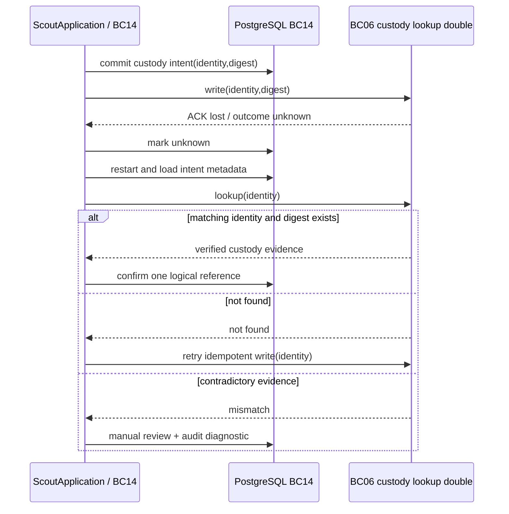

# Scout S1.6 — acceptance and recovery closure

Status: local technical acceptance passed for Draft PR preparation. This assessment does not approve ADRs or claim production BC06/BC15 behavior.

## Initial state and pre-patch operation matrix

Snapshot: branch `feat/scout-s1`, HEAD `7a731a126b2639ab01bd6d21c6b6d94dd2ada0da`. The staged and unstaged work from S0–S1.5 and untracked additions were already present and are preserved. Existing migration checksums and contracts are not edited.

| Operation/state | Owner and identifier | Persistence / external effects | Recovery and undefined outcome |
|---|---|---|---|
| RunScout / session | BC14 owns the session, transitions, version and `session_id` | `scout_sessions.payload` with version CAS; source and policy calls occur outside the transaction | A committed receipt is hydrated by `find_intent` before policy checks. A terminal replay checks principal through key lookup but does not separately compare the request principal to the hydrated session before return. |
| Command receipt | BC14 owns `(principal, idempotency_key)`, `command_id=session_id`, fingerprint, status and response snapshot | Created with session; updated with session save. `expected_version` gates save. | Different fingerprint raises `ConflictError`; lookup loads the receipt snapshot without a pre-read authorization gate. |
| Custody intent | BC14 owns intent correlation and `artifact_id=artifact-<session_id>`; BC06 owns bytes, integrity and retention | `pending/unknown/verified`, digest and optional ref in `scout_custody_intents`; `store` is called after intent commit | On an uncertain write the application marks unknown, but retry calls `store` again without BC06 lookup by stable identity. |
| Proposal/outbox | BC14 owns outbox event `handoff:<proposal_id>`; BC15 owns receipt and any later decision | Proposal is committed in `save`; `RunScout` then invokes `deliver` directly and records transport and business acknowledgements in separate commits | A crash after external receipt but before BC14 confirmation is ambiguous; no lease, fence or persisted bounded backoff exists. Transport receipt is not playbook approval. |
| Authorization/source | Policy port models BC11; source lookup port models the source owner | Policy/source lookups are external to the BC14 transaction | Recheck exists for terminal replay and around effects, but expiry, unavailability, source revision divergence and scope downgrade lack a complete process-restart matrix. |
| Domain/observability | BC14 owns domain; `mozaic-observability` owns technical structured event helpers only | Domain imports stdlib types. Application logs event names and allowlisted state, not payloads. | Domain has no SQL, psycopg or logging dependency. Receipt payload is currently hydrated before the replay policy gate. |

### Minimal patch plan by gate

1. **G1:** introduce a receipt metadata/preflight path that checks authenticated principal, fixed source revision and current policy before loading a response snapshot; make replay conflicts/authorization failures observable and typed; add deterministic unit/process coverage.
2. **G2:** define a BC06 lookup port by durable operation identity; reconcile unknown intents by identity and digest; persist discrepancy/manual-review state and an operator-visible orphan diagnostic whose owner is BC06. Never delete bytes from Scout.
3. **G3:** add a new checksummed migration and Scout-specific PostgreSQL claim/lease/fence/backoff/dead-letter operations; put delivery in a relay unit and test with a durable receiver double. Preserve at-least-once semantics and stable message identity.
4. Re-run migration, library, boundary, local PostgreSQL, recovery, CI and offline-demo checks; record exact outcomes and leave any unmet gate NO-GO. Update roadmap and provide an ADR review dossier; do not start S2 or publish a PR.

## Acceptance evidence collected locally

| Gate | Evidence | Result |
|---|---|---|
| G1 | `test_application_crash_inside_create_rolls_back_then_fresh_process_retries_once` kills the full application subprocess while session and receipt inserts are uncommitted, then retries the same principal/key/fingerprint in a new process. `test_application_replay_after_fresh_process_rechecks_authorization` persists proposal intent, exits before response, runs independent worker CLI, then replays/finalizes in a fresh process. Deny/unavailable/expired/revoked/principal mismatch/source unavailable/revision scope divergence/scope reduction are rejected. `test_replay_authorization_gate_precedes_receipt_payload_load` proves snapshot access is gated. | Passed. After pre-commit crash, session, receipt, outbox and external effect counts are zero; retry creates exactly one logical set. After worker ACK, receipt remains `in_progress` until authorized replay. Terminal replay preserves identity/version. Fingerprint mismatch remains a typed `ConflictError` at the repository boundary. |
| G2 | `test_application_custody_reconciler_and_bc06_owned_orphan_review` uses a persistent PostgreSQL BC06 double for matching result and identity/session/source/digest/size/status/integrity divergences. It checks manual review and audit after constructing a new repository. `test_bc06_unknown_outcome_reconciles_stable_artifact_and_digest` and `test_application_custody_reconciles_unknown_write_by_identity` cover write/ACK loss and retry by identity. | Passed for the collaboration protocol. Every injected divergence persists as `manual_review` with no artifact reference confirmation. Global inventory, physical bytes, retention and deletion remain owned by BC06; no productive BC06 adapter is claimed. |
| G3 | `test_application_replay_after_fresh_process_rechecks_authorization` invokes `scout.relay_worker --once` as a distinct process; application returns pending before receiver call. `test_independent_worker_reclaims_after_process_crashes` kills worker processes after claim and after receiver commit. `test_outbox_concurrent_process_claim_and_stale_fence` races two child processes. `test_relay_lost_ack_backoff_receiver_dedup_and_dead_letter` covers retry/backoff/dead-letter. | Passed locally with durable receiver double. Worker supports polling, one-shot mode and signal-driven graceful stop. Reclaim and stale fencing work; receiver stores one logical row for repeated message ID. This does not assert a production BC15 adapter. |
| Architecture | `test_domain_import_boundaries`; four independent `mozaic-observability` tests; Scout v1 schema/fixture tests; migration checker reported five names; relay/app logs use allowlisted correlation fields and omit payload/bytes. | Passed for checked boundaries and fixtures. No public Scout v1 schema or fixture changed. |
| Runtime | Compose reported PostgreSQL 18.4 healthy on loopback. `make db-migrate` twice; `make test-recovery` 15/15; final `make ci` and `make check` each passed: repository suite 39/39 and library suite 4/4, zero skipped. Migration checker found five migrations; Ruff, docs, offline demo and both diff checks passed. | Local only. Remote GitHub Actions was not observed. |

### Evidence-to-test mapping

| Property | Concrete test(s) | Process/DB evidence |
|---|---|---|
| Atomic rollback before commit | `test_application_crash_inside_create_rolls_back_then_fresh_process_retries_once`, `test_failed_transaction_rolls_back_session_and_receipt`, `test_outbox_insert_failure_rolls_back_cas_and_receipt` | PostgreSQL process exits inside uncommitted application create. No session/receipt/outbox/custody effect remains; new process retries same key once. |
| Commit survives process exit and independent delivery | `test_application_replay_after_fresh_process_rechecks_authorization` | App subprocess returns pending then exits; worker CLI subprocess commits receiver ACK; a new app process reauthorizes and completes. |
| Reauthorization and no receipt disclosure | Same process test plus `test_replay_authorization_gate_precedes_receipt_payload_load` | Fresh policy/source ports; reject results emit no session JSON; fake asserts snapshot reader is untouched when policy unavailable. |
| Custody intent and divergence recovery | `test_application_custody_reconciler_and_bc06_owned_orphan_review`, `test_bc06_unknown_outcome_reconciles_stable_artifact_and_digest` | Persistent BC06 double reports wrong identity/session/source/digest/size/status/bytes; new BC14 repository sees manual review and null artifact ref. |
| BC06 orphan ownership | `test_application_custody_reconciler_and_bc06_owned_orphan_review` | Candidate supplied by BC06 is stored as manual review with owner BC06; no global inventory claim. |
| Competing relay claims and stale fence | `test_outbox_concurrent_process_claim_and_stale_fence` | Two child interpreters compete; one claims. Expired lease gets higher token; old token cannot update row. |
| Worker crash, lost ACK, retry and dedup | `test_independent_worker_reclaims_after_process_crashes`, `test_relay_lost_ack_backoff_receiver_dedup_and_dead_letter` | Child process dies after claim and after receiver commit. Reclaim completes; same message ID leaves one receiver row. |
| Dead letter | Same relay test | Definitive invalid payload is durably marked `dead_letter` with `definitive` classification. |
| Contract, library and migration integrity | `test_schemas_and_fixtures`, library test suite, `migration-check`, `test_migrations_are_checksummed_and_idempotent` | Scout v1 fixtures unchanged; four independent library tests; migration checksum/repeat preserves marker data. |

PostgreSQL profile used: Compose `postgres:18.4`, host bound to `127.0.0.1:55432`; integration harness creates and drops only randomized test databases. The DSN was explicitly set from ignored local `.env` in the shell and was never printed or written to this report.

## Ownership and limits

- BC14 owns custody intent, ScoutSession correlation, command receipts, outbox, relay state and reconciliation decisions.
- BC06 owns artifact bytes, integrity, retention and global inventory. Scout can report only an orphan candidate supplied through a BC06-owned inventory collaboration contract; it cannot infer global orphans from its database.
- BC15 owns receipt of proposals and all approval/release decisions. A relay ACK means received only.
- BC06 and BC15 integrations in this increment are test doubles. There is no production egress, real navigation, or global exactly-once guarantee.

## Sequence diagrams

```mermaid
sequenceDiagram
    participant App as ScoutApplication / BC14
    participant DB as PostgreSQL BC14
    participant Relay as Outbox relay
    participant BC15 as BC15 receiver double
    App->>DB: commit proposal + outbox intent
    Relay->>DB: claim with lease + fencing generation
    DB-->>Relay: stable message_id and payload
    Relay->>BC15: deliver(message_id)
    BC15-->>Relay: received / ACK may be lost
    Relay->>DB: conditional result update by owner + fence
    Note over Relay,DB: Stale lease cannot update; receiver deduplicates at-least-once delivery
```



## S1.6 execution results

All reported results are from this local execution. GitHub Actions is not asserted by local checks. ADRs 006–011 remain Proposed pending human review. Contracts and fixtures were preserved. The technical outcome is **GO local for Draft PR preparation**. BC06 and BC15 test doubles prove only the tested protocol; they do not establish production service, egress, retention or global exactly-once guarantees. Remote CI remains to be checked on the Draft PR.
