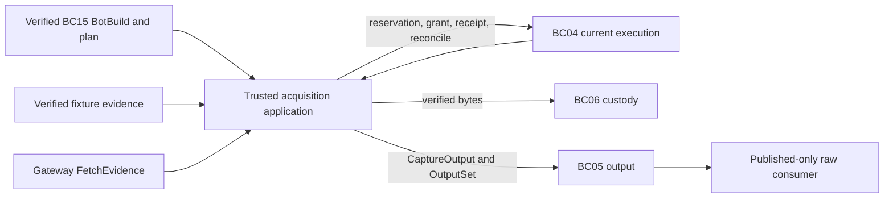

# Trusted Acquisition Application — M2 implementation evidence

**Status:** local implementation under review on `feat/trusted-acquisition-application`; not committed, published, or integrated. ADR 027 remains Proposed. This record supplements, rather than replaces, the comparative [acquisition maturity assessment](acquisition-platform-maturity-assessment-2026-11-25.md).

## Decision and ownership

The import workflow is an in-process application composition boundary at `apps/acquisition-application/`, not a new bounded context or deployable. Neither BC04, BC05 nor BC15 owns all of its semantics, and BC06/gateway authorities must remain distinct. The decision and rejected ownership alternatives are recorded in [ADR 027](../decisions/027-trusted-acquisition-application.md).

| Capability | Owner | Application relationship |
|---|---|---|
| Current attempt, generation, execution validity, reservation, terminal completion | BC04 | Reads current execution through a narrow reader port; delegates finalization and reconciliation to the existing coordinator protocol |
| Result contract, BotBuild identity, compiled-plan interpretation | BC15 | Verifies exact build files and manifest, parses generated plan literals without executing generated code, recomputes records from trusted page bytes |
| Live operation admission and `FetchEvidence` | Acquisition Gateway | Live adapter resolves evidence from gateway and checks tenant/run/attempt/generation/source/policy/release/build bindings |
| Fixture evidence | Immutable fixture bundle and BC15 build binding | Separate fixture verifier; never accepted as live evidence |
| `CaptureOutput`, `OutputSet`, stage/seal/publish and `PublicationReceipt` | BC05 | Constructs deterministic output identities and calls BC05 application interfaces |
| Logical artifacts, byte inventory, custody and receipt | BC06 | Application adapter calls the public HTTP intent/upload/verification contracts; no private persistence access |
| Composition, result validation and use-case sequencing | Trusted acquisition application | No provider domain state, migrations, keys, scheduling, persistence or second finalization protocol |

## Implementation map

- `application.py` provides fixture/live verification, output import, completed-result replay, and delegation to BC04 finalization/reconciliation.
- `context.py` resolves trusted execution binding and rejects wrong tenant/run, stale/expired active attempts, and nonterminal states. Completed replay is permitted only when BC04 is succeeded and has both reservation and publication receipt; the bundle-derived deterministic OutputSet must match BC04's binding and the already-published BC05 snapshot.
- `compiled_plan.py` verifies BotBuild integrity and exact manifest/build/source/runtime identity, safely reads bounded regular files, and extracts only literal plan/runtime metadata from the generated entrypoint AST. Generated code is never executed by the importer.
- `result_bundle.py` owns bounded bundle reads, closed file membership, safe paths, duplicate-key strict JSON, digest/report checks, fixture evidence, and record provenance.
- `live_evidence.py` uses a separate gateway evidence adapter. Worker-declared bytes and evidence metadata are not authoritative. Gateway metadata and bytes are bound to the admitted execution, and the compiled plan is re-evaluated against those bodies.
- `plan_validation.py` reuses BC15's supported HTML/JSON interpretation to compare complete record/provenance results. It contains no controlled expected values.
- `adapters/artifact_custody.py` performs only the consumer-side BC06 request/response contract and bounded upload; it has no business retry policy, provider storage knowledge, or BC06 state.
- `ports.py` contains consumer-owned custody and finalization ports. BC05 output staging is invoked through BC05's existing application interface.
- `identities.py` defines deterministic IDs for idempotent custody, operations, observations, and output sets.

`apps/execution-coordination/src/execution_coordination/domain.py` now owns the deterministic request-identity projection used by BC04 and the result verifier; the worker adapter re-exports it for compatibility. It is a BC04 domain projection, not an extracted shared library.

## Tooling and test-oracle boundary

The former `tooling/fixture_acquisition.py` and `tooling/live_acquisition_import.py` carried reusable validation/import orchestration and live imported fixture-private types/helpers. Their production-relevant behavior moved into the application. The scenario harnesses now invoke it and retain controlled test setup, source/authority construction, fault injection, and independent expected records.

The application does not consume expected output values, fixture page sequences, test keys, scenario record counts, or fault checkpoints. Fixture bytes are evidence inputs, not expected-output oracles. The controlled harness compares accepted outputs to independent expected records after application validation. Invalid output and interruption cases remain scenario setup/assertions in tooling.

## Contract resolution and libraries

`ExactJSONSchemaPayloadContractValidator` checks immutable schema bytes against the declared `PayloadContractRef` digest, validates the schema, and rejects a differing reference. The current controlled composition supplies the immutable contract document. BC04's current binding and the current BotBuild do not yet provide a general release-bound contract resolver. M3 must establish that resolution and compatibility policy; M2 does not claim a schema registry.

This is the M2 implementation snapshot. The M3 local increment supersedes the resolver and release-binding status through the BC08 installed catalog, BotRelease v2 and BC04 binding documented in [the M3 assessment](immutable-contract-resolution-2026-11-25.md); it does not retroactively change M2 evidence.

No general library or SDK was promoted. The bundle reader has one trusted application consumer; the worker is the producer of a BC15 result contract, not a compatible reader consumer. Strict JSON behavior has trust-boundary-specific size/error requirements. The BC06 upload use case has one consumer; BC05's verifier does not share the same lifecycle/API. Keep these L0 owner-local implementations and adapters under the existing L0–L4 governance. Revisit extraction only with a named compatible consumer, stable public API, conformance tests, versioning, and rollback plan.

## Consistency, replay and resource bounds

The application does not infer terminal success. Active imports are staged through BC05 and finalization delegates to BC04's existing reservation/grant/receipt path. Lost acknowledgments use the current reconciliation path. Completed replay is read-only: it checks trusted BC04 success/reservation/receipt, deterministic OutputSet identity, exact run/attempt/fence/source/producer binding, published state, member count, payload contract and manifest digest. It performs no BC06 upload and no BC05 staging.

No cross-store ACID or exactly-once claim is made. A failure before reservation can leave privately staged, unpublished BC05 members; published-only consumers cannot read them, and cleanup remains governed by existing BC05 behavior. BC04 reservation recovery remains unchanged.

The importer preserves existing file counts, per-file and aggregate bundle limits, evidence response limits, gateway quotas, deadlines, and BC06 upload cap. It still materializes bounded records and verified response bodies. No streaming redesign, multipart upload, throughput, or memory improvement is claimed.

## Local validation record

This section records exact local commands and results; external-source access is excluded. Update it after final regression review. No M2 remote CI exists because the branch is unpublished.

### Test discovery reconciliation

The prior M1 report recorded 225 tests in the root suite. The current `make check` discovers 220 root tests plus 6 separately discovered acquisition-application tests (226 executed across those two commands, with 26 environmental/profile skips in the root suite). This is not a lost production contract suite: `tests/test_live_acquisition_import.py` changed from 9 to 4 tests when five tests of the old test-oriented extraction/pagination helper functions were removed; the replacement validates worker output by recomputing against compiled plan and trusted body bytes. `tests/test_fixture_acquisition.py` remains at 9 tests, now exercising the application-owned reader. The application target adds six context and authenticated-transport tests. Integration targets below exercise the end-to-end behaviors formerly asserted by local helper tests. Counts are reported per discovery target, not added to claim that skipped tests passed.

| Command | Result |
|---|---|
| `uv run --locked python tooling/check_architecture.py` | Passed after allowing application ports to depend on BC04's durable domain interface |
| `uv run --locked --all-packages python -m unittest tests.test_fixture_acquisition tests.test_live_acquisition_import -v` | 13 passed |
| `uv run --locked --package mozaic-trusted-acquisition-application python -m unittest discover -s apps/acquisition-application/tests -v` | Final run passed 6 tests, including completed replay's exact BC04 receipt gate and authenticated HTTP redirect rejection for BC06 and gateway evidence clients. |
| `make check` | Final run passed: 220 root Python tests, 26 explicit environmental skips (database URL absent / Docker-profile-only tests), 6 acquisition-application tests, Go tests, lint, formatting, docs (76 Markdown files), 9 migration names, naming and architecture checks. |
| `make collector-cross-backend-conformance scrapy-collector-multibot-conformance execution-coordination-protected-e2e acquisition-live-gateway-container-smoke execution-coordination-fixture-acquisition authorized-live-json-acquisition` | Passed. Cross-backend JSON/HTML/pagination parity retained provenance/order and network denial; multi-bot passed; protected execution exercised callback failure, cancellation, crash/recovery, healthy-after-crash, HTML/JSON/pagination and timeout; gateway smoke denied direct/unauthorized routes; fixture and live JSON publication passed. |
| `make execution-coordination-fixture-acquisition` | Passed twice, including after final application changes. Real local BC04 PostgreSQL, BC05 MongoDB, BC06 custody and protected Scrapy worker; network `none`; fresh-process completed-result replay and authorized publication passed. |
| `make authorized-live-json-acquisition` | Passed twice, including after final application changes. Controlled TLS source, isolated gateway/worker networks, authoritative evidence, custody, BC05 publication, BC04 completion, and independent expected-output assertions passed. |
| `make authorized-live-html-acquisition authorized-live-pagination-acquisition authorized-live-pagination-planned-acquisition authorized-live-redirect-acquisition authorized-live-redirect-denial authorized-live-redirect-budget-exhaustion authorized-live-publication-ack-loss authorized-live-pagination-cancellation authorized-live-custody-interruption authorized-live-partial-stage-interruption` | Passed after the final importer safeguards. HTML, natural/planned pagination and authorized redirect published; denied/budget-exhausted redirects and cancellation produced no publication; lost acknowledgment reconciled; custody interruption and partial staging produced no published output. |
| `for scenario in gateway-restart oversized slow malformed invalid-output interrupted-body pagination-incomplete; do make authorized-live-scenario CASE="$scenario" || exit $?; done` and isolated reruns | The first sequential loop stopped at `slow`: gateway authorization became unavailable before the run's 15-second controlled policy window and the harness rejected that diagnostic; it produced no publication. `make authorized-live-scenario CASE=slow` then passed in isolation with the expected `upstream_request_failed` diagnostic and no receipt. A second loop of `gateway-restart oversized malformed invalid-output interrupted-body pagination-incomplete` passed; all six reached expected failure/recovery outcomes with no invalid publication. The initial timing-sensitive slow failure is retained here rather than reported as a pass. No external source was contacted. |
| M1 regression baseline | PR #23 head `5d04dca9ecee66729279d9eab715079d915384bb` integrated as `f9e53d325a8167b380d31a66d925c89ab05a4fa0`; all seven remote PR checks passed. M1 local conformance evidence is in the preceding assessment section. |

After the final test-support extraction and importer safety fixes, `make check` passed (220 root Python tests, 26 explicit environment/profile skips, 6 application tests, Go tests, lint, formatting, documentation, naming, migration, and architecture checks). The gateway container smoke, fixture, live JSON, HTML, pagination, redirects, recovery and failure matrices were rerun against this tree; the timing-sensitive `slow` case required the documented isolated rerun. The subsequent changes bounded the local execution-report schema read and stopped authenticated evidence/custody clients from following redirects. `git diff --check` and final single-checkout/working-tree review are part of delivery review. No M2 remote CI exists until the branch is published.

## Limits and next increment

- Source and BotRelease lifecycle are still test-generated and do not constitute a general operational registry.
- Payload schema resolution is not release-bound; M3 must define immutable ID/version/digest lookup and compatibility behavior.
- No BC13 Work Intake exists.
- Raw-only arbitrary file acquisition and composite file policy expansion are out of scope.
- The in-process composition is suitable for the current local vertical; no independently operated service API is implied.
- Production deployment authorization, HA, source-specific contract migration, and broad streaming work remain later reviewed increments.

No external source, Banco Central Focus, CVM, Nx, new messaging infrastructure, speculative service, or extra worktree was used for this increment. ADR 027 remains Proposed.
