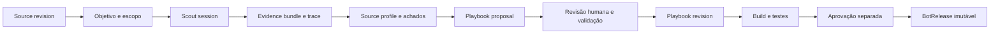
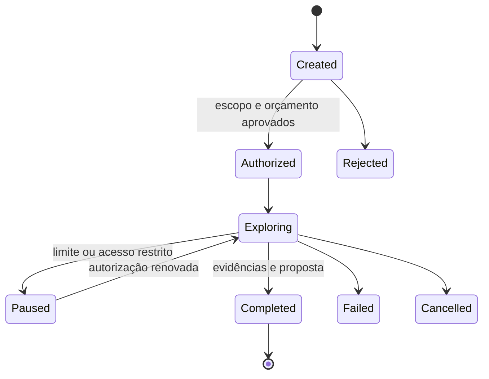
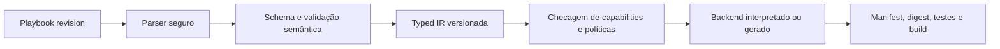
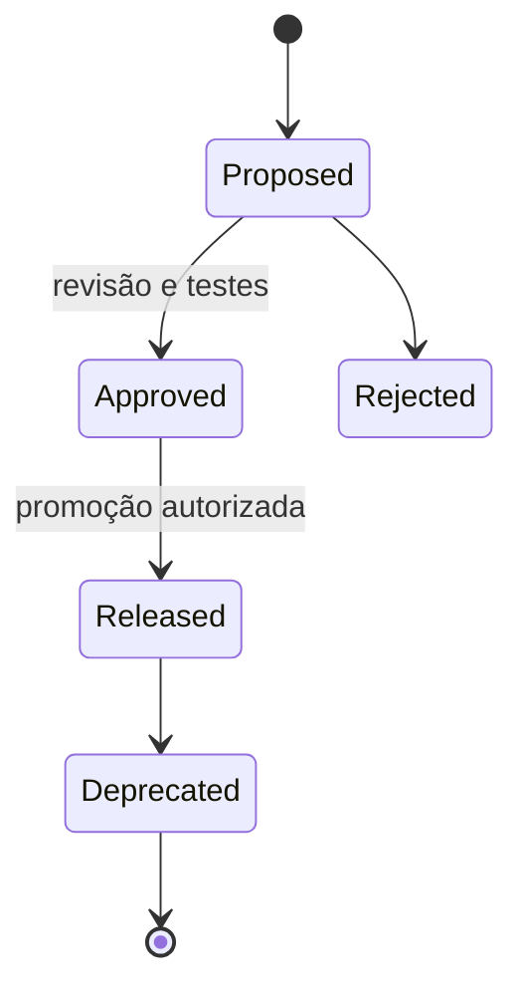

# Scout, playbook e compilação

**Proposta.** O Scout produz conhecimento e propostas, não código confiável automaticamente. Seu objetivo, escopo de domínios, paths, métodos, credenciais permitidas, orçamento, duração, ferramentas e aprovador são fixados antes da sessão. Adapter de agente recebe apenas ferramentas autorizadas e dados minimizados; browser e agente são isolados. Captcha, bloqueio ou autenticação não autorizada interrompem e geram sinalização, nunca contorno.

| Conceito / dono BC14 | Atributos, relação, ciclo e invariantes |
|---|---|
| ScoutSession (root) | ID, source revision, objetivo, escopo, orçamento, versão de agente/ferramentas, timestamps, status acima; não navega antes de autorização nem após expiração |
| ScoutObjective (VO) | pergunta, classe de dados, critérios de sucesso e limites; pertence à sessão e é imutável durante exploração; mudança cria revisão autorizada |
| SourceObservation (entidade) | tempo, tipo, valor observado, referência a evidência e origem; append-only; hipótese é distinta de fato |
| EvidenceBundle (entidade) | IDs de artefatos, hashes, classificação, retenção e proveniência; aberto → selado; selado é imutável, sem segredos |
| NavigationTrace (entidade) | sequência sanitizada de ações, URLs e resultados autorizados, timestamps e referências; parcial ou selada; não armazena tokens |
| DiscoveryFinding (entidade) | paginação, documentos/endpoints, tipo de dados ou pré-requisito autorizado; hipótese, confiança e evidências; proposto → revisado/rejeitado; confiança é declaração não prova |
| SourceProfile (artefato versionado) | sumário de estrutura, limites, estratégias e achados referenciados; draft → revisado → substituído; sujeito a drift |
| PlaybookProposal (entidade) | draft declarativo, suposições, referências de evidência, capacidades e riscos; proposto → aceito/rejeitado; aceite cria revisão em BC15, não release |

Conteúdo de páginas e arquivos, inclusive instruções em linguagem natural, é dado não confiável: não altera missão, permissões ou acesso a segredos. Separar instruções de sistema das observações, reduzir ferramentas, auditar ações, validar saídas e exigir revisão para promoção; nenhuma técnica de prompt isolada garante segurança. Descoberta de paginação, documentos, endpoints e requisitos de autenticação registra o que foi observado e sua confiança, não concede direito de acesso.

## DSL proposta e IR

Autoria YAML é legível, mas aceitar somente subconjunto seguro (sem tags arbitrárias, aliases ilimitados ou chaves duplicadas); normalização para JSON canônico e JSON Schema declarado por versão. JSON direto é alternativa mais simples e menos ambígua. Não há schema homologado. Uma revisão contém ID e versão da DSL, SourceRef fixo, contrato e parâmetros de input tipados, escopo permitido, DAG limitado de operações, seletores declarativos, paginação com limites, condições de término, capabilities, budgets, erros e contratos raw/receipt. Referências externas incluem versão e digest verificado; segredos apenas por referência autorizada.

Primitivas candidatas: fetch, navigate, select, extract referência, descobrir links, iterar página com limite, emitir artefato e condição simples. Não incluir loops ilimitados, eval, shell ou código arbitrário. Controle de fluxo acíclico com iteração delimitada; expressões puras pequenas, tipos e dependências explícitas. Operações específicas entram por plugin assinado e revisado, com versão e capacidade; sem escape hatch de código embutido. A seleção de sintaxe e semântica requer exemplos reais e revisão de segurança antes de publicar contrato.

IR é grafo tipado e determinístico de operações com IDs, entradas/saídas e dependências, controle de fluxo e limites finitos, requirements de capability, constraints de recursos, error policy, metadados de execução e contratos de output. Validador detecta ciclos não autorizados, variáveis ausentes, incompatibilidades, violações de escopo e limite antes do build. Sem imports Scrapy/Playwright, código executável ou dependência de engine. Captura do estado do browser pode limitar portabilidade e deve ser declarada, não escondida.

| Critério | Geração de código | Interpretação da IR |
|---|---|---|
| Desempenho | otimização específica possível; medição necessária | overhead e despacho; provavelmente aceitável para I/O, hipótese |
| Flexibilidade / manutenção | código por backend e centenas de bots aumentam superfície | runtime único facilita correções, aumenta impacto de regressão |
| Segurança | código gerado precisa revisão e sandbox | superfície restrita, plugins ainda requerem isolamento |
| Observabilidade / debugging | rastreamento requer source maps e build | IDs de nós da IR permitem rastreamento uniforme |
| Reprodutibilidade / portabilidade | depende de compilador e dependências fixadas | IR e runtime pinados; efeitos externos não são determinísticos |
| Versionamento | artefato e gerador por backend | versão de IR, runtime e compatibilidade explícitas |

Recomendação: interpretação como padrão inicial, gerador especializado apenas após evidência de necessidade; ambos consomem IR e produzem manifest equivalente. Build reproduzível exige entradas e toolchain imutáveis, não promete resposta remota reproduzível.

## Ciclos independentes

Playbook: draft → validated, nova revisão para alteração. CompilationRequest: pending → running → succeeded/failed. BotBuild: built → tested/failed. BotRelease: proposed → approved → released → deprecated; conteúdo imutável desde criação, status de governança registrado separadamente. Deployment: pending → canary → active → rolled back/retired; BotHealth é observação temporal. BotCompatibility relaciona DSL/IR/runtime/SDK/capabilities e versão de backend, não um estado de release. Compilação SDK incompatível falha antes de gerar release.

Releases fixam digest de playbook, IR, artefato, compilador, SDK, runtime, plugins e declaração de capabilities. Runs ativas continuam fixadas na release original mesmo após troca; revogação de segurança pode cancelar explicitamente. Sinais de saúde (erro, seletor, schema, volume, paginação e HTML) criam incidente; Scout investiga e propõe revisão, teste de regressão e comparação de artefatos, canary e aprovação antecedem promoção. Rollback seleciona release anterior permitida sem reescrever histórico.
