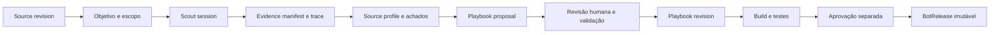
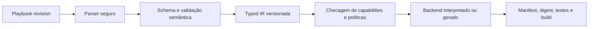
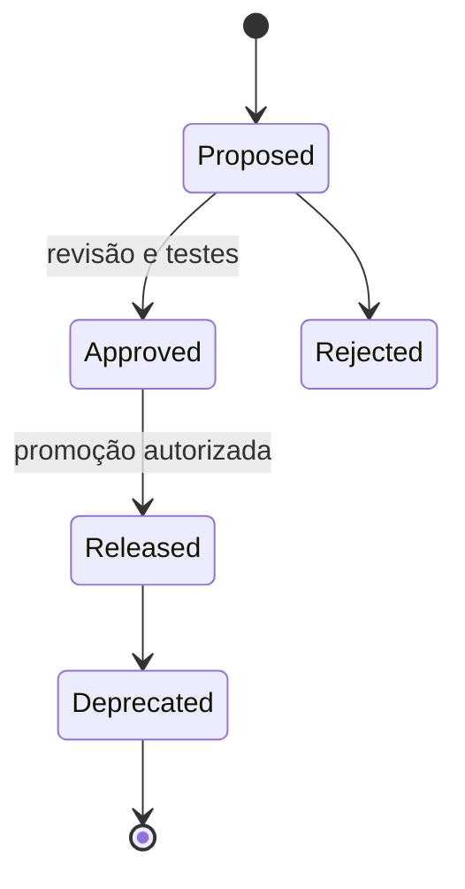

# Scout, playbook e compilação

**Proposta.** O Scout produz conhecimento e propostas, não código confiável automaticamente. Seu objetivo, escopo de domínios, paths, métodos, credenciais permitidas, orçamento, duração, ferramentas e aprovador são fixados antes da sessão. Adapter de agente recebe apenas ferramentas autorizadas e dados minimizados; browser e agente são isolados. Captcha, bloqueio ou autenticação não autorizada interrompem e geram sinalização, nunca contorno.

O modelo detalhado, ciclo de sessão e responsabilidades de evidência foram refinados em [BC14 Scout — S0](scout.md). O manifesto BC14 referencia artefatos sob custódia BC06; proposta para BC15 não é release.

## DSL proposta e IR

Autoria YAML é legível, mas aceitar somente subconjunto seguro (sem tags arbitrárias, aliases ilimitados ou chaves duplicadas); normalização para JSON canônico e JSON Schema declarado por versão. JSON direto é alternativa mais simples e menos ambígua. O [CapturePlaybook draft v1](../../contracts/capture-playbook/draft/v1/CapturePlaybook.schema.json) é illustrative e não homologado: permite somente HTTP fetch, descoberta de links, paginação limitada e saída raw. Uma revisão futura pode ter ID e versão da DSL, SourceRef fixo, contrato e parâmetros de input tipados, escopo permitido, DAG limitado de operações, condições de término, capabilities, budgets, erros e contratos raw/receipt. Referências externas incluem versão e digest verificado; segredos apenas por referência autorizada.

Primitivas candidatas: fetch, navigate, select, extract referência, descobrir links, iterar página com limite, emitir artefato e condição simples. Não incluir loops ilimitados, eval, shell, código arbitrário ou uma API genérica de plugins sem consumidores reais. Controle de fluxo acíclico com iteração delimitada; tipos e dependências explícitas. Uma operação nova exige contrato versionado, consumidor, capability explícita e testes próprios. A seleção de sintaxe e semântica requer exemplos executáveis e revisão de segurança antes de promover o contrato.

IR é grafo tipado e determinístico de operações com IDs, entradas/saídas e dependências, controle de fluxo e limites finitos, requirements de capability, constraints de recursos, error policy, metadados de execução e contratos de output. Validador detecta ciclos não autorizados, variáveis ausentes, incompatibilidades, violações de escopo e limite antes do build. Sem imports Scrapy/Playwright, código executável ou dependência de engine. Captura do estado do browser pode limitar portabilidade e deve ser declarada, não escondida.

| Critério | Geração de código | Interpretação da IR |
|---|---|---|
| Desempenho | otimização específica possível; medição necessária | overhead e despacho; provavelmente aceitável para I/O, hipótese |
| Flexibilidade / manutenção | código por backend e centenas de bots aumentam superfície | runtime único facilita correções, aumenta impacto de regressão |
| Segurança | código gerado precisa revisão e sandbox | superfície restrita, plugins ainda requerem isolamento |
| Observabilidade / debugging | rastreamento requer source maps e build | IDs de nós da IR permitem rastreamento uniforme |
| Reprodutibilidade / portabilidade | depende de compilador e dependências fixadas | IR e runtime pinados; efeitos externos não são determinísticos |
| Versionamento | artefato e gerador por backend | versão de IR, runtime e compatibilidade explícitas |

Recomendação: interpretação como padrão inicial, gerador especializado apenas após evidência de necessidade; ambos consomem IR e produzem manifest equivalente. Build reproduzível exige entradas e toolchain imutáveis, não promete resposta remota reproduzível.

## PR #10 — draft/v2 e Python HTTP Reference

O incremento vertical de BC15 adiciona `contracts/capture-playbook/draft/v2/` sem mudar o contrato nem os consumidores do draft/v1. O v2 continua draft/illustrative. Seu subconjunto cobre fixture fetch, descoberta observada, paginação finita, seleção HTML/JSON, mapeamento tipado e output JSONL/raw-reference. `browser.render_dom/v1` e seleção rendered DOM são reconhecidos como requisitos de contrato, mas o backend Python HTTP Reference não os suporta e rejeita build antes de publicar diretório.

`collector-engineering` transforma documento parseado e validado em `collector-ir/v1`, com operações versionadas, named bindings, tipos, dependências, capabilities, budgets, evidências e failure policy. A geração produz passos Python específicos da IR e usa somente a runtime de referência offline e fixtures com digest. O teste de exemplo roda sob sandbox do sistema operacional; nenhum fetch de rede real é implementado por este backend.

A referência de execução, perfil de capabilities e casos executáveis estão em [examples/playbooks](../../examples/playbooks/README.md); operação do CLI é descrita em [CapturePlaybook drafts](../operations/capture-playbook-drafts.md). Essa cadeia prova extração e acceptance contra fixtures sintéticas, não navegação remota autorizada, custody produtiva, aprovação de BotRelease ou runtime de produção. ADR 013 e ADR 017 continuam Proposed; os gates de deployment Scout descritos em ADR 017 permanecem separados.

## Backend Scrapy fixture-only — incremento proposto

O backend `scrapy-fixture` também consome somente `collector-ir/v1`; não lê YAML nem redefine semântica. Seu gerador em BC15 emite uma Spider determinística, callbacks por operação suportada, Requests e uma configuração fechada. Scrapy Engine/Scheduler/Downloader organizam aquisição e paginação; um handler próprio resolve apenas URLs HTTP/HTTPS exatas do índice verificado. O handler não delega a download handlers de rede. Schemes não usados, retries, redirects, cookies, extensões, middleware padrão, feeds e settings de projeto ficam desabilitados.

Parser, conversões de campos, cardinalidade, normalização e provenance permanecem na runtime interna BC15 compartilhada pelos dois backends. Isso evita que Parsel/lxml introduzam semântica paralela; o custo é copiar os poucos módulos próprios usados para dentro de cada build. Dependências externas continuam pinadas no `uv.lock`. `BotBuild` verifica arquivos, hashes individuais e digest agregado da runtime; o runner confirma que importou os arquivos embutidos. Hash não prova origem nem autorização.

O primeiro perfil não declara `browser.rendered_dom` e falha antes de produzir build para capabilities ou grafos não suportados. Não há fallback de backend. A suite compara os dois builds contra oracles independentes e executa conformance com negação de rede. Em Linux, isolamento efetivo exige container não-root, root filesystem read-only, mounts de fixtures/build read-only, limites de recursos e `--network none`. A execução macOS por `sandbox-exec` é evidência local menos restritiva, não substitui o gate Linux.

Esse incremento continua sem execução produtiva, worker distribuído, autorização de run, BotRelease ou Playwright. Validação de playbook e verificação de build são pré-requisitos técnicos, não autorização de execução.

## Ciclos independentes

Playbook: draft → validated, nova revisão para alteração. CompilationRequest: pending → running → succeeded/failed. BotBuild: built → tested/failed. BotRelease: proposed → approved → released → deprecated; conteúdo imutável desde criação, status de governança registrado separadamente. Deployment: pending → canary → active → rolled back/retired; BotHealth é observação temporal. BotCompatibility relaciona DSL/IR/runtime/SDK/capabilities e versão de backend, não um estado de release. Compilação SDK incompatível falha antes de gerar release.

Releases fixam digest de playbook, IR, artefato, compilador, SDK, runtime, plugins e declaração de capabilities. Runs ativas continuam fixadas na release original mesmo após troca; revogação de segurança pode cancelar explicitamente. Sinais de saúde (erro, seletor, schema, volume, paginação e HTML) criam incidente; Scout investiga e propõe revisão, teste de regressão e comparação de artefatos, canary e aprovação antecedem promoção. Rollback seleciona release anterior permitida sem reescrever histórico.
