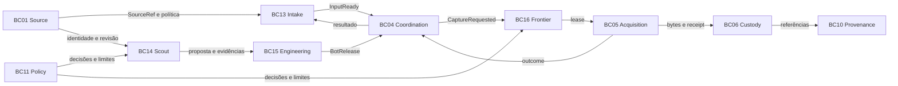

# Domínio e mapa de contextos

**Proposta.** Classificação estratégica é hipótese para revisão. Um contexto possui linguagem e estado, não implica banco, serviço ou deploy separado. IDs BC01–BC16 preservam o vocabulário de discussão, não são nomes de módulos obrigatórios.

| ID / contexto | Classificação | Estado próprio e fronteira |
|---|---|---|
| BC01 Source Catalog | supporting | Source e revisões de configuração; não faz descoberta autônoma |
| BC02 Extension Catalog | generic/supporting | metadados e compatibilidade de extensões; não aprova releases de bot |
| BC03 Pipeline Design | futuro supporting | definição de pipelines; não agenda tarefas internas de crawl |
| BC04 Execution Coordination | supporting | CaptureRun, tentativas, conclusão e cancelamento; não possui a frontier |
| BC05 Acquisition | core | semântica de captura, CaptureReceipt, CaptureOutcome, CaptureOutput e OutputSet; execução pode coexistir com BC16 |
| BC06 Artifact Custody | supporting | identidade, localização, integridade, classificação e retenção do artefato; não interpreta conteúdo |
| BC07 Parsing & Normalization | futuro supporting | transformações derivadas, sem alterar raw |
| BC08 Contract & Quality | supporting (contract-resolution inicial) | identidade e revisões imutáveis de contratos; qualidade de datasets segue futura; não valida sozinho evidência de Scout |
| BC09 Dataset Publishing | futuro supporting | versões de datasets publicados |
| BC10 Provenance & Audit | supporting transversal | registros de linhagem/auditoria; não substitui estado transacional de origem |
| BC11 Policy & Access | generic/supporting | políticas e concessões; enforcement também ocorre em workers e rede |
| BC12 Delivery | futuro supporting | distribuição ao consumidor; diferente de publicação de dataset |
| BC13 Work Intake | supporting | Input e seu ciclo lógico de atendimento/reprocessamento |
| BC14 Source Intelligence | core | ScoutSession, achados, evidências e propostas; não promove bots |
| BC15 Collector Engineering | core | revisões de playbook, builds, aprovação e BotRelease imutável |
| BC16 Crawl Frontier & Bot Fleet | supporting | tarefas internas, leases, budgets e disponibilidade de workers; não possui CaptureRun ou Input |

BC05/BC16 são distinguíveis pela semântica de captura versus agendamento de tarefas; começar como módulos no mesmo deploy e fundir o limite se não houver linguagem ou ownership independente. BC02 descreve plugins; BC15 é dono do release. BC04 coordena execução; BC13 controla trabalho lógico. BC10 ingere fatos, não comanda estado alheio.

`apps/acquisition-application/` é uma composição interna de aplicação, não um novo BC ou serviço. Ela verifica resultados e coordena interfaces existentes entre BC04 (execução/finalização), BC05 (CaptureOutput/OutputSet), BC06 (custody), BC15 (plano/semântica do resultado) e o gateway (evidência live). Ver [README](../../apps/acquisition-application/README.md), [ADR 027 Proposed](decisions/027-trusted-acquisition-application.md) e [evidência M2](assessments/trusted-acquisition-application-2026-11-25.md). Nenhum owner transfere estado ou decisão para essa aplicação.

## Contratos táticos dos contextos de aquisição

Em todos, comandos exigem autorização e chave idempotente; eventos são fatos após commit com outbox; falhas transitórias podem repetir, violações de contrato ou política exigem intervenção. Armazenamento e implementação são propostas, não serviços existentes. Testes incluem invariantes, duplicação e autorização para cada contexto.

### BC01 Source Catalog
- Linguagem: Source, SourceRevision, escopo, credencial referenciada. Aggregate root: Source; entidades revisões; VOs SourceRef e AccessScope. Invariante: revisão identificável e política vigente nunca ampliada implicitamente.
- Comandos `RegisterSource`, `ReviseSource`; eventos `SourceRegistered`, `SourceRevised`; contrato SourceRef e snapshot autorizado. Dependência BC11; dono de configuração de source; persistência transacional e histórico. Revogação bloqueia execução; credenciais são referências, nunca valores. Não explora nem captura. Alternativa: módulo junto ao intake; testes de versionamento/revogação.

### BC13 Work Intake
- Linguagem: Input, geração, reprocessamento. Root Input; entidade tentativa lógica; VOs parâmetros e chave de intenção. Invariante: reprocessamento explícito gera identidade de intenção distinta; uma URL descoberta não é Input global.
- Comandos `CreateInput`, `ReprocessInput`; eventos `InputReady`, `InputCompleted`; contrato CaptureInput. Depende SourceRef e recebe outcome de BC04; possui intenção e status do input, transação/outbox; conflito de idempotência rejeitado. Autorização por source/tenant. Não controla requests ou leases. Alternativa módulo no control; testes de duplicação e reprocessamento.

### BC14 Source Intelligence
- Linguagem: ScoutSession, objetivo, hipótese e evidência. Root ScoutSession; entidades e VOs detalhados em [Scout S0](scout.md). Invariante: qualquer conclusão aponta evidência e confiança, não implica autorização ou aprovação.
- `StartScout`, `RecordFinding`, `SubmitProposal`; eventos `ScoutCompleted`, `ProposalSubmitted`; contratos draft ScoutRequest, EvidenceManifest, DiscoveryFinding e PlaybookProposal; SourceProfile futuro. Depende BC01/BC11 e custódia BC06; possui sessão/observações e referências, persistência auditável. Violação de escopo interrompe; isolamento e egress obrigatórios. Não executa release. Alternativa processo manual sem IA; teste prompt injection e escopo.

### BC15 Collector Engineering
- Linguagem: PlaybookRevision, build, release. Roots Playbook e BotRelease; build é agregado com ciclo independente; VOs digest e compatibility. Invariante release imutável fixa revisão, compilador, SDK e artefato; aprovação é separada da geração.
- `ValidateRevision`, `Compile`, `ApproveRelease`; eventos `BotBuilt`, `BotReleased`; contratos de playbook e manifests. Depende proposta de BC14 e catálogo de capacidade BC02; possui revisões/build/release, persistência imutável e assinaturas futuras. Incompatibilidade bloqueia build; acesso separado para autoria/aprovação. Não executa frontier. Alternativa CLI + registro antes de serviço; testes determinísticos, compatibilidade e autorização.

### BC04 Execution Coordination
- Linguagem: CaptureRun, tentativa, cancelamento. Root CaptureRun; entidades tentativas, VOs referência de release e deadline. Invariante run fixa input e release; apenas transições condicionais do dono encerram run.
- `StartCapture`, `CancelCapture`, `CompleteCapture`; eventos `CaptureRequested`, `CaptureCompleted`; contratos CaptureRun/Outcome. Depende BC13/BC15 e resultados BC05/BC16; possui run e tentativas, transações/outbox. Timeout não torna resultado tardio autoritativo. Não decide URLs internas. Controle por identidade; alternativas módulo ou serviço; testes corrida timeout/cancelamento.
- A implementação durável draft mantém Python e BC04 ownership: PostgreSQL possui Run, histórico de attempts, lease token/generation, reservation, command receipts e outbox. Reserva de finalização vincula uma única OutputSet e manifest; saída múltipla não é concluída atomicamente. O perfil continua fixture-only e a API/autenticação de serviço segue futura.

### BC16 Crawl Frontier & Bot Fleet
- Linguagem: CrawlTask, partição, lease, budget. Root FrontierPartition com tarefas e leases; VOs fingerprint, fencing token, SourceRatePolicy. Invariante lease monotônica e permissão global por origem antes de request; limite externo prevalece.
- `EnqueueTask`, `AcquireLease`, `CompleteTask`; eventos `TaskAvailable`, `FrontierDrained`; contrato interno CrawlTask/lease. Depende política BC11 e pedido BC04; possui tarefa, dedup, lease, token e budget em persistência durável/atômica. Falha do worker expira lease; tokens antigos são rejeitados. Não cria input para URL. Controle de egress também no worker. Alternativas PostgreSQL, Redis ou fila durável; testes concorrentes e crash.

### BC05 Acquisition
- Linguagem: request, fetch, receipt, outcome e output. Roots conceituais CaptureTask e OutputSet; OutputSet possui estado de publicação e contadores/manifests limitados, enquanto outputs são membros endereçados armazenados separadamente. Invariante: cada observação é distinta de seu natural key e do digest do payload; artefatos exigem recibo de custody antes de publicar; captura não confunde bytes HTTP originais com DOM ou registros derivados.
- `ExecuteTask`, `RecordReceipt`, `CreateOutputSet`, `StageOutput`, `SealOutputSet`, `PublishOutputSet`; fatos candidatos `FetchRecorded`, `OutputSetPublished` e `CaptureOutcomeReported`. `CaptureOutput` e `OutputSet` são contratos BC05 draft. Record, Artifact e Composite output compartilham envelope, identidade de producer extensível e referência de contrato versionada quando há payload. O port operacional retorna `OutputSetSnapshot` limitado, sem membros; o wire manifest completo permanece projeção separada. O digest v1 pode ser verificado por streaming ordenado dos membros.
- BC05 possui staging e publicação do OutputSet; BC04 possui tentativas, deadlines, cancelamento e decisão terminal; BC06 possui RawArtifact, digest, localização física, integridade, acesso e retenção; BC09 possui publicação de datasets derivados. `ArtifactRef` é identidade lógica e não URI de autorização. Um output pode omitir run/attempt para capacidades de aquisição sem bot; quando presentes, run e attempt são pares. Bot/release não são obrigatórios: producer pode identificar capacidade não baseada em bot.
- Depende dos contratos BC06 para custody confirmada e do binding BC04/BC15/BC16 quando a execução usa esses contextos. BC05 não consulta tabelas ou modelos internos dos owners. Persistência é datastore-independent no domínio; MongoDB é o adapter inicial. Para sets Run-bound, a publicação exige grant draft verificável emitido após reservation durável BC04. Não há transação distribuída nem revogação do grant após a reservation.
- Invariantes implementadas no primeiro incremento são locais a BC05: envelope/variants fechados, payload e artefatos limitados, contrato declarado, operação idempotente por intenção RFC 8785, OutputSet staging → sealed → published ou aborted/rejected, membership imutável após seal, validação de digest/count e publicação idempotente. Schema JSON é draft, não contrato aprovado. Adapters de persistence e custody são ports do consumidor; in-memory não fornece durabilidade nem coordenação distribuída.
- Implementação e contratos draft: [BC05 Acquisition Output](../../apps/acquisition-output/README.md), [CaptureOutput](../../contracts/acquisition-output/draft/v1/CaptureOutput.schema.json), [OutputSet manifest](../../contracts/acquisition-output/draft/v1/OutputSetManifest.schema.json) e [ADR 022 Proposed](decisions/022-bc05-acquisition-output.md).

### BC06 Artifact Custody
- Linguagem: RawArtifact, conteúdo, retenção. Root RawArtifact; entidade localização; VOs digest, classificação e política. Invariante identidade de observação não é hash; bytes compartilhados não compartilham automaticamente autorização ou retenção.
- `RegisterArtifact`, `ApplyRetention`; eventos `ArtifactStored`, `ArtifactRetired`; contrato RawArtifactRef. Depende armazenamento de objetos e BC11; possui metadados, classificação e retenção; objeto gravado mas não registrado é reconciliável. Segregação por tenant, criptografia e acesso auditado. Não altera payload ou interpreta dados. Alternativa adapter local inicial; testes de integridade, orfandade e autorização.

O estado executável draft está em [`apps/artifact-custody`](../../apps/artifact-custody/README.md): serviço Go, schema PostgreSQL BC06, adapter S3 compatível e contrato HTTP draft com consumidor Python BC05. O perfil local usa policy `local`/`test`; isto não implementa BC11, retenção automática, HA nem o protocolo de finalização BC04↔BC05. Veja [evidência local](assessments/bc06-artifact-custody-local-2026-11-24.md). Os nomes de eventos acima são direção de domínio; o envelope de contrato draft atual tem tipo versionado `data-mozaic.artifact.custody-confirmed.v1`.

### BC08 Contract & Quality — resolução inicial
- BC08 possui a semântica técnica de `ContractReference` e revisão imutável para payloads raw: identidade + versão + digest SHA-256 dos bytes UTF-8 exatos do schema. A instalação local em [`contracts/payload/draft/v1`](../../contracts/payload/draft/v1/README.md) é versionada e revisada em código; não é registry CRUD nem serviço independente.
- `libs/python/contract-resolution` resolve o registro instalado por referência exata e valida JSON Schema Draft 2020-12 autocontido com limites. O consumer atual é a composição de aquisição confiável; seu adapter fornece o port de validação de BC05. Schema inexistente, digest diferente, schema inválido, `$ref` e dialect não suportado falham fechado. Não há busca remota nem fallback de versão.
- O contrato BotRelease v2 (owner BC15) vincula a referência aprovada; BC04 copia-a para a binding durável do run. A aquisição não decide aprovação ou elegibilidade. Revisões antigas não são reinterpretadas. Qualidade de dataset, compatibilidade semântica automática, dependências de schemas e workflow administrativo persistido continuam futuros.

## BC14 S1

O subconjunto executável de ScoutSession, evidência, finding e proposta está descrito em [BC14 S1](scout.md). Referências a BC01, BC06 e BC11 não transferem ownership; os demais elementos desta página permanecem propostas.
