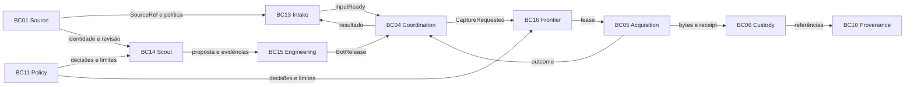

# Domínio e mapa de contextos

**Proposta.** Classificação estratégica é hipótese para revisão. Um contexto possui linguagem e estado, não implica banco, serviço ou deploy separado. IDs BC01–BC16 preservam o vocabulário de discussão, não são nomes de módulos obrigatórios.

| ID / contexto | Classificação | Estado próprio e fronteira |
|---|---|---|
| BC01 Source Catalog | supporting | Source e revisões de configuração; não faz descoberta autônoma |
| BC02 Extension Catalog | generic/supporting | metadados e compatibilidade de extensões; não aprova releases de bot |
| BC03 Pipeline Design | futuro supporting | definição de pipelines; não agenda tarefas internas de crawl |
| BC04 Execution Coordination | supporting | CaptureRun, tentativas, conclusão e cancelamento; não possui a frontier |
| BC05 Acquisition | core | semântica de captura, FetchReceipt e CaptureOutcome; execução pode coexistir com BC16 |
| BC06 Artifact Custody | supporting | identidade, localização, integridade, classificação e retenção do artefato; não interpreta conteúdo |
| BC07 Parsing & Normalization | futuro supporting | transformações derivadas, sem alterar raw |
| BC08 Contract & Quality | futuro supporting | contratos de dataset e regras de qualidade; não valida sozinho evidência de Scout |
| BC09 Dataset Publishing | futuro supporting | versões de datasets publicados |
| BC10 Provenance & Audit | supporting transversal | registros de linhagem/auditoria; não substitui estado transacional de origem |
| BC11 Policy & Access | generic/supporting | políticas e concessões; enforcement também ocorre em workers e rede |
| BC12 Delivery | futuro supporting | distribuição ao consumidor; diferente de publicação de dataset |
| BC13 Work Intake | supporting | Input e seu ciclo lógico de atendimento/reprocessamento |
| BC14 Source Intelligence | core | ScoutSession, achados, evidências e propostas; não promove bots |
| BC15 Collector Engineering | core | revisões de playbook, builds, aprovação e BotRelease imutável |
| BC16 Crawl Frontier & Bot Fleet | supporting | tarefas internas, leases, budgets e disponibilidade de workers; não possui CaptureRun ou Input |

BC05/BC16 são distinguíveis pela semântica de captura versus agendamento de tarefas; começar como módulos no mesmo deploy e fundir o limite se não houver linguagem ou ownership independente. BC02 descreve plugins; BC15 é dono do release. BC04 coordena execução; BC13 controla trabalho lógico. BC10 ingere fatos, não comanda estado alheio.

## Contratos táticos dos contextos de aquisição

Em todos, comandos exigem autorização e chave idempotente; eventos são fatos após commit com outbox; falhas transitórias podem repetir, violações de contrato ou política exigem intervenção. Armazenamento e implementação são propostas, não serviços existentes. Testes incluem invariantes, duplicação e autorização para cada contexto.

### BC01 Source Catalog
- Linguagem: Source, SourceRevision, escopo, credencial referenciada. Aggregate root: Source; entidades revisões; VOs SourceRef e AccessScope. Invariante: revisão identificável e política vigente nunca ampliada implicitamente.
- Comandos `RegisterSource`, `ReviseSource`; eventos `SourceRegistered`, `SourceRevised`; contrato SourceRef e snapshot autorizado. Dependência BC11; dono de configuração de source; persistência transacional e histórico. Revogação bloqueia execução; credenciais são referências, nunca valores. Não explora nem captura. Alternativa: módulo junto ao intake; testes de versionamento/revogação.

### BC13 Work Intake
- Linguagem: Input, geração, reprocessamento. Root Input; entidade tentativa lógica; VOs parâmetros e chave de intenção. Invariante: reprocessamento explícito gera identidade de intenção distinta; uma URL descoberta não é Input global.
- Comandos `CreateInput`, `ReprocessInput`; eventos `InputReady`, `InputCompleted`; contrato CaptureInput. Depende SourceRef e recebe outcome de BC04; possui intenção e status do input, transação/outbox; conflito de idempotência rejeitado. Autorização por source/tenant. Não controla requests ou leases. Alternativa módulo no control; testes de duplicação e reprocessamento.

### BC14 Source Intelligence
- Linguagem: ScoutSession, objetivo, hipótese e evidência. Root ScoutSession; entidades e VOs detalhados em [Scout S0](scout.md). Invariante: qualquer conclusão aponta evidência e confiança, não implica autorização ou aprovação.
- `StartScout`, `RecordFinding`, `SubmitProposal`; eventos `ScoutCompleted`, `ProposalSubmitted`; contratos draft ScoutRequest, EvidenceManifest, DiscoveryFinding e PlaybookProposal; SourceProfile futuro. Depende BC01/BC11 e custódia BC06; possui sessão/observações e referências, persistência auditável. Violação de escopo interrompe; isolamento e egress obrigatórios. Não executa release. Alternativa processo manual sem IA; teste prompt injection e escopo.

### BC15 Collector Engineering
- Linguagem: PlaybookRevision, build, release. Roots Playbook e BotRelease; build é agregado com ciclo independente; VOs digest e compatibility. Invariante release imutável fixa revisão, compilador, SDK e artefato; aprovação é separada da geração.
- `ValidateRevision`, `Compile`, `ApproveRelease`; eventos `BotBuilt`, `BotReleased`; contratos de playbook e manifests. Depende proposta de BC14 e catálogo de capacidade BC02; possui revisões/build/release, persistência imutável e assinaturas futuras. Incompatibilidade bloqueia build; acesso separado para autoria/aprovação. Não executa frontier. Alternativa CLI + registro antes de serviço; testes determinísticos, compatibilidade e autorização.

### BC04 Execution Coordination
- Linguagem: CaptureRun, tentativa, cancelamento. Root CaptureRun; entidades tentativas, VOs referência de release e deadline. Invariante run fixa input e release; apenas transições condicionais do dono encerram run.
- `StartCapture`, `CancelCapture`, `CompleteCapture`; eventos `CaptureRequested`, `CaptureCompleted`; contratos CaptureRun/Outcome. Depende BC13/BC15 e resultados BC05/BC16; possui run e tentativas, transações/outbox. Timeout não torna resultado tardio autoritativo. Não decide URLs internas. Controle por identidade; alternativas módulo ou serviço; testes corrida timeout/cancelamento.

### BC16 Crawl Frontier & Bot Fleet
- Linguagem: CrawlTask, partição, lease, budget. Root FrontierPartition com tarefas e leases; VOs fingerprint, fencing token, SourceRatePolicy. Invariante lease monotônica e permissão global por origem antes de request; limite externo prevalece.
- `EnqueueTask`, `AcquireLease`, `CompleteTask`; eventos `TaskAvailable`, `FrontierDrained`; contrato interno CrawlTask/lease. Depende política BC11 e pedido BC04; possui tarefa, dedup, lease, token e budget em persistência durável/atômica. Falha do worker expira lease; tokens antigos são rejeitados. Não cria input para URL. Controle de egress também no worker. Alternativas PostgreSQL, Redis ou fila durável; testes concorrentes e crash.

### BC05 Acquisition
- Linguagem: request, fetch, receipt, outcome. Root conceitual CaptureTask; entidades FetchAttempt/FetchReceipt; VOs fingerprint e capability. Invariante cada observação identifica run, tentativa e release; nunca confundir DOM com resposta HTTP original.
- `ExecuteTask`, `RecordReceipt`; eventos `FetchRecorded`, `CaptureOutcomeReported`; contratos CaptureReceipt e CaptureOutcome. Depende lease BC16, release BC15 e BC06; possui semântica e receipt confirmado, não a identidade de objeto físico. Receipts persistem transacionalmente ou com reconciliação; falhas de acesso não são retentadas cegamente. Worker isolado e com menor privilégio. Alternativa biblioteca com adapters; testes de conformidade e captura raw.

### BC06 Artifact Custody
- Linguagem: RawArtifact, conteúdo, retenção. Root RawArtifact; entidade localização; VOs digest, classificação e política. Invariante identidade de observação não é hash; bytes compartilhados não compartilham automaticamente autorização ou retenção.
- `RegisterArtifact`, `ApplyRetention`; eventos `ArtifactStored`, `ArtifactRetired`; contrato RawArtifactRef. Depende armazenamento de objetos e BC11; possui metadados, classificação e retenção; objeto gravado mas não registrado é reconciliável. Segregação por tenant, criptografia e acesso auditado. Não altera payload ou interpreta dados. Alternativa adapter local inicial; testes de integridade, orfandade e autorização.

## BC14 S1

O subconjunto executável de ScoutSession, evidência, finding e proposta está descrito em [BC14 S1](scout.md). Referências a BC01, BC06 e BC11 não transferem ownership; os demais elementos desta página permanecem propostas.
