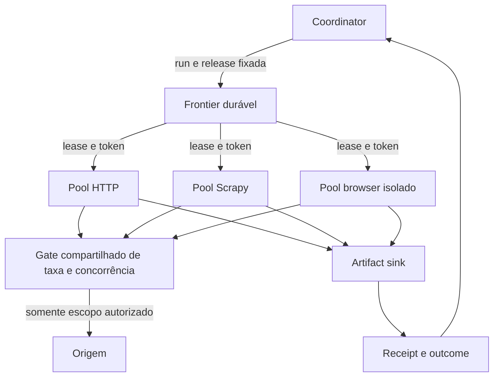
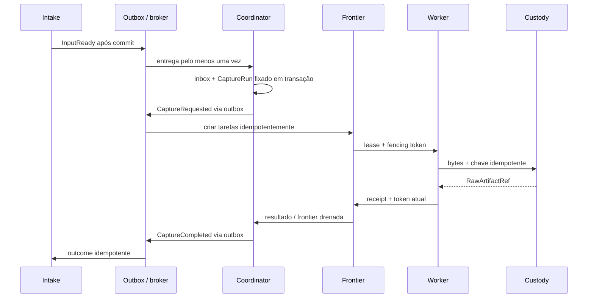
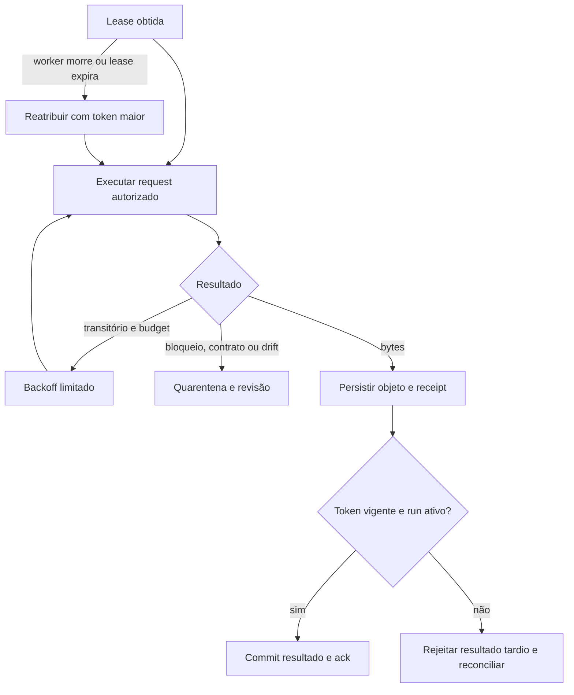

# Runtime, frontier e recuperação

**Proposta.** Input é unidade lógica de negócio; CaptureRun fixa um Input e BotRelease; CaptureTask representa execução associada ao run; CrawlTask é requisição/navegação interna potencialmente numerosa. FrontierPartition agrupa tarefas por chave operacional e dono de scheduling; RequestFingerprint versão sua canonicalização com método, URL normalizada, corpo e contexto relevante, nunca segredos em texto. WorkerLease contém ID, expiração e fencing token monotônico. CapacityBudget representa concorrência e taxa compartilhadas; SourceRatePolicy limita source e origem/domínio. CaptureCheckpoint guarda progresso serializável e referências, não memória de browser como promessa de retomada. FetchReceipt relata tentativa e observação; CaptureOutcome relata sucesso, parcialidade, falha ou cancelamento.

## SDK e backends

SDK público define tipos/portas estáveis e não importa workers. Começar com CaptureBackend (manifesto de capacidades e execução), FrontierPort (tarefas e leases), ArtifactSinkPort (bytes e registro), TelemetryPort e CheckpointPort somente quando houver consumidores. NetworkClient e BrowserSession são portas específicas de adapter; PageNavigation, RequestExecution e Selector podem ser primitivas internas, evitando interfaces redundantes. SessionState é capability opcional e material sensível. HTTP, Scrapy e Playwright expõem diferenças reais: scheduler Scrapy não é browser; browser tem JS, sessões, custos e isolamento distintos. Adapters declaram nome, versão, interface suportada, capacidades, dependências, restrições e runtime. Seleção combina requisitos, política, custo e compatibilidade; ausência de capability falha antes de executar. Suite de conformidade testa versões, limites, erros, cancelamento, emissão raw e observabilidade contra fixtures, além de testes específicos do backend.

Antes de **cada** request, inclusive redirects, o gate atômico adquire permissão por source e origem e respeita simultaneamente limites de concorrência e taxa; dez workers compartilham o mesmo estado de budget. Serviço/gate indisponível falha fechado. Uma permissão de concorrência tem lease expirada/reconciliada; limite de taxa consome token uma vez. Validar DNS/IP de destino e redirects em cada salto e no ponto de conexão; aplicar egress externo porque validação no cliente isolada não previne rebinding. Tráfego interno de browser, subresources e redirects também passa pelo enforcement ou é bloqueado. TLS, limites externos e políticas mais restritivas prevalecem.

Fair scheduling por source/tenant e prioridade com prevenção de starvation; pool por capacidade, limites por origem, backpressure quando filas, storage ou fonte saturam, jitter/backoff e circuit breaker por origem. Prioridade não atropela budgets. Cancelamento invalida geração/token, cessa novos leases, interrompe workers quando possível e reconcilia efeitos. Graceful shutdown para novos leases, termina ou abandona operações e não confirma trabalho incompleto. Não prometer exclusividade de acesso à fonte: processo velho pode ter efetuado request antes de perder lease; fencing protege commits internos, não efeitos externos.

PostgreSQL é candidato inicial: transação, unicidade e `FOR UPDATE SKIP LOCKED` para fila concorrente, com custo de vacuum, índices, contenção e ordenação não estrita. Redis pode oferecer baixa latência mas durabilidade, failover e atomicidade de dedup/leases exigem projeto e testes; fila durável oferece entrega mas não substitui estado transacional e dedup. Benchmark com volume, retenção, concorrência e recuperação reais orientará troca; sem estimativas homologadas. Particionar por source/tenant e medir hot partitions antes de distribuir.

JetStream é candidato a eventos operacionais, não banco de estado ou frontier automaticamente. Streams com retenção explícita e consumers duráveis/ack explícito; producer grava mudança e outbox na mesma transação; relay publica e aguarda confirmação, repetindo com ID estável; consumer grava inbox e mudança local na mesma transação antes do ack. Entrega pelo menos uma vez; efeitos externos precisam de idempotência/reconciliação próprios. Ordenação só dentro de partição/chave garantida pelo desenho específico; eventos levam versão de agregado e rejeitam ou reordenam versões inesperadas. Replay respeita retenção, autorização e isolamento de efeitos, preferencialmente projeção separada. DLQ/quarentena tem motivo, tentativas e procedimento de reintrodução; não descarta silenciosamente.

## Raw-first e consistência

Source → BotRelease → Input → CaptureRun → FetchReceipt → RawArtifact é relação de proveniência; o run também fixa versões de compilador, SDK e runtime. RawArtifact tem ID próprio, hash, tamanho, tipo, classificação, localização, política de retenção e metadados mínimos; hash identifica bytes, não observação. Resposta HTTP original e DOM renderizado são artefatos distintos com relação explícita; redigir headers sensíveis. Deduplicação física por hash não altera retenção e autorização individuais, nem é obrigatória entre tenants. Armazenamento imutável/versionado e verificação de digest são propostas; delete deve respeitar todas as referências e obrigações aplicáveis.

Gravar objeto com chave idempotente estável por tentativa/observação e digest verificado, depois registrar metadados/receipt com transação local e outbox. Escrita e banco não formam transação distribuída: reconciliador encontra objeto órfão e registro pendente; retenção de órfãos tem período controlado. Se confirmação se perde, repetir encontra objeto e registro existentes; conteúdo diferente sob mesma chave é conflito investigável. Não emitir sucesso antes de receipt durável. Resultado com token expirado ou run terminal é rejeitado/quarentenado e auditado; bytes eventualmente gravados são reconciliados, nunca aceitos como conclusão autoritativa.

## Falhas e orçamento de retries

| Nível | Automático | Limite e escalonamento |
|---|---|---|
| Publicação outbox | sim, falha transitória de broker | backoff/jitter, alerta por idade; ID estável; não refaz captura |
| Request | timeout, 429/5xx conforme política e método seguro | budget por task e run; respeitar Retry-After e política de origem; mudança de estrutura ou 401/403 requer revisão |
| CaptureRun | infraestrutura transitória após reconciliação | nova tentativa explícita com budget global; não multiplicar budgets internos |
| Input | somente por comando de reprocessamento | nova intenção com lineage; não confundir com retry operacional |
| Pipeline/dataset | política futura independente | usa raw/versões existentes e não inicia captura implicitamente |

Erros de contrato, credenciais, restrição de acesso, CAPTCHA e drift bloqueiam ou exigem investigação; cancelamento não é falha retentável. Persistência indisponível pausa conclusão; falha permanente de dados vai à quarentena. Configurar teto absoluto de tentativas e deadline por run, compartilhados entre níveis para evitar amplificação.

Entrega duplicada é deduplicada por inbox; worker morto perde lease e nova tentativa recebe token maior. Mudança de fonte durante run pode gerar parcial e incidente, sem apagar evidência. Release substituída não altera run fixada. Scout inválido falha schema/semântica e volta à revisão. Sem exactly-once global: requests externos e armazenamento não compartilham transação com broker.
