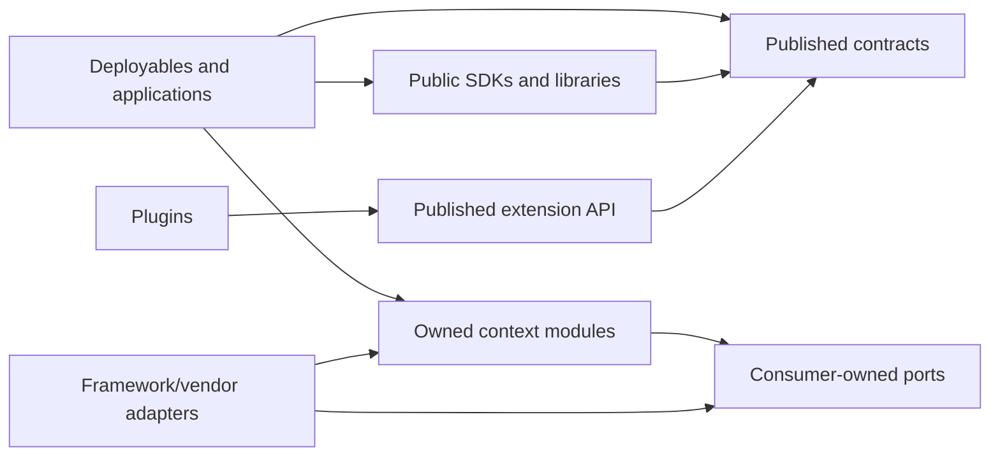

# Library architecture

**Status: Proposed.** This document defines placement and promotion rules. This increment adds one internal experimental Python library; no multi-language workspace is claimed.

## Audit snapshot

At the audit, branch `feat/scout-s1` was at `7a731a1`. S0–S1.2b files remained staged and unstaged. The repository contained `apps/scout/scout/` as an internal BC14 module, `contracts/scout/v1/`, root tooling, migrations, tests, and a local Compose profile. It contained no `libs/` or `packages/` tree and no Go, Rust, or TypeScript workspace. This increment adds the first real shared package at `libs/python/observability/`, consumed by `apps/scout/scout/application.py`; it is internal and experimental, not a public API promise. Root uv remains `package = false` and now includes only real workspace members.

BC14 separates `domain.py`, application use cases, `ports.py`, fakes, the JSON Schema edge, and a PostgreSQL adapter. The PostgreSQL repository remains BC14-specific: it persists Scout aggregate JSON, command receipts, custody intents, and proposal outbox. The observability package defines allowlisted event fields and correlation context rather than wrapping stdlib logging; Scout uses it for command/replay/custody/handoff events. It has one consuming deployable, so broader promotion requires another consumer or explicit platform ownership. psycopg and jsonschema are mature dependencies; a generic PostgreSQL wrapper has no demonstrated value.

## Terms and ownership

| Unit | Meaning | Ownership and visibility |
|---|---|---|
| Bounded context | Model, language, policies and ubiquitous language for a domain capability. | Owned by its domain team; may be composed with other contexts in one deployable. |
| Internal BC module | Code implementing one context inside its owning application/service, such as `apps/scout/scout/domain.py`. | Private to that context. Aggregates, entities and internal repositories are not shared APIs. |
| Technical library | Versioned reusable capability with a cohesive API and at least one demonstrated second consumer or explicit platform requirement. | Owned by a library maintainer; independent tests and dependency policy. No business rules from another context. |
| SDK | Consumer-facing client for a published contract/API. | Versioned for consumers; contains transport/mapping conveniences, not the provider's aggregates or policy. |
| Framework adapter | Adapter connecting an owner's port to a framework or vendor. | Starts beside the owning module; extract only after reuse and a stable adapter contract exist. |
| Plugin | Independently versioned extension implementing a published capability contract. | Depends only on the public extension API/SDK; must pass the host's conformance suite. |
| Contract package | Language-neutral schemas/examples or generated language bindings for a published boundary. | Owned/versioned by the contract owner. It contains wire shapes and compatibility rules, not runtime internals. |
| Deployable | Independently built/released/operated application, service, or worker. | Owns composition and runtime configuration; is not synonymous with a bounded context or library. |

## Target layout

Create paths only with a real consumer and owner. The target for shared code is `libs/<language>/<library>/`:

```text
libs/
  go/<library>/                 # a Go module only when independently consumed/released
  python/<distribution-name>/   # pyproject.toml and src/<import_name>/
  rust/<crate-name>/            # Cargo package, optionally a member of a real workspace
  typescript/<package-name>/    # package.json, optionally a member of pnpm workspace
```

Language grouping makes toolchains and release boundaries explicit. It is not a taxonomy of capability; “observability” or “persistence” belongs in library identity/metadata, not another path segment. Existing import names and published contract paths remain stable.

### Go

- A Go package is a directory of source files imported by its module path. A shared library with its own release lifecycle gets its own `go.mod` under `libs/go/<library>/`; the module path is a stable VCS path, e.g. `<repository-module>/libs/go/<library>`.
- A `go.work` is introduced only when two or more real Go modules need coordinated local development. It selects local modules but is not published and must not become a hidden production dependency. CI also tests modules without workspace overrides.
- Keep packages small and cohesive. `internal/` prevents imports from outside its permitted parent tree; it is useful for module-private implementation, not a replacement for ownership/contracts between bounded contexts.
- Avoid `replace` directives as a substitute for release/version policy. Module major versions use Go's `/v2` path convention when a breaking major is published; preserve old module paths during a consumer migration.
- Interfaces are small and defined near the consuming package. Accept interfaces only where substitution is useful; return concrete types by default. No speculative global interfaces package.

### Python

- A distribution uses `libs/python/<distribution-name>/pyproject.toml` with a `src/<import_name>/` layout. Distribution and import names are documented separately (for example, distribution `mozaic-observability`, import `mozaic_observability`).
- Add a package to the root uv workspace only when an actual app/test consumes it locally. Keep package runtime dependencies in its own metadata; root development tooling dependencies do not imply runtime dependencies of every app. Test both workspace resolution and a built wheel/install when publishing.
- Keep `apps/scout/scout/` private. Do not turn aggregates into a distribution to simplify imports. `Protocol` is preferred for structural application ports; `ABC` is reserved for nominal extension contracts or behavior reuse that requires a base implementation. Neither belongs in a shared package by default.
- Public Python APIs have explicit exports, supported Python versions, dependency ranges, compatibility policy and consumer tests. Avoid accidental exports from package `__init__.py`.

### Rust

- A reusable crate lives in `libs/rust/<crate-name>/` with its own `Cargo.toml`. Add it to a Cargo workspace only when there is a real set of members that benefit from shared resolution/build/test.
- Traits are defined at the abstraction boundary that owns the behavior; avoid a universal traits crate. Do not expose domain structs from one context as cross-context contracts.
- SemVer applies to public crate APIs; lockfile/workspace policy is documented at the actual deployable/workspace root. No Rust workspace is created while there are no Rust crates.

### TypeScript

- A package lives in `libs/typescript/<package-name>/` with explicit `exports`, types, build/test scripts and package visibility. Use a pnpm workspace only when a real package/app needs coordinated local linking.
- Scope public packages under the organization namespace (for example `@data-mozaic/<name>`). Avoid source-path aliases that bypass package exports or create imports into another context's source tree.
- Keep generated contract clients distinct from application/domain models. No TypeScript workspace is created while there are no TypeScript packages.

## Dependency rules

Allowed source-code direction:



- Domain rules depend on the same context's domain concepts; application orchestrates domain and consumer-owned ports. Adapters implement those ports and translate at the edge. Framework/runtime mechanisms do not leak inward.
- A reusable library may depend on standard libraries and explicitly declared technical libraries/contracts. It must not import `apps/`, `services/`, `workers/`, a deployable, or private modules of a bounded context.
- One bounded context must not import another context's domain model, tables, migrations, repository or private package. Cross-context interaction uses owned, versioned contracts and an adapter/SDK.
- SDKs depend on public contracts and transport dependencies only. Plugins depend on their public extension contract. Contract packages do not depend on implementation packages.
- Prohibited: dependency cycles between libraries; application imports into adapter internals; adapter imports from another context's persistence; a `common`, `utils`, `helpers`, or `shared-core` bucket without one bounded responsibility; language bindings used as a substitute for a wire contract.

These rules support DDD ownership and Clean Architecture dependency inversion. SOLID is applied locally: cohesive single-purpose APIs, extension through explicit contracts, substitutable adapters, narrow interfaces, and explicit dependencies—not a requirement to create an interface or package for each class.

## Taxonomy and proposed catalog

Categories are logical labels and may overlap only when the library's single responsibility warrants it.

| Category | Responsibility examples | Current inventory / candidate |
|---|---|---|
| Foundation | Small platform primitives with stable semantics | None. Avoid a general core bucket. |
| Observability | Structured event conventions, redaction and correlation propagation | `mozaic-observability` is implemented as an internal experimental library consumed by Scout; no exporter or global logging setup. Prefer maintained OpenTelemetry SDKs if export becomes necessary. |
| Persistence | Shared connection/pool/transaction mechanics | `mozaic-postgres` is not justified yet. psycopg is direct; Scout repository, migrations, receipt/outbox SQL and CAS policy stay in BC14. |
| Networking | Shared transport mechanics under a clear security policy | No implementation or consumer. A future adapter must preserve each context's auth/egress policy. |
| Security | Reusable enforcement/policy integrations | No library candidate until a concrete cross-context policy contract and threat model exist. |
| Capture | Capture runtime or SDK contracts | No library now; future consumers must use public Capture/Input contracts, not Scout internals. |
| Testing | Reusable contract fixtures/conformance harness | `contracts/scout/v1` is contract-owned fixture material, not a test helper package. Extract a harness only with multiple consumers. |
| Developer tooling | Repository-local checks and migration tooling | Current `tooling/` is repository tooling, not a product library. |

## Manifest and extraction gate

For each real library, include a small `library.yaml` next to its README. The first library includes actual ownership, consumers, exclusions and dependency/test policy; the manifest remains documentation until a validator needs machine-readable enforcement. Required fields:

```yaml
name: mozaic-observability
language: python
owner: platform-observability
responsibility: "Structured event conventions and correlation propagation"
excludes:
  - "Domain policy and authorization decisions"
visibility: internal # internal | public
stability: experimental # experimental | stable | deprecated
consumers:
  - "<named app or explicit architecture requirement>"
dependencies:
  runtime: []
  development: []
api_version: "0.x"
tests:
  command: "uv run --locked pytest" # illustrative until adopted by the package
deprecation: "Document replacement and supported removal window"
```

The example is **illustrative** except for the concrete manifest under `libs/python/observability/`. Extract only after documenting: cohesive responsibility, named consumers/requirement, benefit over local code/third-party dependency, owner, public/private API, dependency/license policy, independent tests, release/versioning and deprecation plan. Promotion from internal module to library requires stable contract, consumer compatibility tests, import-boundary checks, build/install verification and an approved ADR if it changes ownership or public boundaries.

## Governance and compatibility

- Paths follow the repository's kebab-case directory/Markdown, snake_case Python, language-native package names, and immutable published contract paths. Naming rules are in [naming conventions](../development/naming-conventions.md).
- Internal visibility is the default. Public visibility requires named external consumers and an owner. Public libraries use SemVer, supported runtime/dependency matrix, changelog and deprecation window; `0.x` means pre-stability, not unrestricted breakage. Breaking changes use a parallel major and migration period.
- Each library documents purpose, non-goals, ownership, public API, dependencies, consumers, compatibility, tests, security/data handling, release and deprecation. No API is public by virtue of its directory name.
- Executable checks grow with actual packages: existing BC14 domain-import test remains; new library adds import-cycle/boundary checks and package build/install/consumer tests in its own language. Do not create a generic monorepo dependency-management system before multiple language workspaces exist.
- Third-party packages are preferred when they solve the need and meet security/license/support requirements. A wrapper is justified only when it adds Data Mozaic semantics, safer defaults, integration or a stable interface.

## Migration plan and S1.3

There is currently no `packages/` directory or consumer path to rename. Adopt `libs/<language>/<library>/` for future shared libraries; do not create empty language roots or move `apps/scout/`, `contracts/`, or `tooling/`. If a real `packages/` tree appears before adoption: inventory owners/import paths/release identities; classify each path; keep existing import/module/package names stable; add a compatibility alias or thin forwarding package where necessary; migrate consumers in small PRs; deprecate old paths over an announced window; remove only after consumer/release checks. Go module path changes and public package export changes require explicit major-version migration. Contract schema filenames and `$id`s are never renamed for layout preference.

S1.3 recovery remains ahead of extraction. G1 application restart plus fresh authorization, G2 durable custody reconciliation/orphan policy, and G3 outbox lease/reclaim/backoff are BC14 behavior. Implement them in the current owning module and adapters. A future library may supply technical mechanics after real reuse, but must not alter command identity/fingerprint, transactions, receipts, aggregate states, evidence ownership or BC15 acknowledgment semantics. S1 recovery gates remain open; this architecture work does not declare S1 complete.
