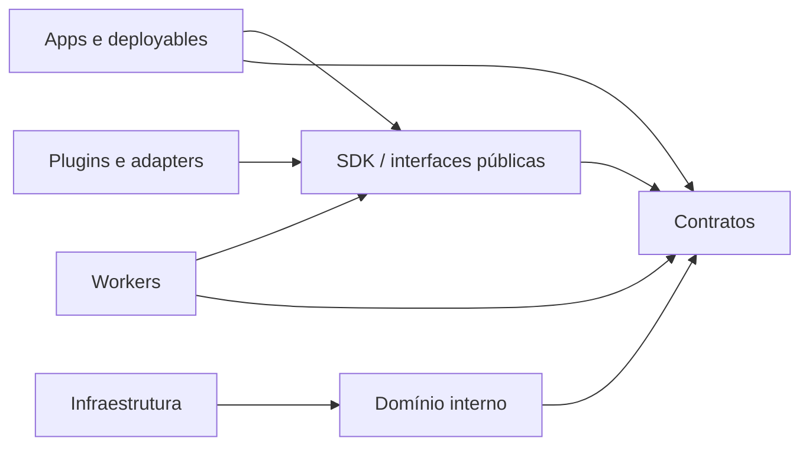

# Monorepo e distribuição

**Proposta.** A árvore abaixo é alvo, não inventário de componentes existentes. Criar diretório somente com primeiro consumidor, contrato e responsável claros. Cada componente tem dono, testes e política de release documentados junto ao código.

| Diretório alvo | Permitido / propósito | Dependências e teste/release |
|---|---|---|
| `contracts/` | schemas, interfaces e exemplos versionados | sem imports de implementação; testes de compatibilidade; versão por contrato |
| `apps/` | console e CLI de usuário | contratos e SDKs, não internos de serviço; testes de interface; release por app |
| `services/` | deployables de controle quando justificados | domínio local, contratos e adapters; sem tabelas internas alheias; testes de integração; release por serviço |
| `workers/` | deployables de execução | SDK, contratos e adapters; não dependem de internos de outros workers; testes de conformidade; release por worker |
| `libs/<language>/<library>/` | bibliotecas técnicas compartilhadas com consumidores definidos | API coesa, owner, dependências e release explícitos; não importa deployables nem domínios privados; build e testes de consumidores |
| `extensions/` | plugins com interface e capacidades | apenas API pública/SDK; não importa implementação de worker; suite de conformidade; versão independente |
| `integrations/` | adapters de fornecedor e sistemas externos | portas públicas, sem acoplar domínio; testes contra fixtures; versão por adapter |
| `templates/` | esqueletos e perfis reutilizáveis | contratos públicos; testar geração quando houver gerador; versão de distribuição |
| `deployments/` | Compose e manifests operacionais futuros | imagens e configurações públicas; sem lógica de domínio; teste de implantação; versão de perfil |
| `tooling/` | ferramentas de desenvolvimento do próprio repo | sem dependências runtime da plataforma; testes de comportamento; versionamento junto ao repo |
| `examples/` | exemplos marcados draft ou versão suportada | somente interfaces públicas, sem segredos; smoke tests quando executáveis; versão declarada |
| `tests/` | testes transversais de contratos/integração | fronteiras públicas; sem acesso direto a internos; executados com versões da distribuição |
| `docs/` e `.github/` | decisões/documentação e CI | não dita implementação por dependência de runtime; links e workflows validados; versionados no repo |

Seta é dependência de código; domínio nunca importa implementação de infraestrutura, workers, framework ou fornecedor. Contratos não importam deployables. Integração entre bounded contexts ocorre via contratos, não banco compartilhado como API. Um deployable pode conter módulos de vários contextos com fronteiras explícitas. Bibliotecas compartilhadas não exportam agregados/regras de um contexto.

## Unidades de composição

Bounded context define significado e ownership; módulo agrupa código coeso; library é código reutilizável; SDK é API pública orientada a consumidores; plugin implementa contrato de extensão; adapter conecta porta a tecnologia; worker processa trabalho; service oferece capacidade operacional; application é experiência ou processo de usuário; deployable é unidade de release/operação e pode hospedar módulos; distribution profile seleciona versões, configuração e infraestrutura para um consumidor. Nenhuma equivalência obrigatória entre eles.

Go é candidato ao control/CLI por concorrência e binários simples; Python ao Scout e captura pelo ecossistema Scrapy/Playwright; TypeScript ao console; Rust apenas a gargalos medidos ou processamento binário crítico. Um time pode escolher Python também para control inicial se isso reduzir custo sem prejudicar contratos. Linguagem não determina contexto. O workspace uv existe na raiz para ferramentas de desenvolvimento, com lock compartilhado e sem membros adicionais vazios; cada futuro app/library Python deve ser incluído com consumer explícito. A versão de Python usada no desenvolvimento está em `.python-version`, e o CI fixa uv. Go modules/workspace, Cargo e pnpm serão criados com seus primeiros componentes reais. O Makefile é a entrada comum para verificações e automação. As demais versões locais são observações no baseline.

## Library architecture

`libs/<language>/<library>/` é o destino proposto para código reutilizável com ownership, API e consumidores demonstrados. Módulo interno de bounded context, library, SDK, framework adapter, plugin, contract package e deployable são unidades diferentes; seus critérios e governança estão na [Library Architecture](libraries.md). Não criar `libs/` vazio nem renomear um futuro `packages/` em massa. Hoje BC14 permanece interno em `apps/scout/scout/`; nenhuma library compartilhada está implementada.

Fontes oficiais: [Go workspaces](https://go.dev/doc/tutorial/workspaces), [uv workspaces](https://docs.astral.sh/uv/concepts/projects/workspaces/), [Cargo workspaces](https://doc.rust-lang.org/cargo/reference/workspaces.html), [pnpm workspace](https://pnpm.io/workspaces), [GitHub Actions](https://docs.github.com/en/actions).

## Inventário e templates

`component.yaml` é proposta, não contrato nem dependência de tooling. Campos candidatos: `id`, `name`, `type`, `language`, `owner`, `contexts`, `capabilities`, `provides`, `consumes`, `runtime`, `dependencies`, `deployment`, `versioning`. Sem schema até definir identidade, cardinalidade, compatibilidade e consumers. Templates futuros de Go service, Python worker, Rust package, Python SDK, capture plugin, playbook e integration adapter devem fornecer README de ownership e fronteiras, manifest quando homologado, testes, configuração mínima de linguagem e exemplo de contrato. Plugin inclui testes de conformidade; playbook inclui evidências e revisão; adapter declara portas e segredos. Não existem geradores hoje.

## Distribuição

Core publica contratos, SDKs e runtimes versionados; distribuição combina imagens OCI, packages, configuração e perfis compatíveis; consumer mantém sources, playbooks, plugins privados e políticas. Template GitHub copia ponto inicial e exige estratégia de atualização explícita; fork permite merge upstream mas aumenta conflitos; dependências publicadas e perfis pinados são recomendados para minimizar divergência. Matriz de compatibilidade e releases independentes devem ser verificadas por testes; plugins privados têm registry/credenciais e interface pública idêntica. Futuros `mozaic init` e `mozaic upgrade` resolvem perfil fixado e propõem migrações revisáveis, nunca sobrescrevem customizações silenciosamente. Ainda não existem comandos nem mecanismo de publicação.

## BC14

A localização e extração propostas para o núcleo Scout, dependências e contratos de extensão estão no [ADR 006](decisions/006-scout-module-contracts.md). O S1 implementa um módulo interno offline em `apps/scout/scout/`, sem serviço implantável ou package público; veja [BC14 S1](scout.md).
