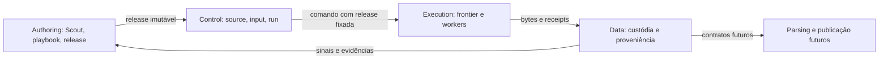
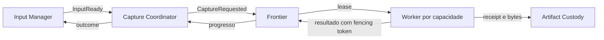
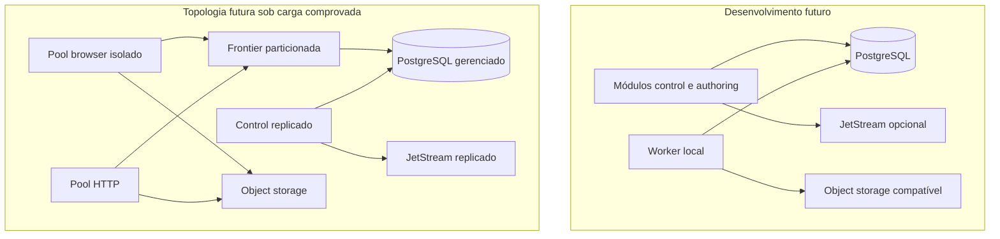

# Visão da plataforma

**Proposta.** Data Mozaic fornece aquisição reutilizável e preservação de evidências para projetos consumidores; modelos de negócio, fontes específicas e regras particulares pertencem ao consumidor. Quatro planos são fronteiras lógicas, não topologia obrigatória.

Authoring investiga, valida e promove. Control possui intenção de captura e coordenação, sem detalhes de Scrapy. Execution possui tarefas internas e executa sob limites de acesso. Data possui custódia e metadados; qualidade, lineage e publicação mais amplos são capacidades futuras. A dependência de feedback D→A é de dados/eventos e não dependência de código circular.

Topologias são alternativas propostas, não infraestrutura configurada. Separar deployables depende de carga, isolamento, ciclo de release e ownership demonstrados; um processo modular inicial reduz operação. Kubernetes somente quando a operação justificar; Compose pode facilitar integração local posterior, sem simular alta disponibilidade.

## Requisitos não funcionais

Não há SLO ou volume validado. Métricas abaixo são candidatas; baseline e metas exigem medição e aprovação.

| Requisito | Decisão relacionada / risco | Evidência, teste futuro e métrica candidata |
|---|---|---|
| Escalabilidade | pools e frontier particionável; contenção em banco | carga por origem e fairness; tarefas/s, espera, saturação |
| Disponibilidade | processos recuperáveis; dependências compartilhadas | falha de nó e restauração; disponibilidade observada |
| Confiabilidade | outbox, inbox, idempotência; efeitos externos ambíguos | duplicação e crash injection; duplicatas e perdas |
| Recuperabilidade | leases, checkpoints, backups; retenção insuficiente | restore e retomada; tempo medido de recuperação |
| Manutenibilidade | contextos e releases imutáveis; contratos divergentes | revisão, testes de compatibilidade; lead time de mudança |
| Extensibilidade | capacidades e plugins versionados; abstração vazada | backend alternativo em conformidade; esforço medido |
| Portabilidade | portas e distribuição; diferenças entre object stores | instalação em dois ambientes; passos específicos |
| Segurança | egress, identidade e revisão; prompt injection | teste de DNS rebinding e isolamento; violações bloqueadas |
| Observabilidade | correlação e receipts; cardinalidade e dados sensíveis | rastrear um input até artefato; cobertura e lacunas |
| Reprodutibilidade | digests, compilador e SDK fixados; rede mutável | rebuild com entradas fixas; divergências de digest |
| Custo | pooling e budgets; browsers caros | perfil de carga; custo por captura e bytes |
| Simplicidade operacional | processo modular inicial; crescimento prematuro | instalação e recuperação por operador; dependências necessárias |
