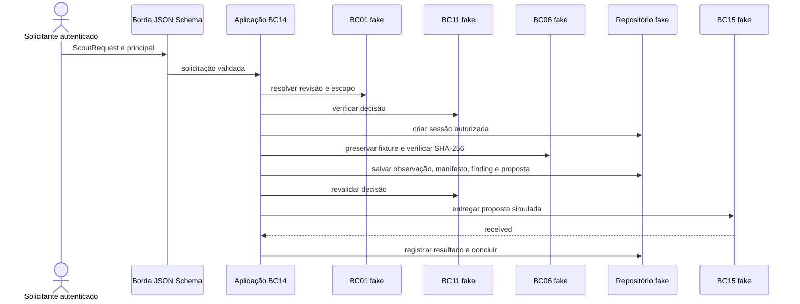

# BC14 Source Intelligence & Scout — S1 offline

**Modelo arquitetural Proposed; fluxo S1 offline implementado.** BC14 produz conhecimento rastreável e propostas sobre uma revisão de fonte. Não aprova BotRelease, não cria Input ou CaptureRun e não executa captura produtiva. Um bounded context não implica serviço. Os contratos [draft](../../contracts/scout/v1/README.md) são projeções deliberadas; não são serializações dos agregados.

## Modelo e responsabilidades

Todos os itens abaixo pertencem semanticamente a BC14, exceto os dados referenciados de BC01, BC06 e BC11. IDs e transições são propostas; eventos são fatos após commit, não comandos remotos. A tabela descreve o modelo proposto; apenas o subconjunto S1 documentado abaixo está implementado.

| Conceito / forma | Identidade, invariantes e estado | Comandos e eventos propostos; interface e testes necessários |
|---|---|---|
| ScoutSession / agregado raiz | ID próprio, SourceRef fixo, objetivo e escopo autorizados, orçamento e histórico. Transições condicionais; não atua sem decisão vigente. | `RequestScout`, `AuthorizeScout`, `StartScout`, `PauseScout`, `ResumeScout`, `CompleteScout`, `FailScout`, `CancelScout`; fatos `ScoutRequested`, `ScoutAuthorized`, `ScoutStarted`, `ScoutPaused`, `ScoutCompleted`, `ScoutFailed`, `ScoutCancelled`. Entrada ScoutRequest e consulta futura de projeção; testar todas transições, concorrência, revogação e idempotência. |
| ScoutObjective / VO imutável da sessão | Pergunta, critérios de sucesso e limites; alteração exige nova sessão ou revisão explicitamente autorizada antes de atuar. | Parte de ScoutRequest; alterações via solicitação, sem evento independente. Testar objetivo vazio e mudança após autorização. |
| ScoutScope / VO imutável | Escopo solicitado: origens, caminhos, métodos, tempo e requests; não concede direitos. | Parte de ScoutRequest; alteração segue revisão autorizada. Testar que ampliação nunca decorre da saída de ferramenta. |
| AuthorizedNavigationScope / VO derivado | Interseção do solicitado, revisão BC01 e decisão vigente BC11, inclusive expiração, credenciais, ferramentas e budgets. Nunca ampliar implicitamente. | Interno, criado por `AuthorizeScout` a partir de decisão verificável; nenhum evento próprio. Testar interseção, expiração e revogação. |
| SourceObservation / entidade append-only | ID, instante, tipo, valor sanitizado e referência à evidência; observação localizada não prova comportamento geral. | `RecordObservation`, `ObservationRecorded`; referências em achados, sem DTO próprio no S0. Testar vínculo a sessão e evidência e proibição de alteração. |
| NavigationTrace / entidade append-only | Sequência temporal de ações, resultados, escopo aplicado e referências sanitizadas; parcial ou selada, sem credenciais. | `RecordNavigationStep`, `SealTrace`; `NavigationStepRecorded`, `TraceSealed`. Referência a artefato no manifesto; testar ordem, redaction e selagem. |
| DiscoveryFinding / entidade | ID, afirmação, natureza epistêmica, confiança declarada e evidências; draft → reviewed ou rejected; revisão não transforma hipótese automaticamente em fato. | `RecordFinding`, `ReviewFinding`; `FindingRecorded`, `FindingReviewed`. Projeção DiscoveryFinding; testar vínculo, confiança e revisão. |
| EvidenceManifest / entidade | ID, sessão, revisão e referências BC06 com digest e natureza dos bytes; aberto → selado, selado imutável. BC14 não possui bytes, retenção ou identidade BC06. | `SealEvidenceManifest`, `EvidenceManifestSealed`; projeção EvidenceManifest só de manifesto selado. Testar referências, digest verificado por BC06 e selagem. |
| SourceProfile / projeção versionada | Sumário de achados referenciados, limitações e revisão da source; draft → reviewed → superseded. Não é Source Registry; fica sujeito a drift. | `PublishProfile`, `SupersedeProfile`; `ProfilePublished`, `ProfileSuperseded`. Interface pública e schema adiados até haver consumidor; testar proveniência, versão e drift. |
| PlaybookProposal / entidade | ID, achados, evidências, suposições, riscos e capacidades; draft → submitted → acknowledged/rejected. Aceite de BC15 é decisão de BC15, não release. | `SubmitProposal`, `RecordProposalResponse`; `ProposalSubmitted`, `ProposalResponseRecorded`. Projeção PlaybookProposal; testar suporte, idempotência e ausência de promoção. |

**Observação** registra o que uma operação autorizada percebeu em momento e condições particulares. **Hipótese** é uma explicação ou generalização ainda não demonstrada. **Verificado** requer procedimento independente, responsável, data e evidências suficientes segundo política de revisão; confiança numérica não comprova nada. O campo `verification_note` descreve o método, mas sua suficiência depende de revisão humana, não do schema.

## Ciclo da sessão

`requested → authorized → exploring → completed`; `requested → rejected`; `exploring → paused → exploring`; `requested`, `authorized`, `exploring` ou `paused` podem terminar em `cancelled` ou `failed`. Estados terminais são imutáveis. A autorização fixa revisão, escopo efetivo, orçamento e validade. Início e cada ação exigem decisão vigente; falta de política, revogação, CAPTCHA, bloqueio ou expiração interrompe a exploração. Retomada exige nova decisão BC11 e orçamento remanescente, nunca ampliação automática. `completed` requer evidências seladas e resultado explícito, inclusive resultado sem proposta; falha ou cancelamento preserva evidências parciais. Comandos duplicados com mesma chave e conteúdo retornam resultado anterior; mesma chave com conteúdo diferente conflita. Concorrência usa versão esperada; eventos só após commit. Não se promete atomicidade com custódia: reconciliar gravação órfã ou registro pendente antes de declarar evidência disponível.

## Integrações e portas propostas

| Fronteira / porta | Consumidor planejado e responsabilidade | Falhas / testes antes da implementação |
|---|---|---|
| BC01 `SourceLookupPort` | Caso de uso resolve identidade, revisão imutável e restrições publicadas por BC01. | Ausente, revisão divergente ou revogada bloqueia; contrato de consumidor e revisão fixada. |
| BC11 `PolicyDecisionPort` | Caso de uso pede decisão por principal, source, revisão, ação, escopo, credencial e orçamento; recebe decisão identificável, condições e validade. | Indisponível, negada ou expirada falha fechado; testar revogação e condições restritivas. |
| BC14 `ScoutSessionRepositoryPort` | Casos de uso salvam e carregam sessão com versão esperada, idempotência e transação local. | Conflito não sobrescreve; testar concorrência e eventos após commit. |
| `NavigatorPort` | Caso de exploração solicita navegação delimitada e recebe observação/trace sanitizados. Futuros adapters HTTP e Playwright passam por enforcement independente. | Negar redirects e subrequests fora do escopo; testar DNS, limites, cancelamento e isolamento. |
| `ScoutToolPort` | Orquestrador futuro expõe ao agente apenas operações já autorizadas, com entradas/saídas validadas; adapter Codex ou outro agente não recebe controle de política. | Testar ferramentas não concedidas, injeção e limites. Se orquestrador não existir, não criar porta. |
| BC06 `EvidenceStorePort` | Caso de uso entrega bytes com classificação e chave idempotente, recebe referência e digest verificado por BC06. Raw e derivados redigidos têm identidades distintas. | Falha de custódia impede selagem; testar integridade, isolamento, retenção e reconciliação. |
| BC15 proposta | Consumidor futuro recebe PlaybookProposal e evidências por contratos; BC15 decide revisão e governança. | Testar versão, replay, acesso e rejeição; nenhum acesso a tabelas internas. |

BC04 coordena CaptureRun, BC05 aquisição, BC13 Input e BC16 frontier e frota de captura. Nenhum desses modelos é duplicado no Scout. BC10 poderá receber fatos auditáveis, sem assumir estado transacional. S1 implementa apenas as portas utilizadas abaixo, com adapters fakes em memória; navegador e agente continuam futuros.

## Segurança e custódia

Antes de iniciar: aprovação humana de objetivo, identidade, política, escopo, orçamento, ferramentas, retenção e uso de credenciais conforme BC11; reavaliar quando mudarem. Aplicar allowlist de origem e caminho, métodos e quotas, duração, tamanho, concorrência e número de requests incluindo redirects/subrequests. Validar esquema, hostname, porta e IP resolvido em cada salto e no ponto de conexão; bloquear por padrão loopback, privadas, link-local e metadata, com exceções explícitas auditadas. Revalidar redirects e DNS rebinding; bloquear subrequests não autorizadas. Egress independente do agente e do browser; política indisponível falha fechado.

Fontes e saídas de agentes são dados hostis, nunca instruções superiores, política ou autorização. Isolar processo, rede e filesystem efêmero; limitar ferramentas e recursos, validar entradas/saídas e exigir revisão humana. Nenhum prompt sozinho garante contenção. Não contornar CAPTCHA, login ou bloqueio. Credenciais de cofre são injetadas somente na operação autorizada, limitadas por source e tenant, sem expor valor ao agente, logs ou contratos; sessões autenticadas são isoladas e destruídas segundo política.

BC06 custodia bytes e sua classificação, acesso, integridade e retenção; BC14 registra relações e referência. Identificar resposta original e DOM como artefatos distintos; redigir segredos e dados sensíveis antes de logs e compartilhamento. Se preservação raw autorizada exigir bytes intactos, armazenar original restrito e criar derivado redigido separado, com proveniência; se política proibir retenção raw, não persistir o original. Manifesto identifica digest dos bytes realmente referidos, não garante por si mesmo acesso, integridade ou ausência de dados sensíveis. Auditar principal, decisão BC11, revisão, limites, ações, negações, referências e revisões humanas sem segredos; retenção e acesso de auditoria são decisões pendentes.

## S1 executável offline

O módulo interno `apps/scout/scout` contém domínio puro, aplicação, portas e fakes. A borda valida ScoutRequest e o adapter de entrega valida PlaybookProposal pelo schema draft. O exemplo usa fixture sanitizada controlada, principal passado separadamente, decisão e revisão simuladas; não faz HTTP. Execute `PYTHONPATH=apps/scout uv run --locked python -m scout`.

O domínio fixa identidade, objetivo e escopo solicitado, restringe transições e relacionamentos e mantém orçamento na retomada. Não implementa revisão independente: `verified` é rejeitado. A aplicação coordena portas; adapters simulam integrações, e contratos são projeções externas, não agregados compartilhados. O handoff reconhecido não é aprovação de playbook ou BotRelease.

### Recovery durável S1.6

No perfil PostgreSQL, `ScoutApplication` confirma a proposta e a intenção na mesma transação e retorna `delivery_pending`. `scout.relay_worker` roda em processo separado, reclama a outbox com lease/fence e registra o ACK do receptor. Um replay posterior, autorizado de novo, pode avançar a sessão a `received_by_bc15`; o BC14 não define `playbook_approved`. Detalhes e falhas estão na [avaliação S1.6](assessments/scout-s1-6-acceptance.md).

No slice offline, fixture, principal, relógio e decisão são simulados, sem autenticação ou enforcement operacional. O adapter PostgreSQL e Compose existem para recovery local; BC06 e integração BC15 continuam doubles. A reconciliação só aceita identidade, sessão, revisão, size, digest, status normalizado e integridade compatíveis; inventário global e retenção são do BC06. A outbox entrega at-least-once; fencing protege a escrita BC14, enquanto deduplicação do receptor protege efeitos lógicos no BC15. `received_by_bc15` não significa playbook aprovado. O adapter HTTP experimental aplica allowlist origem/path, TLS, redirects manuais e budget persistido. A topologia de sandbox é opcional e sua prova local nega egress direto e destinos bloqueados, mas não é um MCP host nem contém um agente externo. O gerador BC15 local cria draft separado e replay por fixtures, sem cliente de rede ou runtime. O fluxo S1 continua sem egress.
